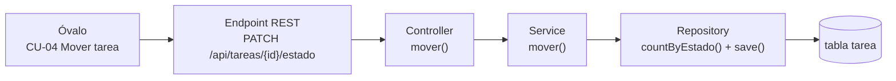

# 00 · Diagrama UML de casos de uso (antes de construir)

> El modelo responde *"¿qué necesita poder hacer el usuario?"*. Diseñar, programar y verificar son actividades iterativas: un hallazgo puede obligar a revisar el modelo.

## 1. El diagrama

La vista revisada está en la diapositiva 12 de `presentaciones/04-Clase-03-Ingenieria-Software-Diagramas.pptx`. Incluye Usuario, frontera del sistema y cinco objetivos: ver, crear, editar, mover y eliminar. Consultar [el atlas y la ficha de movimiento](10-atlas-diagramas-kanban.md).

El [esquema inicial](img/casos-de-uso.svg) se conserva como antecedente. Sus relaciones de validación y rechazo deben leerse con las precisiones siguientes; no representan una equivalencia general entre errores y extensiones UML.

## 2. ¿Cómo se lee? (la teoría)

| Elemento | Cómo se dibuja | Qué significa |
|---|---|---|
| **Actor** | El **monito** | Quien **usa** el sistema desde afuera. Es un *rol*, no una clase. Aquí hay uno solo: el **Usuario** (no hay login) |
| **Caso de uso** | Un **óvalo** | Un **objetivo del usuario**, nombrado con un verbo: *Crear tarea*, *Mover tarea* |
| **Límite del sistema** | El **rectángulo grande** | Lo que está *dentro* del sistema que construimos. El actor queda **afuera** |
| **Relaciones** | **Líneas** | Ver la tabla siguiente |

| Línea | Nombre | Significado | Ejemplo del proyecto |
|---|---|---|---|
| ─────── | **Asociación** | "El actor participa en este caso de uso" | Usuario — Mover tarea |
| - - - ▶ **«include»** | **Inclusión** | Incorpora el comportamiento del caso incluido | En esta vista las validaciones quedan como pasos del flujo |
| - - - ▶ **«extend»** | **Extensión** | Añade comportamiento bajo condiciones y en puntos de extensión definidos | El rechazo por cupo se documenta como flujo alternativo de Mover tarea |

> La flecha de *include* apunta al caso incluido; la de *extend* apunta al caso extendido. Frecuencia y opcionalidad por sí solas no bastan para decidir la relación. Un error no es automáticamente una extensión.

## 3. ¿Cada óvalo es un método?

No exactamente: un óvalo es un **objetivo del usuario**. Al programar, cada caso principal se convierte en una cadena de piezas:

| Óvalo | ¿Método propio? | Cómo se implementa de verdad |
|---|---|---|
| CU-01 Ver tablero | **Sí** | `GET /api/tareas` → `service.listar()`; Angular reparte las tareas por columna |
| CU-02 Crear tarea | **Sí** | `POST /api/tareas` → `service.crear()` (nace `POR_HACER`) |
| CU-03 Editar tarea | **Sí** | `PUT /api/tareas/{id}` → `service.actualizar()` |
| CU-04 Mover tarea | **Sí** | `PATCH /api/tareas/{id}/estado` → `service.mover()` |
| CU-05 Eliminar tarea | **Sí** | `DELETE /api/tareas/{id}` → `service.eliminar()` |
| Validar datos | **No** | Anotaciones `@NotBlank`, `@Size`… en los DTO + `@Valid` en el controller → **400** |
| Rechazar edición (hecha) | **No** (es una regla) | `if` en `service.actualizar()` → `TareaHechaNoEditableException` → **409** |
| Validar movimiento | **No** (es una regla) | `if` en `service.mover()` → `MovimientoInvalidoException` → **409** |
| Rechazar por límite de 3 | **No** (es una regla) | `countByEstado(EN_CURSO) >= 3` → `LimiteEnCursoExcedidoException` → **409** |
| Confirmar eliminación | **No** | Diálogo de confirmación en Angular antes de llamar al `DELETE` |

> Las reglas de negocio de este proyecto viven en el service. La notación `extend` no determina la clase ni la capa que implementa una regla.

## 4. Casos de uso en detalle

| Caso | Flujo normal | Flujos alternativos |
|---|---|---|
| **CU-04 Mover tarea** | El usuario arrastra la tarjeta (o pulsa ← →) a la columna vecina; la tarea cambia de columna | Salto de dos columnas → **409**. Cuarta tarea en *En curso* → **409**. Tarea inexistente → **404** |
| **CU-03 Editar tarea** | El usuario cambia título, descripción, prioridad o fecha y guarda | Tarea `HECHA` → **409**. Datos inválidos → **400** |
