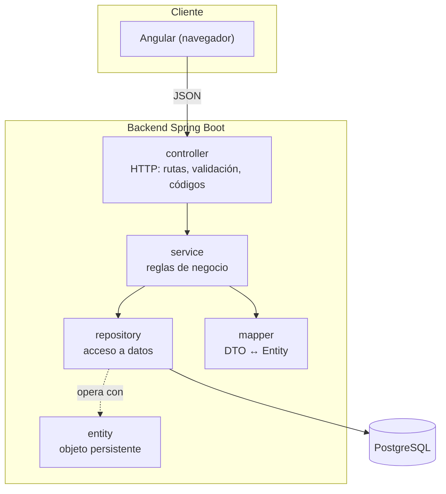
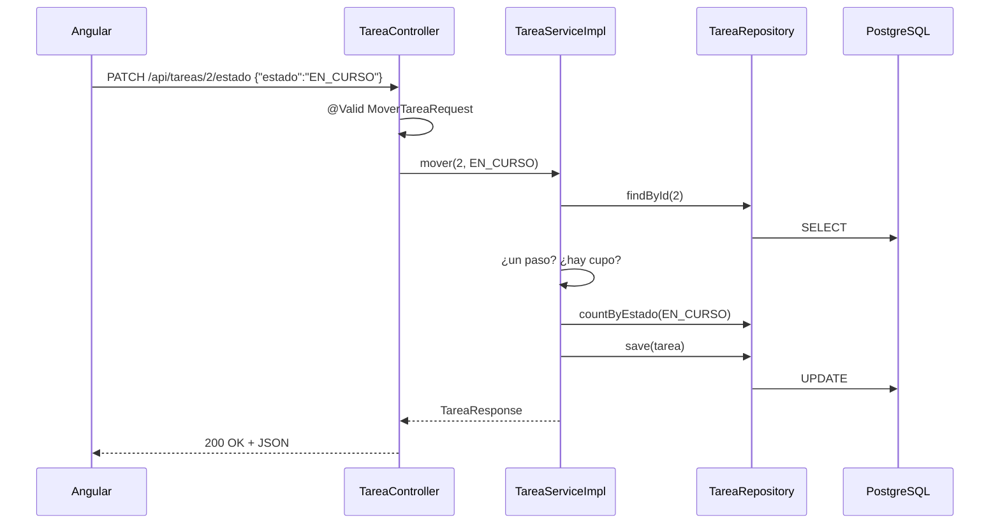

# 02 · Teoría: arquitectura MVC en capas

## ¿Qué es una arquitectura en capas?

Organizar el programa por responsabilidades y definir qué dependencias se permiten. En este proyecto el controller delega al service y este usa repository y mapper. Esto limita el impacto de los cambios, pero cambiar de base de datos puede exigir adaptar consultas, migraciones y tipos. La separación debe comprobarse en el código.

| Capa | Paquete | Responsabilidad | NO debe hacer |
|---|---|---|---|
| Controller | `controller` | Recibir la petición HTTP, validar (`@Valid`), llamar al service, devolver el código HTTP | Reglas de negocio, consultas a la BD |
| Service | `service`, `service.impl` | **Reglas de negocio** (límite de 3, movimiento válido, hecha no editable) | Saber de HTTP |
| Repository | `repository` | Leer y guardar en la base | Reglas de negocio |
| Entity | `entity` | Representar los datos persistentes | Depender de HTTP. En este ejercicio las reglas están en el service; otros diseños permiten comportamiento de dominio en entidades |
| DTO | `dto` | Datos que **entran y salen** por HTTP | Persistirse |
| Mapper | `mapper` | Convertir DTO ↔ Entity | Reglas de negocio |
| Exception | `exception` | Errores propios y su traducción a HTTP | — |
| Config | `config` | Swagger y CORS | — |

> El backend usa Spring MVC como infraestructura web y una arquitectura por capas. MVC y capas describen aspectos diferentes del diseño. La arquitectura hexagonal se presenta como evolución posible en [09-fundamentos-ingenieria-software.md](09-fundamentos-ingenieria-software.md).

## MVC: Modelo – Vista – Controlador

| Letra | En una API REST | En este proyecto |
|---|---|---|
| **M**odelo | Los datos y sus reglas | `Tarea` (entity) + `TareaService` |
| **V**ista | Una API REST serializa representaciones en lugar de renderizar una vista HTML tradicional | JSON con `TareaResponse`; Angular es el cliente que presenta la interfaz |
| **C**ontrolador | Recibe y decide a quién llamar | `TareaController` |

## Viaje de una petición: mover una tarea

## ¿Por qué DTO y Entity son clases distintas?

| | Entity (`Tarea`) | DTO (`TareaResponse`, `CrearTareaRequest`…) |
|---|---|---|
| Para qué | Hablar con la base | Hablar con el cliente HTTP |
| Cambia cuando | Cambia la tabla | Cambia el contrato de la API |
| Validaciones | Puede tener invariantes y restricciones de mapeo; la base también impone restricciones | Valida la entrada HTTP con `@NotBlank`, `@Size`… |
| Riesgo si se mezclan | El cliente podría fijar `id`, `estado` o fechas que no debe | — |

Ejemplo: `CrearTareaRequest` **no tiene** `estado`: el cliente no puede crear una tarea ya `HECHA`.

## Programar contra interfaces

El controller depende de la **interface** `TareaService`. Un contrato explícito permite sustituir la implementación si conserva el comportamiento esperado. Mockito también puede simular clases: tener una interfaz no es requisito universal para probar ni demuestra por sí solo SOLID.

## SOLID en pocas líneas

| Principio | Dónde se ve |
|---|---|
| **S**ingle Responsibility | Agrupar responsabilidades que cambian por la misma razón; separar HTTP y reglas |
| **O**pen/Closed | Aislar puntos de variación cuando existe una necesidad real. Editar un handler no demuestra este principio |
| **L**iskov | Una sustitución debe conservar precondiciones, resultados e invariantes del contrato |
| **I**nterface Segregation | Evitar que un cliente dependa de operaciones que no necesita |
| **D**ependency Inversion | Orientar dependencias hacia abstracciones apropiadas. Inyección por constructor es un mecanismo, no una prueba suficiente de inversión |

La secuencia anterior es simplificada: JPA puede diferir el SQL hasta el flush. El límite global requiere además coordinación concurrente. Consultar [10-atlas-diagramas-kanban.md](10-atlas-diagramas-kanban.md) para las vistas y su lectura.
