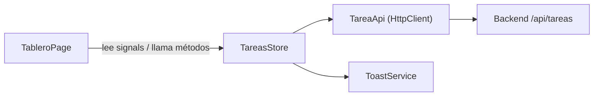

# 03 · Patrones de diseño del proyecto

Un **patrón de diseño** describe una solución recurrente dentro de un contexto y sus consecuencias. Este inventario combina patrones de arquitectura y aplicación con mecanismos y convenciones de Java/Spring. No todos son patrones GoF ni deben agregarse solo para aumentar su cantidad.

| Patrón | Dónde | Problema que resuelve |
|---|---|---|
| **MVC** | Todo el backend / Angular | Separar datos, presentación y control |
| **Service Layer** | `TareaService` + `TareaServiceImpl` | Concentrar las reglas de negocio en un solo lugar |
| **Repository** | `TareaRepository` | Ocultar cómo se consulta la base |
| **DTO** | `CrearTareaRequest`, `TareaResponse`… (`record`) | No exponer la entity y validar la entrada |
| **Mapper** | `TareaMapper` | Convertir DTO ↔ Entity en un único sitio |
| **Dependency Injection** | Constructores de controller/service | Que Spring entregue las dependencias |
| **Alcance singleton de Spring** | Beans con alcance por defecto | Una instancia por definición de bean y contenedor; no garantiza seguridad entre hilos |
| **Convención JavaBean** | Accesores de `Tarea` | Acceso convencional a propiedades. JPA exige constructor sin argumentos público o protegido y admite acceso por campo o propiedad |
| **Front Controller** | `DispatcherServlet` de Spring MVC | Un único punto de entrada que reparte a cada controller |
| **Advice** | `GlobalExceptionHandler` (`@RestControllerAdvice`) | Manejar errores de todos los controllers en un lugar |
| **Store / Facade** (Angular) | `TareasStore` | Las páginas no hablan con la API; usan un estado central con signals |

## Detalle

### Service Layer
`TareaServiceImpl.mover()` decide si el movimiento es válido y si hay cupo. El controller solo traduce HTTP.

### Repository
```java
public interface TareaRepository extends JpaRepository<Tarea, Long> {
    long countByEstado(EstadoTarea estado);   // Spring crea el SELECT COUNT
}
```

### DTO como `record`
Un `record` declara componentes y genera constructor canónico, accesores como `titulo()` (no `getTitulo()`), `equals`, `hashCode` y `toString`. Sus campos son finales, pero la inmutabilidad es superficial: si un componente referencia una lista mutable, su contenido puede cambiar. Es útil para DTOs cuando su estructura y reglas de construcción encajan con el contrato.

### Mapper
Sin librerías de generación de código: `TareaMapper` es una clase `@Component` escrita a mano (`aEntidad`, `actualizarEntidad`, `aRespuesta`).

Este mapper convierte DTO y Entity. No debe confundirse con toda la implementación del patrón Data Mapper del ORM, que conecta objetos y almacenamiento relacional.

### Selección y costo de un patrón

Antes de añadir Strategy, State o eventos, explicar qué variación o acoplamiento se necesita resolver. Para las tres columnas actuales un enum y transiciones explícitas pueden ser suficientes. Una clase por estado solo aporta si aparece comportamiento que justifica esa separación. Revisar las diapositivas 24–28 y [09-fundamentos-ingenieria-software.md](09-fundamentos-ingenieria-software.md).

### Advice
Cada excepción se traduce a un código HTTP **y** a un `ApiError` uniforme:

| Excepción | HTTP |
|---|---|
| `TareaNoEncontradaException` | 404 |
| `LimiteEnCursoExcedidoException`, `MovimientoInvalidoException`, `TareaHechaNoEditableException` | 409 |
| `MethodArgumentNotValidException` | 400 |
| `Exception` (cualquier otra) | 500 |

### Store / Facade (frontend)
`TareasStore` expone `tareas`, `tareasPorEstado` (computed) y `resumen` (computed) como **signals**, y métodos (`crear`, `mover`…) que devuelven `Observable<void>` y refrescan la lista. La página solo lee signals y llama métodos.


