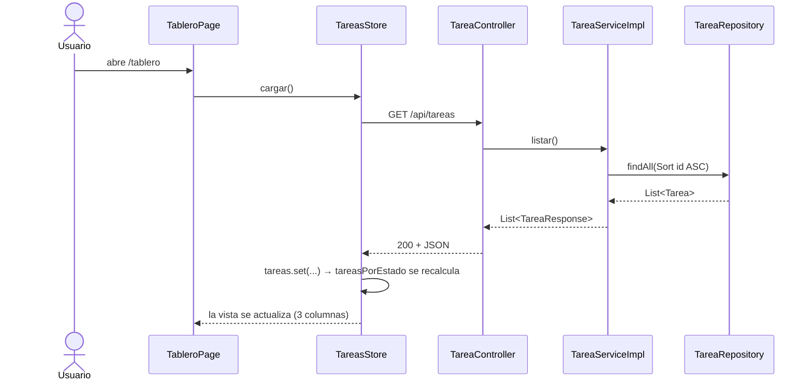
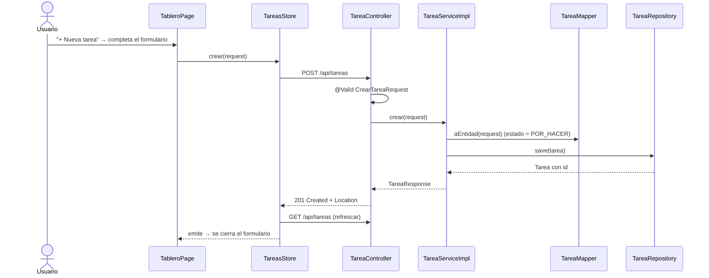
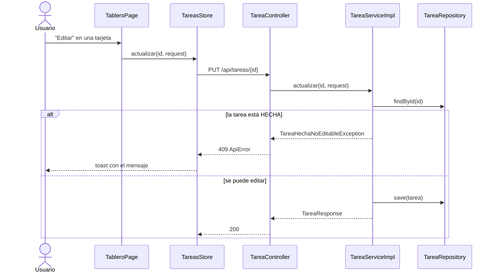
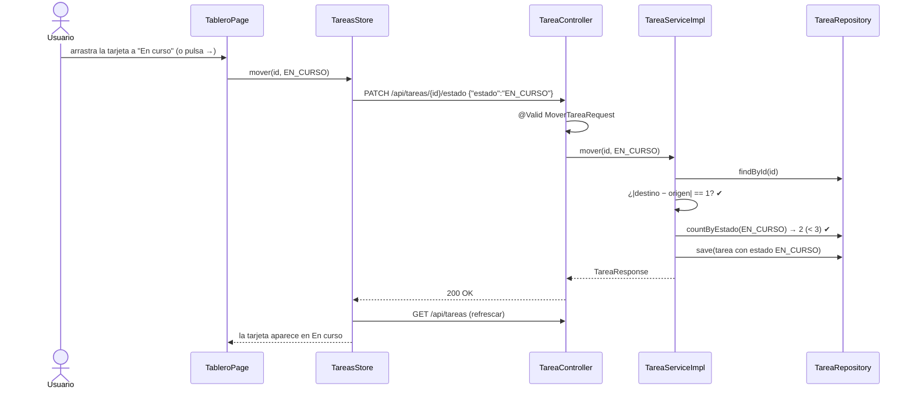
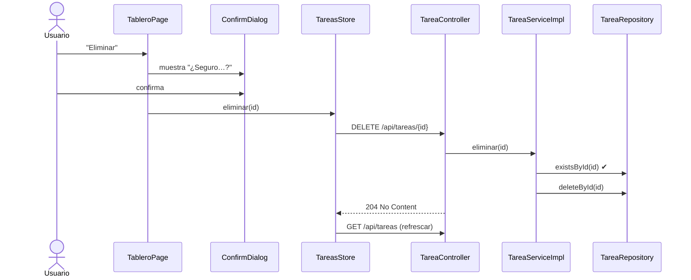
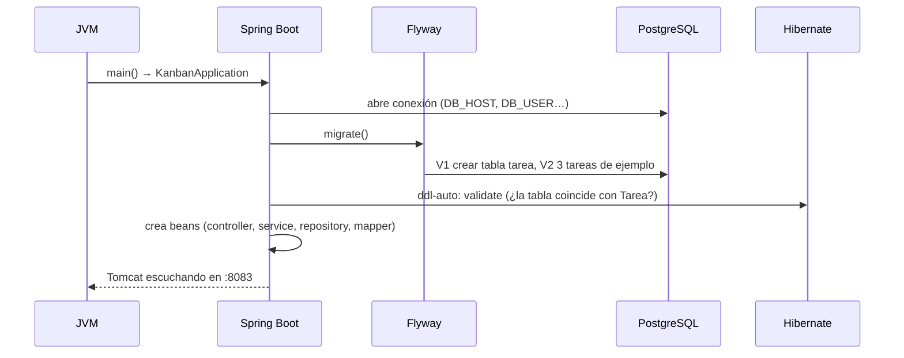

# 05 · UML de secuencia

Cada diagrama muestra **quién llama a quién y en qué orden**.

## 1. Listar (cargar el tablero)



## 2. Crear



## 3. Editar



## 4. Mover entre columnas — camino feliz



## 5. Mover — rechazo con 409 por límite de 3 en curso

```mermaid
sequenceDiagram
    actor U as Usuario
    participant P as TableroPage
    participant ST as TareasStore
    participant C as TareaController
    participant S as TareaServiceImpl
    participant R as TareaRepository
    participant H as GlobalExceptionHandler
    U->>P: arrastra una 4ª tarjeta a "En curso"
    P->>ST: mover(id, EN_CURSO)
    ST->>C: PATCH /api/tareas/{id}/estado
    C->>S: mover(id, EN_CURSO)
    S->>R: findById(id)
    S->>R: countByEstado(EN_CURSO) → 3
    S->>S: warn "in-progress limit reached"
    S-->>C: LimiteEnCursoExcedidoException
    C->>H: (Spring deriva la excepción)
    H-->>ST: 409 ApiError {mensaje: "La columna En curso ya tiene el máximo de 3 tareas…"}
    ST-->>U: toast de error; la tarjeta queda donde estaba
```

> El mismo camino (409) ocurre con `MovimientoInvalidoException` si se intenta saltar de `POR_HACER` a `HECHA`.

## 6. Eliminar



## 7. Arranque del backend


