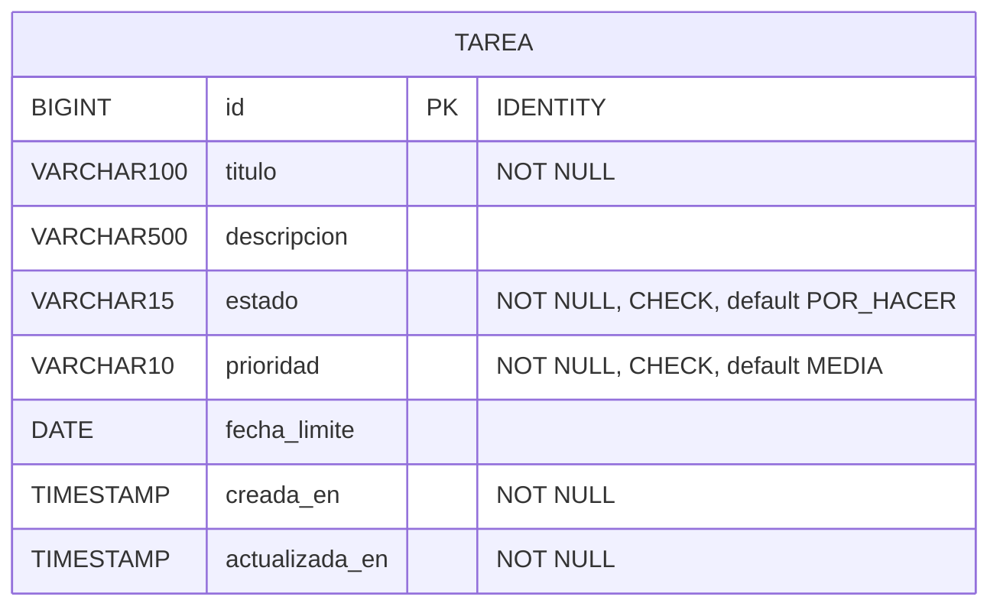

# 06 · Modelo de base de datos

Base `kanban_db` · usuario `kanban` · PostgreSQL 18. El esquema **lo crea Flyway**; Hibernate solo lo **valida** (`ddl-auto: validate`).

## Diagrama



Es una sola tabla: el tablero no necesita más para este alcance.

## Columnas y restricciones

| Columna | Tipo | Restricción | Para qué |
|---|---|---|---|
| `id` | `BIGINT GENERATED ALWAYS AS IDENTITY` | PRIMARY KEY | Identificador autogenerado |
| `titulo` | `VARCHAR(100)` | NOT NULL | Nombre de la tarea |
| `descripcion` | `VARCHAR(500)` | — | Detalle opcional |
| `estado` | `VARCHAR(15)` | NOT NULL, default `POR_HACER`, `CHECK (estado IN ('POR_HACER','EN_CURSO','HECHA'))` | Columna del tablero |
| `prioridad` | `VARCHAR(10)` | NOT NULL, default `MEDIA`, `CHECK (prioridad IN ('BAJA','MEDIA','ALTA'))` | Chip de color |
| `fecha_limite` | `DATE` | — | Fecha objetivo opcional |
| `creada_en` | `TIMESTAMP` | NOT NULL, default `CURRENT_TIMESTAMP` | Auditoría |
| `actualizada_en` | `TIMESTAMP` | NOT NULL, default `CURRENT_TIMESTAMP` | Auditoría |

Índice: `idx_tarea_estado` sobre `estado` (se consulta por columna al contar las de *En curso*).

> **¿Por qué `CHECK` si ya hay un enum en Java?** Defensa en profundidad: aunque alguien inserte datos directo en la base, no puede guardar un estado inválido.
>
> **¿Dónde vive el límite de 3 en curso?** En el **service**, no en la base: es una regla de negocio que cambia más seguido que el esquema.

## Mapeo Java ↔ tabla

| Campo de `Tarea` | Columna | Anotación |
|---|---|---|
| `id` | `id` | `@Id @GeneratedValue(IDENTITY)` |
| `estado` | `estado` | `@Enumerated(EnumType.STRING)` (se guarda el texto, no el número) |
| `fechaLimite` | `fecha_limite` | `@Column(name = "fecha_limite")` |
| `creadaEn` | `creada_en` | `updatable = false`, llenado por `@PrePersist` |
| `actualizadaEn` | `actualizada_en` | actualizado por `@PreUpdate` |

## Migraciones Flyway

| Archivo | Contenido |
|---|---|
| `V1__crear_tabla_tarea.sql` | Crea la tabla, los `CHECK` y el índice |
| `V2__datos_iniciales.sql` | **3 tareas de ejemplo, una por columna** |

```text
src/main/resources/db/migration/
├── V1__crear_tabla_tarea.sql
└── V2__datos_iniciales.sql
```

Flyway guarda lo ya aplicado en la tabla `flyway_schema_history` junto con un *checksum* de cada archivo.

> ⚠️ **Una migración ya aplicada NUNCA se edita.** Si cambias una letra, Flyway detecta el checksum distinto y el arranque falla. Los cambios van en un archivo **nuevo**: `V3__...sql`, `V4__...sql`…

Ejemplo de cambio futuro (agregar un campo `etiqueta`):

```sql
-- V3__agregar_etiqueta.sql
ALTER TABLE tarea ADD COLUMN etiqueta VARCHAR(30);
```

## Usuario y permisos (PostgreSQL 15+)

Desde PostgreSQL 15 el esquema `public` no es escribible por cualquier usuario, por eso el script incluye `GRANT ALL ON SCHEMA public`:

```sql
CREATE USER kanban WITH PASSWORD 'kanban';
CREATE DATABASE kanban_db OWNER kanban;
\connect kanban_db
GRANT ALL ON SCHEMA public TO kanban;
```

(Está en `kanban-backend/crear-bd.sql`.)

## Consultas útiles

```sql
SELECT id, titulo, estado, prioridad FROM tarea ORDER BY id;
SELECT estado, count(*) FROM tarea GROUP BY estado;
SELECT version, description, success FROM flyway_schema_history;
```
