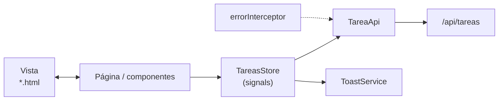

# 08 · Guía del frontend: Angular 21 paso a paso

> Angular 21 · standalone · zoneless · **signals** · Vitest · **sin librerías extra** (el arrastrar y soltar usa la API nativa de HTML5, no Angular CDK).
> El proyecto terminado está en `kanban-frontend/`. Los bloques de código de esta guía se generan **directamente desde esos archivos**.

## Mapa

```text
src/app
├── core
│   ├── models        api-error.ts · tarea.model.ts
│   ├── api           tarea.api.ts
│   └── interceptors  error.interceptor.ts
├── shared/ui         toast.service.ts · toast.ts · confirm-dialog.ts
├── features/tareas
│   ├── tareas.store.ts (+ spec)
│   ├── tarea-labels.ts
│   ├── pages         tablero.page (ts · html · css)
│   └── components    tarea-card · tarea-form
├── app.config.ts · app.routes.ts · app.ts/html/css
proxy.conf.json
```



## Teoría previa

| Concepto | Qué es | Dónde se usa |
|---|---|---|
| **Componente standalone** | Componente que declara sus propios `imports`; no hay `NgModule` | Todos |
| **Signal** | Valor reactivo: `signal(0)`, se lee `x()`, se cambia `x.set()` | `tareas`, `cargando`… |
| **computed** | Signal derivada que se recalcula sola | `tareasPorEstado`, `resumen` |
| **Zoneless** | Angular no usa `zone.js`; la vista se actualiza cuando cambian signals | Toda la app |
| **Store / Facade** | Un servicio que concentra el estado y las operaciones | `TareasStore` |
| **Interceptor** | Función que ve toda petición/respuesta HTTP | `errorInterceptor` |
| **`input()` / `output()`** | Datos que entran / eventos que salen de un componente | `TareaCard`, `TareaForm` |
| **Formularios reactivos** | El formulario se define en TypeScript con `Validators` | `TareaForm` |

## Paso 1 · Proyecto, proxy y puertos

```powershell
cd kanban-frontend
npm install
npm start          # http://localhost:4200
```

El proxy reenvía `/api` al backend (puerto **8083**), así el front no depende de CORS. Está registrado en `angular.json` (`serve.options.proxyConfig`).

<!-- archivo: proxy.conf.json -->
```json
{
  "/api": {
    "target": "http://localhost:8083",
    "secure": false
  }
}
```

> Si el puerto 4200 está ocupado (p. ej. por el proyecto de la clase 02): `npx ng serve --port 4300` y agrega `http://localhost:4300` a `CORS_ORIGINS` solo si no usas el proxy.

## Paso 2 · Modelos (`core/models`)

Reflejan los DTO del backend. **Los códigos coinciden con los enums de Java.**

<!-- archivo: src/app/core/models/tarea.model.ts -->
```typescript
export type EstadoTarea = 'POR_HACER' | 'EN_CURSO' | 'HECHA';

export type PrioridadTarea = 'BAJA' | 'MEDIA' | 'ALTA';

/** Tarea tal como la entrega la API (GET /api/tareas). Las fechas llegan como texto ISO. */
export interface Tarea {
  id: number;
  titulo: string;
  descripcion: string | null;
  estado: EstadoTarea;
  prioridad: PrioridadTarea;
  fechaLimite: string | null;
  creadaEn: string;
  actualizadaEn: string;
}

/** Datos para crear (POST) o editar (PUT) una tarea. El estado lo maneja el servidor / el tablero. */
export interface TareaRequest {
  titulo: string;
  descripcion: string | null;
  prioridad: PrioridadTarea;
  fechaLimite: string | null;
}

/** Orden de las columnas del tablero: de izquierda a derecha. */
export const ESTADOS: readonly EstadoTarea[] = ['POR_HACER', 'EN_CURSO', 'HECHA'];

/** Máximo de tareas simultáneas en la columna En curso (el backend lo exige igual). */
export const LIMITE_EN_CURSO = 3;

/** Reglas que el formulario repite para avisar antes de enviar (el backend las valida igual). */
export const REGLAS_TAREA = {
  tituloMaxLargo: 100,
  descripcionMaxLargo: 500,
} as const;
```

- `ESTADOS` define el **orden de las columnas**.
- `LIMITE_EN_CURSO = 3` repite la regla del backend para **avisar visualmente**; el que manda es el servidor.
- `REGLAS_TAREA` repite los máximos del DTO para el formulario.

<!-- archivo: src/app/core/models/api-error.ts -->
```typescript
/** Error ya traducido a un mensaje que la interfaz puede mostrar tal cual. */
export class ApiError extends Error {
  constructor(
    message: string,
    readonly status: number,
  ) {
    super(message);
    this.name = 'ApiError';
  }
}
```

## Paso 3 · API e interceptor (`core/api`, `core/interceptors`)

`TareaApi` es **el único lugar que conoce las rutas HTTP**:

<!-- archivo: src/app/core/api/tarea.api.ts -->
```typescript
import { HttpClient } from '@angular/common/http';
import { Injectable, inject } from '@angular/core';
import { Observable } from 'rxjs';

import { EstadoTarea, Tarea, TareaRequest } from '../models/tarea.model';

/** Único lugar que conoce las rutas HTTP del backend (Spring Boot, /api/tareas). */
@Injectable({ providedIn: 'root' })
export class TareaApi {
  private readonly http = inject(HttpClient);
  private readonly base = '/api/tareas';

  listar(): Observable<Tarea[]> {
    return this.http.get<Tarea[]>(this.base);
  }

  crear(request: TareaRequest): Observable<Tarea> {
    return this.http.post<Tarea>(this.base, request);
  }

  actualizar(id: number, request: TareaRequest): Observable<Tarea> {
    return this.http.put<Tarea>(`${this.base}/${id}`, request);
  }

  mover(id: number, estado: EstadoTarea): Observable<Tarea> {
    return this.http.patch<Tarea>(`${this.base}/${id}/estado`, { estado });
  }

  eliminar(id: number): Observable<void> {
    return this.http.delete<void>(`${this.base}/${id}`);
  }
}
```

Un `PATCH` a `/api/tareas/{id}/estado` con `{ estado }` mueve la tarjeta.

El interceptor convierte cualquier error en un `ApiError` con **mensaje legible** (el `mensaje` y `detalles` que manda `ApiError.java`; o "No hay conexión…" si el backend está apagado):

<!-- archivo: src/app/core/interceptors/error.interceptor.ts -->
```typescript
import { HttpErrorResponse, HttpInterceptorFn } from '@angular/common/http';
import { catchError, throwError } from 'rxjs';

import { ApiError } from '../models/api-error';

/** Forma del error que responde el backend (ApiError.java). */
interface ProblemaHttp {
  mensaje?: string;
  detalles?: string[];
}

/** Convierte cualquier error HTTP en un ApiError con un mensaje legible. */
export const errorInterceptor: HttpInterceptorFn = (req, next) =>
  next(req).pipe(
    catchError((error: HttpErrorResponse) =>
      throwError(() => new ApiError(mensajeDe(error), error.status)),
    ),
  );

function mensajeDe(error: HttpErrorResponse): string {
  if (error.status === 0) {
    return 'No hay conexión con el servidor. ¿Está encendido el backend?';
  }
  const problema = error.error as ProblemaHttp | null;
  const detalles = problema?.detalles?.length ? ` (${problema.detalles.join('. ')})` : '';
  return problema?.mensaje ? `${problema.mensaje}${detalles}` : 'Ocurrió un error inesperado';
}
```

## Paso 4 · Avisos y diálogo (`shared/ui`)

`ToastService` mantiene una lista de avisos en un signal; `Toast` los dibuja. Desaparecen solos a los 4 segundos.

<!-- archivo: src/app/shared/ui/toast.service.ts -->
```typescript
import { Injectable, signal } from '@angular/core';

export interface Aviso {
  id: number;
  tipo: 'exito' | 'error';
  mensaje: string;
}

const DURACION_MS = 4000;

@Injectable({ providedIn: 'root' })
export class ToastService {
  private siguienteId = 0;
  readonly avisos = signal<Aviso[]>([]);

  exito(mensaje: string): void {
    this.mostrar('exito', mensaje);
  }

  error(mensaje: string): void {
    this.mostrar('error', mensaje);
  }

  descartar(id: number): void {
    this.avisos.update((lista) => lista.filter((aviso) => aviso.id !== id));
  }

  private mostrar(tipo: Aviso['tipo'], mensaje: string): void {
    const id = ++this.siguienteId;
    this.avisos.update((lista) => [...lista, { id, tipo, mensaje }]);
    setTimeout(() => this.descartar(id), DURACION_MS);
  }
}
```

<!-- archivo: src/app/shared/ui/toast.ts -->
```typescript
import { Component, inject } from '@angular/core';

import { ToastService } from './toast.service';

@Component({
  selector: 'app-toast',
  template: `
    <div class="toasts" aria-live="polite">
      @for (aviso of toast.avisos(); track aviso.id) {
        <div class="toast" [class.toast-error]="aviso.tipo === 'error'">
          <span>{{ aviso.mensaje }}</span>
          <button type="button" class="toast-cerrar" aria-label="Cerrar aviso" (click)="toast.descartar(aviso.id)">✕</button>
        </div>
      }
    </div>
  `,
})
export class Toast {
  protected readonly toast = inject(ToastService);
}
```

`ConfirmDialog` es el diálogo reutilizable "¿Seguro…?" (se usa antes de eliminar):

<!-- archivo: src/app/shared/ui/confirm-dialog.ts -->
```typescript
import { ChangeDetectionStrategy, Component, input, output } from '@angular/core';

/** Diálogo de confirmación reutilizable. El padre decide cuándo se muestra y qué hacer. */
@Component({
  selector: 'app-confirm-dialog',
  changeDetection: ChangeDetectionStrategy.OnPush,
  template: `
    <div class="fondo" (click)="cancelar.emit()">
      <div class="dialogo" role="alertdialog" aria-modal="true" [attr.aria-label]="titulo()" (click)="$event.stopPropagation()">
        <h2>{{ titulo() }}</h2>
        <p>{{ mensaje() }}</p>
        <div class="acciones">
          <button type="button" class="btn" (click)="cancelar.emit()">Cancelar</button>
          <button type="button" class="btn btn-peligro" (click)="confirmar.emit()">{{ textoConfirmar() }}</button>
        </div>
      </div>
    </div>
  `,
  styles: `
    .fondo { position: fixed; inset: 0; background: rgb(3 6 14 / .75); display: grid; place-items: center; z-index: 40; padding: 1rem; }
    .dialogo { background: var(--superficie); border: 1px solid var(--borde); border-radius: .9rem; padding: 1.5rem; width: min(26rem, 100%); box-shadow: 0 20px 50px rgb(0 0 0 / .6); }
    h2 { margin: 0 0 .5rem; font-size: 1.15rem; }
    p { margin: 0 0 1.25rem; color: var(--texto-suave); }
    .acciones { display: flex; justify-content: flex-end; gap: .5rem; }
  `,
})
export class ConfirmDialog {
  readonly titulo = input.required<string>();
  readonly mensaje = input.required<string>();
  readonly textoConfirmar = input('Eliminar');
  readonly confirmar = output<void>();
  readonly cancelar = output<void>();
}
```

## Paso 5 · El Store (`features/tareas/tareas.store.ts`)

Patrón **Store/Facade con signals**. Las páginas **leen** signals y **llaman** métodos; nunca hablan con la API.

<!-- archivo: src/app/features/tareas/tareas.store.ts -->
```typescript
import { Injectable, computed, inject, signal } from '@angular/core';
import { EMPTY, Observable, catchError, finalize, map, switchMap, tap } from 'rxjs';

import { TareaApi } from '../../core/api/tarea.api';
import { ApiError } from '../../core/models/api-error';
import {
  EstadoTarea,
  LIMITE_EN_CURSO,
  Tarea,
  TareaRequest,
} from '../../core/models/tarea.model';
import { ToastService } from '../../shared/ui/toast.service';

/**
 * Estado del tablero (patrón Store/Facade con signals).
 * Las páginas leen signals y llaman a métodos; nunca hablan con la API directamente.
 */
@Injectable({ providedIn: 'root' })
export class TareasStore {
  private readonly api = inject(TareaApi);
  private readonly toast = inject(ToastService);

  /** Todas las tareas que hay en el servidor. */
  readonly tareas = signal<Tarea[]>([]);
  readonly cargando = signal(false);
  readonly error = signal<string | null>(null);

  /** Las tareas repartidas por columna. */
  readonly tareasPorEstado = computed<Record<EstadoTarea, Tarea[]>>(() => {
    const columnas: Record<EstadoTarea, Tarea[]> = { POR_HACER: [], EN_CURSO: [], HECHA: [] };
    for (const tarea of this.tareas()) {
      columnas[tarea.estado].push(tarea);
    }
    return columnas;
  });

  /** Contadores por columna y si En curso llegó al límite. */
  readonly resumen = computed(() => {
    const columnas = this.tareasPorEstado();
    return {
      total: this.tareas().length,
      porHacer: columnas.POR_HACER.length,
      enCurso: columnas.EN_CURSO.length,
      hechas: columnas.HECHA.length,
      enCursoLleno: columnas.EN_CURSO.length >= LIMITE_EN_CURSO,
    };
  });

  cargar(): void {
    this.cargando.set(true);
    this.error.set(null);
    this.refrescar()
      .pipe(finalize(() => this.cargando.set(false)))
      .subscribe({ error: (e: ApiError) => this.error.set(e.message) });
  }

  /**
   * Cada operación devuelve un Observable que emite solo si salió bien;
   * así la pantalla cierra el formulario únicamente en caso de éxito.
   */
  crear(request: TareaRequest): Observable<void> {
    return this.api.crear(request).pipe(
      switchMap(() => this.refrescar()),
      tap(() => this.toast.exito('Tarea creada')),
      catchError(this.fallar),
    );
  }

  actualizar(id: number, request: TareaRequest): Observable<void> {
    return this.api.actualizar(id, request).pipe(
      switchMap(() => this.refrescar()),
      tap(() => this.toast.exito('Tarea actualizada')),
      catchError(this.fallar),
    );
  }

  /** Mueve una tarea de columna. Las reglas (límite, un paso a la vez) las valida el backend. */
  mover(id: number, estado: EstadoTarea): Observable<void> {
    return this.api.mover(id, estado).pipe(
      switchMap(() => this.refrescar()),
      catchError(this.fallar),
    );
  }

  eliminar(id: number): Observable<void> {
    return this.api.eliminar(id).pipe(
      switchMap(() => this.refrescar()),
      tap(() => this.toast.exito('Tarea eliminada')),
      catchError(this.fallar),
    );
  }

  /** Vuelve a pedir la lista al servidor. */
  private refrescar(): Observable<void> {
    return this.api.listar().pipe(
      tap((tareas) => this.tareas.set(tareas)),
      map(() => undefined),
    );
  }

  /** Muestra el error y corta el flujo: el Observable termina sin emitir. */
  private readonly fallar = (error: ApiError): Observable<never> => {
    this.toast.error(error.message);
    return EMPTY;
  };
}
```

| Pieza | Tipo | Para qué |
|---|---|---|
| `tareas` | `signal` | Lista completa desde el servidor |
| `tareasPorEstado` | `computed` | `{ POR_HACER: [...], EN_CURSO: [...], HECHA: [...] }` |
| `resumen` | `computed` | Contadores por columna y `enCursoLleno` (≥ 3) |
| `crear / actualizar / mover / eliminar` | `Observable<void>` | Llaman a la API, **refrescan la lista** y emiten **solo si salió bien** |
| `fallar` | función | Muestra el error en un toast y **corta** el flujo con `EMPTY` |

> **Por qué `Observable<void>` que emite solo en éxito:** la página cierra el formulario o el diálogo dentro del `subscribe(next)`. Si el servidor rechaza (p. ej. **409** por límite), no emite: el usuario ve el toast y el tablero queda como estaba.

### Prueba del store (Vitest + `HttpTestingController`)

<!-- archivo: src/app/features/tareas/tareas.store.spec.ts -->
```typescript
import { TestBed } from '@angular/core/testing';
import { provideHttpClient, withInterceptors } from '@angular/common/http';
import { HttpTestingController, provideHttpClientTesting } from '@angular/common/http/testing';

import { errorInterceptor } from '../../core/interceptors/error.interceptor';
import { Tarea } from '../../core/models/tarea.model';
import { TareasStore } from './tareas.store';

const ahora = '2026-10-15T10:00:00';
function tarea(id: number, estado: Tarea['estado']): Tarea {
  return {
    id, titulo: `Tarea ${id}`, descripcion: null, estado, prioridad: 'MEDIA',
    fechaLimite: null, creadaEn: ahora, actualizadaEn: ahora,
  };
}

describe('TareasStore', () => {
  let store: TareasStore;
  let http: HttpTestingController;

  beforeEach(() => {
    TestBed.configureTestingModule({
      providers: [provideHttpClient(withInterceptors([errorInterceptor])), provideHttpClientTesting()],
    });
    store = TestBed.inject(TareasStore);
    http = TestBed.inject(HttpTestingController);
  });

  afterEach(() => http.verify());

  function cargarDatos(tareas: Tarea[]): void {
    store.cargar();
    http.expectOne('/api/tareas').flush(tareas);
  }

  it('carga las tareas', () => {
    store.cargar();
    expect(store.cargando()).toBe(true);

    http.expectOne('/api/tareas').flush([tarea(1, 'POR_HACER')]);

    expect(store.tareas().length).toBe(1);
    expect(store.cargando()).toBe(false);
  });

  it('reparte las tareas por columna y calcula el resumen', () => {
    cargarDatos([tarea(1, 'POR_HACER'), tarea(2, 'EN_CURSO'), tarea(3, 'HECHA'), tarea(4, 'EN_CURSO')]);

    expect(store.tareasPorEstado().EN_CURSO.map((t) => t.id)).toEqual([2, 4]);
    expect(store.resumen()).toEqual({ total: 4, porHacer: 1, enCurso: 2, hechas: 1, enCursoLleno: false });
  });

  it('avisa cuando En curso llega al límite de 3', () => {
    cargarDatos([tarea(1, 'EN_CURSO'), tarea(2, 'EN_CURSO'), tarea(3, 'EN_CURSO')]);

    expect(store.resumen().enCursoLleno).toBe(true);
  });

  it('guarda el mensaje si el servidor no responde', () => {
    store.cargar();
    http.expectOne('/api/tareas').error(new ProgressEvent('error'), { status: 0 });

    expect(store.error()).toContain('No hay conexión');
    expect(store.cargando()).toBe(false);
  });

  it('crea con POST y recarga la lista', () => {
    cargarDatos([]);
    let terminado = false;

    store
      .crear({ titulo: 'Nueva', descripcion: null, prioridad: 'ALTA', fechaLimite: null })
      .subscribe(() => (terminado = true));

    const post = http.expectOne('/api/tareas');
    expect(post.request.method).toBe('POST');
    post.flush(tarea(1, 'POR_HACER'));
    http.expectOne('/api/tareas').flush([tarea(1, 'POR_HACER')]);

    expect(terminado).toBe(true);
    expect(store.tareas().length).toBe(1);
  });

  it('mueve con PATCH y recarga la lista', () => {
    cargarDatos([tarea(1, 'POR_HACER')]);

    store.mover(1, 'EN_CURSO').subscribe();

    const patch = http.expectOne('/api/tareas/1/estado');
    expect(patch.request.method).toBe('PATCH');
    expect(patch.request.body).toEqual({ estado: 'EN_CURSO' });
    patch.flush(tarea(1, 'EN_CURSO'));
    http.expectOne('/api/tareas').flush([tarea(1, 'EN_CURSO')]);

    expect(store.tareasPorEstado().EN_CURSO.length).toBe(1);
  });

  it('si el servidor rechaza el movimiento (409) no emite y deja el tablero igual', () => {
    cargarDatos([tarea(1, 'POR_HACER')]);
    let terminado = false;

    store.mover(1, 'EN_CURSO').subscribe(() => (terminado = true));

    http
      .expectOne('/api/tareas/1/estado')
      .flush({ mensaje: 'La columna En curso ya tiene el máximo de 3 tareas' }, { status: 409, statusText: 'Conflict' });

    expect(terminado).toBe(false);
    expect(store.tareas()[0].estado).toBe('POR_HACER');
  });

  it('edita con PUT y elimina con DELETE', () => {
    cargarDatos([tarea(1, 'POR_HACER'), tarea(2, 'POR_HACER')]);

    store.actualizar(1, { titulo: 'X', descripcion: null, prioridad: 'BAJA', fechaLimite: null }).subscribe();
    const put = http.expectOne('/api/tareas/1');
    expect(put.request.method).toBe('PUT');
    put.flush(tarea(1, 'POR_HACER'));
    http.expectOne('/api/tareas').flush([tarea(1, 'POR_HACER'), tarea(2, 'POR_HACER')]);

    store.eliminar(2).subscribe();
    const del = http.expectOne('/api/tareas/2');
    expect(del.request.method).toBe('DELETE');
    del.flush(null);
    http.expectOne('/api/tareas').flush([tarea(1, 'POR_HACER')]);

    expect(store.tareas().length).toBe(1);
  });
});
```

```powershell
npx ng test --watch=false     # 8 pruebas en verde
```

## Paso 6 · Textos y fechas (`tarea-labels.ts`)

<!-- archivo: src/app/features/tareas/tarea-labels.ts -->
```typescript
import { EstadoTarea, PrioridadTarea } from '../../core/models/tarea.model';

/** Textos que ve el usuario para los valores del backend (el JSON usa los códigos en mayúsculas). */
export const ETIQUETA_ESTADO: Record<EstadoTarea, string> = {
  POR_HACER: 'Por hacer',
  EN_CURSO: 'En curso',
  HECHA: 'Hecha',
};

export const ETIQUETA_PRIORIDAD: Record<PrioridadTarea, string> = {
  BAJA: 'Baja',
  MEDIA: 'Media',
  ALTA: 'Alta',
};

/** "2026-10-31" -> "31-10-2026" (sin pasar por Date, para evitar corrimientos de zona horaria). */
export function formatearFecha(iso: string): string {
  const [anio, mes, dia] = iso.split('-');
  return `${dia}-${mes}-${anio}`;
}

/** Fecha de hoy como "YYYY-MM-DD" en hora local. */
export function hoyIso(): string {
  const ahora = new Date();
  const mes = String(ahora.getMonth() + 1).padStart(2, '0');
  const dia = String(ahora.getDate()).padStart(2, '0');
  return `${ahora.getFullYear()}-${mes}-${dia}`;
}
```

`formatearFecha` **no usa `Date`** para mostrar `fechaLimite`: así se evitan corrimientos de un día por zona horaria.

## Paso 7 · La tarjeta (`tarea-card`)

Componente **presentacional**: recibe la tarea por `input()` y avisa con `output()`. No conoce el store.

<!-- archivo: src/app/features/tareas/components/tarea-card/tarea-card.ts -->
```typescript
import { ChangeDetectionStrategy, Component, computed, input, output } from '@angular/core';

import { EstadoTarea, Tarea } from '../../../../core/models/tarea.model';
import { ETIQUETA_PRIORIDAD, formatearFecha, hoyIso } from '../../tarea-labels';

/** Tipo de dato que viaja en el arrastre (API nativa de HTML5): el id de la tarea. */
export const TIPO_ARRASTRE = 'text/plain';

/** Tarjeta de una tarea. Componente presentacional: recibe datos y avisa con eventos. */
@Component({
  selector: 'app-tarea-card',
  changeDetection: ChangeDetectionStrategy.OnPush,
  templateUrl: './tarea-card.html',
  styleUrl: './tarea-card.css',
})
export class TareaCard {
  readonly tarea = input.required<Tarea>();

  readonly editar = output<Tarea>();
  readonly eliminar = output<Tarea>();
  readonly mover = output<EstadoTarea>();

  protected readonly etiquetaPrioridad = computed(() => ETIQUETA_PRIORIDAD[this.tarea().prioridad]);
  protected readonly fecha = computed(() => {
    const iso = this.tarea().fechaLimite;
    return iso ? formatearFecha(iso) : null;
  });
  protected readonly vencida = computed(() => {
    const iso = this.tarea().fechaLimite;
    return !!iso && iso < hoyIso() && this.tarea().estado !== 'HECHA';
  });

  protected alArrastrar(evento: DragEvent): void {
    evento.dataTransfer?.setData(TIPO_ARRASTRE, String(this.tarea().id));
    if (evento.dataTransfer) {
      evento.dataTransfer.effectAllowed = 'move';
    }
  }

  protected retroceder(): void {
    this.mover.emit(this.tarea().estado === 'HECHA' ? 'EN_CURSO' : 'POR_HACER');
  }

  protected avanzar(): void {
    this.mover.emit(this.tarea().estado === 'POR_HACER' ? 'EN_CURSO' : 'HECHA');
  }
}
```

<!-- archivo: src/app/features/tareas/components/tarea-card/tarea-card.html -->
```html
<article
  class="tarjeta"
  [class.hecha]="tarea().estado === 'HECHA'"
  draggable="true"
  (dragstart)="alArrastrar($event)"
>
  <header class="cabecera">
    <h3 class="titulo">{{ tarea().titulo }}</h3>
    <span class="chip" [class]="'prioridad-' + tarea().prioridad.toLowerCase()">{{ etiquetaPrioridad() }}</span>
  </header>

  @if (tarea().descripcion) {
    <p class="descripcion">{{ tarea().descripcion }}</p>
  }

  @if (fecha(); as f) {
    <p class="fecha" [class.vencida]="vencida()">
      <span aria-hidden="true">📅</span> {{ f }}@if (vencida()) { · vencida }
    </p>
  }

  <footer class="acciones">
    <div class="mover" role="group" aria-label="Mover tarea">
      <button type="button" class="btn btn-chico" aria-label="Mover a la columna anterior"
        [disabled]="tarea().estado === 'POR_HACER'" (click)="retroceder()">←</button>
      <button type="button" class="btn btn-chico" aria-label="Mover a la columna siguiente"
        [disabled]="tarea().estado === 'HECHA'" (click)="avanzar()">→</button>
    </div>
    <div class="mover">
      <button type="button" class="btn btn-chico" [disabled]="tarea().estado === 'HECHA'"
        [title]="tarea().estado === 'HECHA' ? 'Una tarea hecha no se edita' : 'Editar'"
        (click)="editar.emit(tarea())">Editar</button>
      <button type="button" class="btn btn-chico btn-peligro-suave" (click)="eliminar.emit(tarea())">Eliminar</button>
    </div>
  </footer>
</article>
```

- Muestra **título, chip de prioridad, fecha límite** y los botones **editar, eliminar y mover (← →)**.
- `draggable="true"` + `(dragstart)` es la **API nativa de HTML5**: se guarda el `id` en `dataTransfer`.
- Los botones ← → son la **alternativa accesible** al arrastre (funcionan con teclado y en móvil).
- Una tarea `HECHA` no se puede editar (el botón se deshabilita, igual que la regla del backend).

<!-- archivo: src/app/features/tareas/components/tarea-card/tarea-card.css -->
```css
:host { display: block; }

.tarjeta {
  background: var(--superficie); border: 1px solid var(--borde); border-radius: .75rem;
  padding: .8rem .9rem; display: grid; gap: .5rem; cursor: grab;
  box-shadow: 0 4px 14px rgb(0 0 0 / .35);
  transition: border-color .15s, transform .15s;
}
.tarjeta:active { cursor: grabbing; }
.tarjeta:hover { border-color: #3a4766; transform: translateY(-1px); }
.tarjeta.hecha { opacity: .75; }
.tarjeta.hecha .titulo { text-decoration: line-through; color: var(--texto-suave); }

.cabecera { display: grid; gap: .4rem; justify-items: start; }
.titulo { margin: 0; font-size: 1rem; font-weight: 700; overflow-wrap: anywhere; }
.descripcion { margin: 0; font-size: .85rem; color: #c3c9d8; overflow-wrap: anywhere; }

.chip { padding: .1rem .6rem; border-radius: .35rem; font-size: .75rem; font-weight: 700; }
.prioridad-alta { background: #be185d; color: #fff; }
.prioridad-media { background: #f59e0b; color: #1c1300; }
.prioridad-baja { background: #16a34a; color: #fff; }

.fecha { margin: 0; font-size: .8rem; color: var(--texto-suave); }
.fecha.vencida { color: #fb7185; font-weight: 600; }

.acciones {
  display: flex; justify-content: space-between; align-items: center; gap: .4rem; flex-wrap: wrap;
  padding-top: .55rem; border-top: 1px solid var(--borde);
}
.mover { display: flex; gap: .3rem; }
```

## Paso 8 · El formulario (`tarea-form`)

Formulario reactivo en un diálogo. Las validaciones **reflejan las del DTO**: título obligatorio y máx. 100, descripción máx. 500.

<!-- archivo: src/app/features/tareas/components/tarea-form/tarea-form.ts -->
```typescript
import { ChangeDetectionStrategy, Component, OnInit, inject, input, output } from '@angular/core';
import { FormBuilder, ReactiveFormsModule, Validators } from '@angular/forms';

import { REGLAS_TAREA, Tarea, TareaRequest } from '../../../../core/models/tarea.model';

/** Formulario (en un diálogo) para crear o editar. Las validaciones repiten las del DTO del backend. */
@Component({
  selector: 'app-tarea-form',
  changeDetection: ChangeDetectionStrategy.OnPush,
  imports: [ReactiveFormsModule],
  templateUrl: './tarea-form.html',
  styleUrl: './tarea-form.css',
})
export class TareaForm implements OnInit {
  private readonly fb = inject(FormBuilder).nonNullable;

  /** Si viene una tarea se edita; si es null se crea una nueva. */
  readonly tarea = input<Tarea | null>(null);
  readonly guardando = input(false);

  readonly guardar = output<TareaRequest>();
  readonly cancelar = output<void>();

  protected readonly reglas = REGLAS_TAREA;

  protected readonly form = this.fb.group({
    titulo: ['', [Validators.required, Validators.pattern(/\S/), Validators.maxLength(REGLAS_TAREA.tituloMaxLargo)]],
    descripcion: ['', [Validators.maxLength(REGLAS_TAREA.descripcionMaxLargo)]],
    prioridad: ['MEDIA' as TareaRequest['prioridad'], [Validators.required]],
    fechaLimite: [''],
  });

  ngOnInit(): void {
    const t = this.tarea();
    if (t) {
      this.form.patchValue({
        titulo: t.titulo,
        descripcion: t.descripcion ?? '',
        prioridad: t.prioridad,
        fechaLimite: t.fechaLimite ?? '',
      });
    }
  }

  protected enviar(): void {
    if (this.form.invalid) {
      this.form.markAllAsTouched();
      return;
    }
    const v = this.form.getRawValue();
    this.guardar.emit({
      titulo: v.titulo.trim(),
      descripcion: v.descripcion.trim() || null,
      prioridad: v.prioridad,
      fechaLimite: v.fechaLimite || null,
    });
  }
}
```

<!-- archivo: src/app/features/tareas/components/tarea-form/tarea-form.html -->
```html
<div class="fondo" (click)="cancelar.emit()">
  <form class="dialogo" [formGroup]="form" (ngSubmit)="enviar()" (click)="$event.stopPropagation()"
    role="dialog" aria-modal="true" aria-labelledby="titulo-dialogo">
    <h2 id="titulo-dialogo">{{ tarea() ? 'Editar tarea' : 'Nueva tarea' }}</h2>

    <label class="grupo">
      <span>Título *</span>
      <input class="campo" formControlName="titulo" [maxlength]="reglas.tituloMaxLargo" autofocus />
      @if (form.controls.titulo.touched && form.controls.titulo.invalid) {
        <small class="error">El título es obligatorio (máx. {{ reglas.tituloMaxLargo }} caracteres)</small>
      }
    </label>

    <label class="grupo">
      <span>Descripción</span>
      <textarea class="campo" rows="3" formControlName="descripcion" [maxlength]="reglas.descripcionMaxLargo"></textarea>
      @if (form.controls.descripcion.touched && form.controls.descripcion.invalid) {
        <small class="error">Máximo {{ reglas.descripcionMaxLargo }} caracteres</small>
      }
    </label>

    <div class="fila">
      <label class="grupo">
        <span>Prioridad *</span>
        <select class="campo" formControlName="prioridad">
          <option value="BAJA">Baja</option>
          <option value="MEDIA">Media</option>
          <option value="ALTA">Alta</option>
        </select>
      </label>
      <label class="grupo">
        <span>Fecha límite</span>
        <input class="campo" type="date" formControlName="fechaLimite" />
      </label>
    </div>

    <div class="acciones">
      <button type="button" class="btn" (click)="cancelar.emit()">Cancelar</button>
      <button type="submit" class="btn btn-primario" [disabled]="guardando()">
        {{ guardando() ? 'Guardando…' : 'Guardar' }}
      </button>
    </div>
  </form>
</div>
```

- `Validators.required` + `Validators.pattern(/\S/)` rechazan un título de solo espacios (como `@NotBlank`).
- `form.markAllAsTouched()` hace aparecer los mensajes si se intenta guardar un formulario inválido.
- Si recibe una `tarea`, edita; si no, crea.

## Paso 9 · La página del tablero (`pages/tablero.page`)

<!-- archivo: src/app/features/tareas/pages/tablero.page.ts -->
```typescript
import { ChangeDetectionStrategy, Component, OnInit, inject, signal } from '@angular/core';

import {
  ESTADOS,
  EstadoTarea,
  LIMITE_EN_CURSO,
  Tarea,
  TareaRequest,
} from '../../../core/models/tarea.model';
import { ConfirmDialog } from '../../../shared/ui/confirm-dialog';
import { TIPO_ARRASTRE, TareaCard } from '../components/tarea-card/tarea-card';
import { TareaForm } from '../components/tarea-form/tarea-form';
import { ETIQUETA_ESTADO } from '../tarea-labels';
import { TareasStore } from '../tareas.store';

/** Pantalla principal: el tablero con sus tres columnas. Solo habla con el store. */
@Component({
  selector: 'app-tablero-page',
  changeDetection: ChangeDetectionStrategy.OnPush,
  imports: [TareaCard, TareaForm, ConfirmDialog],
  templateUrl: './tablero.page.html',
  styleUrl: './tablero.page.css',
})
export class TableroPage implements OnInit {
  protected readonly store = inject(TareasStore);

  protected readonly columnas = ESTADOS;
  protected readonly etiqueta = ETIQUETA_ESTADO;
  protected readonly limite = LIMITE_EN_CURSO;

  /** Diálogo del formulario: cerrado, "nueva" o una tarea en edición. */
  protected readonly formulario = signal<'nueva' | Tarea | null>(null);
  protected readonly guardando = signal(false);
  protected readonly porEliminar = signal<Tarea | null>(null);
  /** Columna sobre la que se está arrastrando (para resaltarla). */
  protected readonly columnaActiva = signal<EstadoTarea | null>(null);

  ngOnInit(): void {
    this.store.cargar();
  }

  protected tareaEnEdicion(): Tarea | null {
    const f = this.formulario();
    return f === 'nueva' ? null : f;
  }

  protected guardar(request: TareaRequest): void {
    const edicion = this.tareaEnEdicion();
    this.guardando.set(true);
    const operacion = edicion ? this.store.actualizar(edicion.id, request) : this.store.crear(request);
    operacion.subscribe({
      next: () => this.formulario.set(null),
      complete: () => this.guardando.set(false),
    });
  }

  protected mover(tarea: Tarea, destino: EstadoTarea): void {
    if (tarea.estado !== destino) {
      this.store.mover(tarea.id, destino).subscribe();
    }
  }

  protected confirmarEliminar(): void {
    const tarea = this.porEliminar();
    if (tarea) {
      this.store.eliminar(tarea.id).subscribe(() => this.porEliminar.set(null));
    }
  }

  // ---------- arrastrar y soltar (API nativa de HTML5) ----------
  protected alPasarSobre(evento: DragEvent, columna: EstadoTarea): void {
    evento.preventDefault(); // sin esto el navegador no permite soltar aquí
    this.columnaActiva.set(columna);
  }

  protected alSoltar(evento: DragEvent, columna: EstadoTarea): void {
    evento.preventDefault();
    this.columnaActiva.set(null);
    const id = Number(evento.dataTransfer?.getData(TIPO_ARRASTRE));
    const tarea = this.store.tareas().find((t) => t.id === id);
    if (tarea) {
      this.mover(tarea, columna);
    }
  }
}
```

### Arrastrar y soltar con HTML5 (sin librerías)

1. La **tarjeta** es `draggable` y en `dragstart` guarda su `id`.
2. La **columna** escucha `dragover` y llama `preventDefault()` (sin esto el navegador **no permite soltar**).
3. En `drop` se lee el `id`, se busca la tarea y se llama `store.mover(...)`.
4. Si el backend rechaza el movimiento (**409** por límite o por saltarse una columna), el toast muestra el mensaje y la tarjeta no se mueve.

<!-- archivo: src/app/features/tareas/pages/tablero.page.html -->
```html
<div class="encabezado">
  <div>
    <h1>Mi tablero</h1>
    <p class="sub">{{ store.resumen().total }} tareas · máximo {{ limite }} en curso a la vez</p>
  </div>
  <button type="button" class="btn btn-primario" (click)="formulario.set('nueva')">+ Nueva tarea</button>
</div>

@if (store.error(); as error) {
  <div class="aviso-error" role="alert">
    {{ error }} <button type="button" class="btn btn-chico" (click)="store.cargar()">Reintentar</button>
  </div>
}

<section class="tablero" aria-label="Tablero Kanban">
  @for (columna of columnas; track columna) {
    <div
      class="columna"
      [attr.data-estado]="columna"
      [class.activa]="columnaActiva() === columna"
      [class.llena]="columna === 'EN_CURSO' && store.resumen().enCursoLleno"
      (dragover)="alPasarSobre($event, columna)"
      (dragleave)="columnaActiva.set(null)"
      (drop)="alSoltar($event, columna)"
    >
      <header class="columna-cabecera">
        <h2>{{ etiqueta[columna] }}</h2>
        <span class="contador">
          {{ store.tareasPorEstado()[columna].length }}@if (columna === 'EN_CURSO') { / {{ limite }} }
        </span>
      </header>
      @if (columna === 'EN_CURSO' && store.resumen().enCursoLleno) {
        <p class="limite" role="status">Límite alcanzado: termina una tarea antes de iniciar otra</p>
      }

      <div class="lista">
        @for (tarea of store.tareasPorEstado()[columna]; track tarea.id) {
          <app-tarea-card
            [tarea]="tarea"
            (editar)="formulario.set($event)"
            (eliminar)="porEliminar.set($event)"
            (mover)="mover(tarea, $event)"
          />
        } @empty {
          <p class="vacia">{{ store.cargando() ? 'Cargando…' : 'Sin tareas' }}</p>
        }
      </div>
    </div>
  }
</section>

@if (formulario() !== null) {
  <app-tarea-form
    [tarea]="tareaEnEdicion()"
    [guardando]="guardando()"
    (guardar)="guardar($event)"
    (cancelar)="formulario.set(null)"
  />
}

@if (porEliminar(); as tarea) {
  <app-confirm-dialog
    titulo="Eliminar tarea"
    [mensaje]="'¿Seguro que quieres eliminar «' + tarea.titulo + '»? No se puede deshacer.'"
    (confirmar)="confirmarEliminar()"
    (cancelar)="porEliminar.set(null)"
  />
}
```

- El contador de cada columna usa `store.tareasPorEstado()[columna].length`.
- **En curso** muestra `n / 3` y, al llegar al límite, cambia de color y muestra el aviso *"Límite alcanzado"* (`resumen().enCursoLleno`).
- `@for … @empty` dibuja *"Sin tareas"* en las columnas vacías.
- La confirmación de eliminar usa `ConfirmDialog`.

<!-- archivo: src/app/features/tareas/pages/tablero.page.css -->
```css
.encabezado { display: flex; justify-content: space-between; align-items: center; gap: 1rem; margin-bottom: 1rem; padding-bottom: 1rem; border-bottom: 1px solid var(--borde); }
h1 { margin: 0; font-size: 1.6rem; }
.sub { margin: 0; color: var(--texto-suave); font-size: .9rem; }

.aviso-error { background: rgb(244 63 94 / .12); border: 1px solid var(--peligro); color: #fecdd3; padding: .6rem .9rem; border-radius: .6rem; margin-bottom: .75rem; }

/* minmax(0, 1fr): las columnas se reparten el ancho sin generar scroll lateral */
.tablero { display: grid; grid-template-columns: repeat(3, minmax(0, 1fr)); gap: .9rem; align-items: start; }

/* cada columna toma su color de acento según data-estado */
.columna { --acento: var(--por-hacer); }
.columna[data-estado='EN_CURSO'] { --acento: var(--en-curso); }
.columna[data-estado='HECHA'] { --acento: var(--hecha); }

.columna {
  background: var(--columna); border: 1px solid var(--borde); border-radius: .9rem;
  display: grid; gap: .6rem; min-height: 9rem; padding: 0 .7rem .7rem;
  box-shadow: 0 10px 30px rgb(0 0 0 / .35);
}
.columna.activa { border-color: var(--acento); box-shadow: 0 0 0 1px var(--acento), 0 10px 30px rgb(0 0 0 / .35); }
.columna.llena { --acento: var(--peligro); }

.columna-cabecera {
  display: flex; justify-content: space-between; align-items: center;
  padding: .75rem .15rem .6rem; border-bottom: 2px solid var(--acento);
}
.columna-cabecera h2 { margin: 0; font-size: .95rem; text-transform: uppercase; letter-spacing: .05em; color: var(--texto); }
.contador { color: var(--acento); font-weight: 800; font-size: .95rem; }
.limite { margin: 0; font-size: .8rem; font-weight: 600; color: #fda4af; }

.lista { display: grid; gap: .6rem; }
.vacia { margin: 0; text-align: center; color: var(--texto-suave); font-size: .85rem; padding: 1rem 0; }

@media (max-width: 800px) {
  .tablero { grid-template-columns: minmax(0, 1fr); }
}
```

> **Sin scroll lateral:** el truco es `grid-template-columns: repeat(3, minmax(0, 1fr))` (el `minmax(0, …)` permite que las columnas se encojan) y, bajo 800 px, una sola columna.

## Paso 10 · Configuración y rutas

<!-- archivo: src/app/app.config.ts -->
```typescript
import { ApplicationConfig, provideBrowserGlobalErrorListeners } from '@angular/core';
import { provideHttpClient, withInterceptors } from '@angular/common/http';
import { provideRouter } from '@angular/router';

import { routes } from './app.routes';
import { errorInterceptor } from './core/interceptors/error.interceptor';

export const appConfig: ApplicationConfig = {
  providers: [
    provideBrowserGlobalErrorListeners(),
    provideRouter(routes),
    provideHttpClient(withInterceptors([errorInterceptor])),
  ]
};
```

<!-- archivo: src/app/app.routes.ts -->
```typescript
import { Routes } from '@angular/router';

/** Cada pantalla se carga "perezosamente" (lazy loading): solo se descarga cuando se visita. */
export const routes: Routes = [
  { path: '', pathMatch: 'full', redirectTo: 'tablero' },
  {
    path: 'tablero',
    title: 'Tablero Kanban',
    loadComponent: () => import('./features/tareas/pages/tablero.page').then((m) => m.TableroPage),
  },
  { path: '**', redirectTo: 'tablero' },
];
```

`loadComponent` hace *lazy loading*: la pantalla del tablero se descarga solo cuando se visita.

## Paso 11 · Estilos globales

Diseño propio con **tema oscuro** (distinto del rojo de Bip!). Los colores viven en variables de `:root`, incluido el acento de cada columna:

<!-- archivo: src/styles.css -->
```css
/* Estilos globales: tema oscuro. Variables de diseño + clases reutilizables (botones, campos y avisos). */
:root {
  color-scheme: dark;                 /* controles nativos (fecha, select, scroll) en modo oscuro */

  --fondo: #0b0f1a;
  --barra: #0e1424;
  --columna: #111827;
  --superficie: #182033;              /* tarjetas y diálogos */
  --superficie-alta: #1f2940;         /* hover y campos */
  --borde: #273147;
  --texto: #e6e9f2;
  --texto-suave: #8f98ad;

  --primario: #22c5d6;
  --primario-oscuro: #19a7b6;
  --degradado: linear-gradient(90deg, #14b8a6, #6366f1);

  /* acento de cada columna */
  --por-hacer: #22d3ee;
  --en-curso: #ec4899;
  --hecha: #f59e0b;

  --peligro: #f43f5e;
}

* { box-sizing: border-box; }

body {
  margin: 0;
  font-family: system-ui, -apple-system, 'Segoe UI', Roboto, sans-serif;
  background: radial-gradient(1200px 600px at 20% -10%, #18223a 0%, var(--fondo) 60%) fixed, var(--fondo);
  color: var(--texto);
  line-height: 1.5;
  min-height: 100vh;
}

.btn {
  display: inline-flex; align-items: center; justify-content: center;
  padding: .5rem .95rem; border-radius: .6rem; border: 1px solid var(--borde);
  background: var(--superficie-alta); color: var(--texto);
  font: inherit; font-weight: 600; font-size: .9rem; text-decoration: none; cursor: pointer;
}
.btn:hover { background: #28344f; }
.btn:focus-visible, .campo:focus-visible { outline: 2px solid var(--primario); outline-offset: 2px; }
.btn:disabled { opacity: .4; cursor: not-allowed; }
.btn-primario { background: var(--degradado); border-color: transparent; color: #fff; box-shadow: 0 6px 18px rgb(34 197 214 / .25); }
.btn-primario:hover { filter: brightness(1.1); background: var(--degradado); }
.btn-peligro { background: var(--peligro); border-color: var(--peligro); color: #fff; }
.btn-peligro:hover { background: #e11d48; }
.btn-peligro-suave { color: #fb7185; }
.btn-peligro-suave:hover { background: rgb(244 63 94 / .12); }
.btn-chico { padding: .2rem .55rem; font-size: .8rem; }

.campo {
  width: 100%; padding: .5rem .75rem; border-radius: .6rem; border: 1px solid var(--borde);
  background: var(--columna); color: var(--texto); font: inherit;
}
.campo.ng-invalid.ng-touched { border-color: var(--peligro); }

/* ---- Avisos (toast) ---- */
.toasts {
  position: fixed; right: 1rem; bottom: 1rem; z-index: 60;
  display: grid; gap: .5rem; max-width: min(24rem, calc(100vw - 2rem));
}
.toast {
  display: flex; align-items: center; justify-content: space-between; gap: .75rem;
  padding: .75rem 1rem; border-radius: .6rem;
  background: #0f5132; color: #fff; border: 1px solid #198754; box-shadow: 0 8px 24px rgb(0 0 0 / .5);
}
.toast-error { background: #5c1a26; border-color: var(--peligro); }
.toast-cerrar { background: none; border: 0; color: inherit; font-size: 1rem; cursor: pointer; line-height: 1; }
```

## Paso 12 · Verificar

| Prueba | Resultado esperado |
|---|---|
| Abrir <http://localhost:4200> | 3 columnas con una tarjeta de ejemplo en cada una, **sin scroll lateral** |
| Redimensionar a 1366, 1024, 800 y 375 px | A 800 px o menos las columnas se apilan; sin scroll horizontal en ninguno |
| **+ Nueva tarea** con título vacío | Mensaje de validación; no se envía |
| Crear una tarea | Aparece en *Por hacer* y un toast "Tarea creada" |
| Pulsar → en esa tarea | Pasa a *En curso* (contador `2 / 3`) |
| Arrastrar una tarjeta de *Por hacer* a *Hecha* | Toast de error 409 (no se salta una columna) |
| Llenar *En curso* con 3 y mover una cuarta | Toast 409 por límite; la columna se ve en naranja con el aviso |
| Editar una tarea `HECHA` | El botón *Editar* está deshabilitado |
| Eliminar | Diálogo de confirmación; luego toast "Tarea eliminada" |
| Apagar el backend y recargar | Aviso *"No hay conexión con el servidor"* con botón *Reintentar* |

```powershell
npx ng build          # compila para producción
npx ng test --watch=false
```
