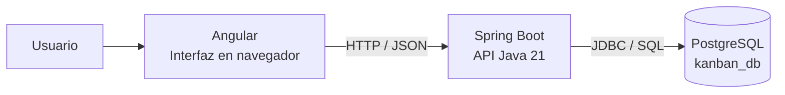
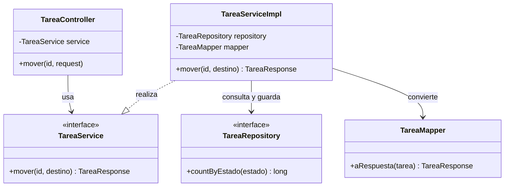
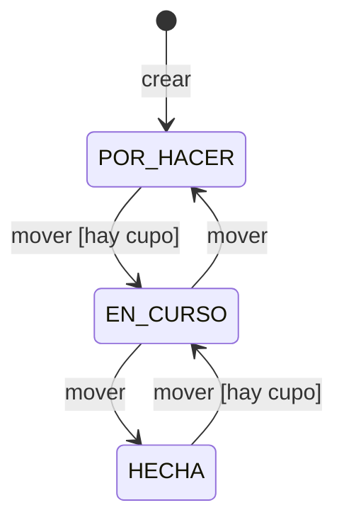
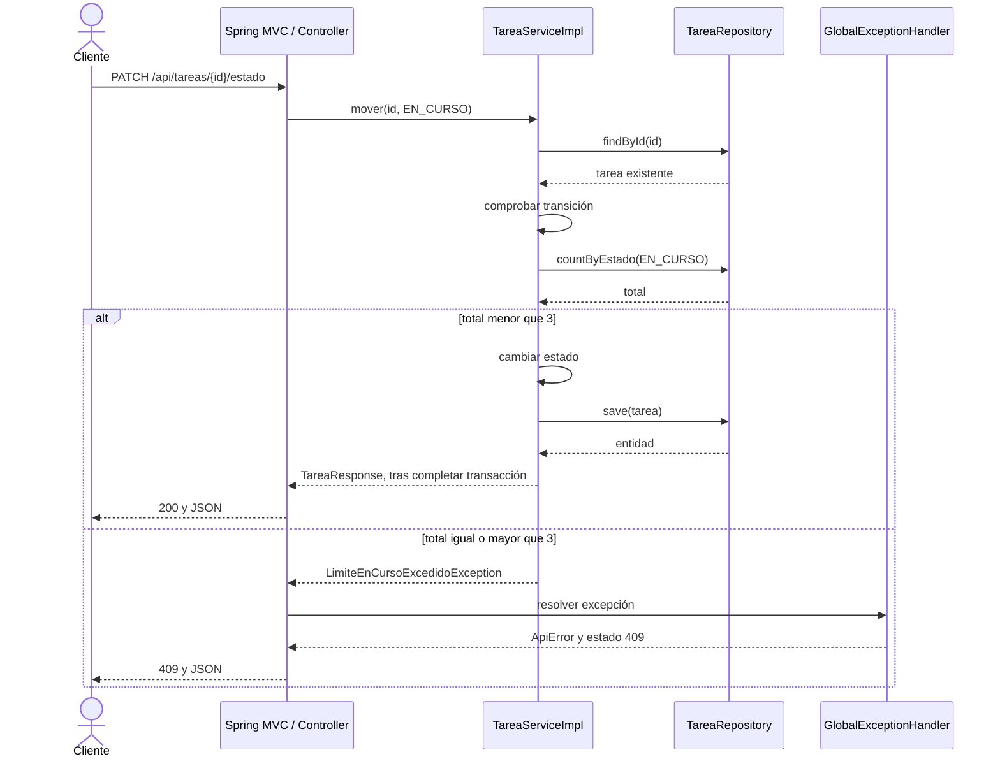
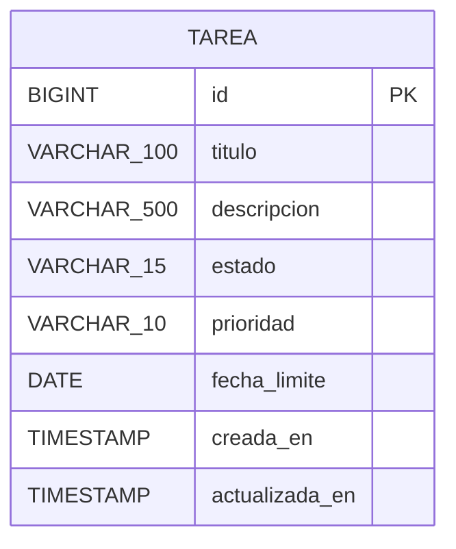
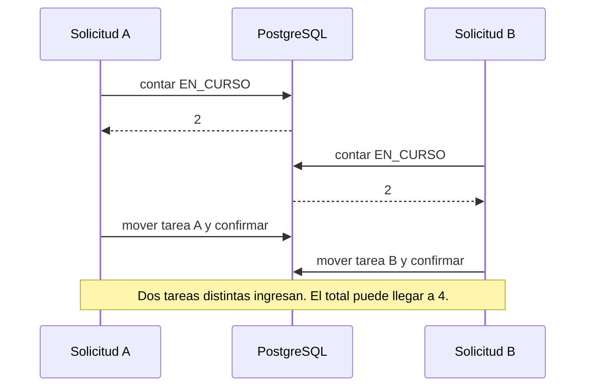
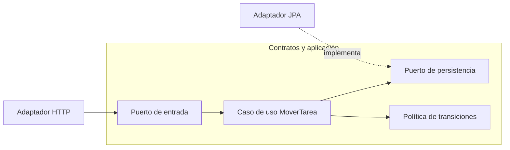
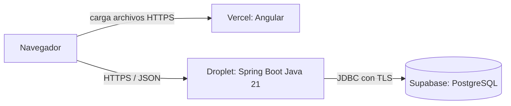

# 10 · Atlas de diagramas y decisiones del Kanban

Complemento de `presentaciones/04-Clase-03-Ingenieria-Software-Diagramas.pptx` y [guion teórico](09-fundamentos-ingenieria-software.md). Los diagramas de la PPT son objetos editables. Estas versiones Mermaid facilitan mantener la documentación junto al código.

## Cómo evaluar un diagrama

Un diagrama útil responde una pregunta concreta, declara su alcance y usa símbolos con significado consistente. Revisar nombres contra el código, dirección de dependencias, condiciones de error y nivel de detalle. No mezclar clases Java con servidores sin explicar los niveles. Actualizar el modelo cuando cambia una regla.

La secuencia docente recomendada es: necesidad del usuario, criterio de aceptación, modelo que permita discutirlo, implementación y evidencia. Los diagramas ayudan a conversar y descubrir errores antes de modificar código; no sustituyen pruebas ni decisiones documentadas.

## 1. Alcance y casos de uso

**Pregunta:** ¿qué objetivos satisface el sistema para el usuario?

El actor es un rol externo. Los objetivos actuales son ver tablero, crear, editar, mover y eliminar tareas. La PPT representa esta vista con actor, frontera y óvalos. Las asociaciones indican participación, no secuencia.

Ejemplo de ficha de caso de uso:

| Elemento | Mover tarea |
|---|---|
| Actor | Usuario del tablero |
| Precondición | La tarea existe y se conoce su estado |
| Entrada | Id y estado destino |
| Camino principal | Consultar, comprobar transición, comprobar cupo si corresponde, actualizar y responder |
| Alternativas | Id inexistente: 404. Misma columna, salto o columna llena: 409 |
| Postcondición de éxito | La tarea conserva el estado nuevo |
| Postcondición de rechazo | La operación no persiste el cambio solicitado |

`include` representa comportamiento incorporado por otro caso de uso y `extend` una extensión condicionada en puntos definidos. Un error no es automáticamente un caso `extend`. En este ejercicio es más claro documentar rechazos como flujos alternativos.

## 2. Contenedores actuales

**Pregunta:** ¿qué unidades ejecutan el sistema y cómo se comunican?

Un contenedor C4 es una aplicación o almacén de datos. No implica Docker. En desarrollo Angular usa su proxy hacia la API en el puerto 8083. Esta vista no determina dónde se desplegará producción. Fuente conceptual: [C4](https://c4model.com/diagrams).

## 3. Clases y responsabilidades actuales

**Pregunta:** ¿quién conoce a quién y quién implementa el contrato?

Vista parcial: omite operaciones que no aportan al movimiento. `TareaRepository` extiende `JpaRepository<Tarea, Long>`. La realización usa línea discontinua y triángulo hueco hacia el contrato. Las referencias no indican orden temporal. Para ese propósito se utiliza secuencia. Fuente de notación: [UML 2.5.1](https://www.omg.org/spec/UML/2.5.1).

## 4. Estados y guardas actuales

**Pregunta:** ¿qué cambios son válidos y bajo qué condiciones?

El máximo es tres tareas en `EN_CURSO`. También aplica al reabrir una tarea `HECHA`. No existe transición directa entre `POR_HACER` y `HECHA`; tampoco se acepta mover al estado actual. La edición de una tarea `HECHA` está bloqueada, aunque puede reabrirse y luego editarse.

Ejercicio: enumerar los nueve pares origen/destino. Cuatro son transiciones candidatas válidas, dos de ellas sujetas a cupo, y cinco son inválidas. Así el diagrama produce una matriz de pruebas.

## 5. Secuencia de movimiento y rechazo

**Pregunta:** ¿cómo colaboran los objetos y dónde se interrumpe un intento inválido?

Precondición del fragmento: id existente y transición adyacente. La vista agrupa infraestructura web y omite el mapper y el proxy transaccional. Spring MVC invoca el mecanismo de manejo de excepciones; el controller no llama manualmente al handler. `save()` no equivale necesariamente a un `UPDATE` inmediato: JPA puede diferirlo al flush. La respuesta exitosa ocurre después de completar la transacción del servicio.

## 6. Modelo persistente actual

**Pregunta:** ¿qué datos conserva realmente el sistema?

Solo existe una tabla de negocio. El SQL define identidad para `id`, obligatoriedad de campos, CHECK para valores de estado y prioridad e índice por estado. `fecha_limite` y descripción son opcionales. No agregar relaciones a usuarios o tableros como si ya existieran. Los timestamps indican creación y última modificación, no una bitácora completa.

## 7. Riesgo concurrente actual

**Pregunta:** ¿qué ocurre cuando dos solicitudes deciden con la misma lectura?

`@Transactional` da una frontera transaccional, pero no hace indivisible la regla global entre solicitudes. Un bloqueo de cada tarea individual o `@Version` en cada tarea no basta para dos tareas diferentes.

Opciones para estudiar y verificar: una fila coordinadora compartida que todos los ingresos bloqueen, aislamiento serializable con reintentos controlados, o un bloqueo transaccional compartido compatible con PostgreSQL. Cada opción exige una prueba concurrente contra la base real. Mantener transacciones cortas y analizar el costo de serializar ingresos. Fuente: [aislamiento de PostgreSQL](https://www.postgresql.org/docs/current/transaction-iso.html).

## 8. Arquitectura futura: puertos y adaptadores

**Pregunta:** ¿cómo aislar una política de las decisiones de infraestructura si la complejidad lo justifica?

**Propuesta no implementada.** Las flechas muestran dependencias de código. El flujo de ejecución puede invocar el adaptador de salida mediante el contrato, mientras la dependencia se orienta hacia el puerto interno. Mantener capas es razonable para este CRUD. Adoptar más límites cuando existan cambios o integraciones que los justifiquen. Fuente: [Cockburn, Hexagonal Architecture](https://alistair.cockburn.us/hexagonal-architecture).

## 9. Despliegue futuro

**Propuesta no desplegada.** Las credenciales de PostgreSQL pertenecen al backend. Vercel sirve el frontend; un Droplet ofrece un host para Java y tiene costo. Revisar planes, límites, pausas, región, conexiones de base y backups antes de cada laboratorio. Configurar HTTPS, CORS, autorización, secretos y restauración antes de usar datos reales.

## Guion de una clase de 120 minutos

| Minutos | Actividad | Evidencia del alumno |
|---|---|---|
| 0–15 | Problema, alcance y aceptación | Historia de reabrir una tarea |
| 15–35 | Capas y clases, siguiendo el código | Explicación de responsabilidades |
| 35–55 | Estados y secuencia | Predicción de éxito y 409 |
| 55–70 | Demostración Java 21 / Swagger | Respuestas observables |
| 70–95 | Laboratorio en parejas | Test de reapertura sin cupo |
| 95–110 | Revisión del PR o diff | Feedback basado en criterio |
| 110–120 | Cierre y riesgo concurrente | Qué se comprobó y qué falta |

No impartir todo el banco de cuarenta diapositivas en esta sesión. Usar Scrum/Kanban para organizar el siguiente trabajo, después profundizar pruebas SQL, seguridad y despliegue.

## Recomendaciones concretas para el código

1. **Transiciones:** reemplazar la dependencia de `ordinal()` por una política explícita y verificar los nueve pares. La propuesta de la PPT devuelve validez; el caller debe rechazar cuando devuelve `false`.
2. **Integridad:** reproducir la carrera con PostgreSQL real y elegir coordinación compartida para el cupo. No afirmar que los mocks prueban concurrencia.
3. **Persistencia:** añadir pruebas de Flyway/JPA y verificar que el timestamp devuelto corresponde a la actualización efectiva.
4. **Errores:** comprobar entradas ilegibles, ids inexistentes, transiciones, métodos no soportados y fallos inesperados. Reservar 500 para fallos internos.
5. **Configuración:** mantener Java 21 en IDE, Maven y CI. Separar credenciales de laboratorio y producción. Verificar `java -version`, `javac -version` y `mvnw.cmd -v`.
6. **Publicación:** agregar autenticación y autorización por recurso según el nuevo alcance, reducir datos de logs y probar restauración.

Estas son recomendaciones para trabajo posterior. Esta ampliación entrega teoría y documentación; no incorpora esos cambios al backend.
