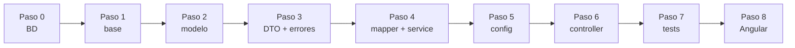
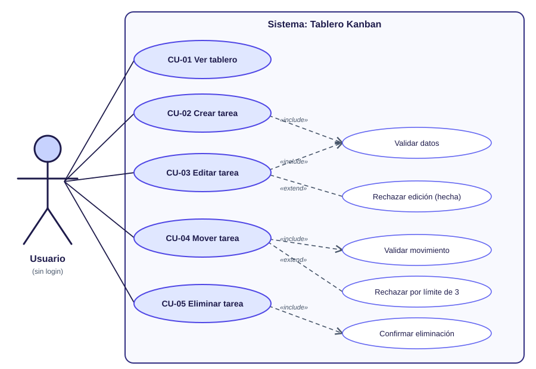
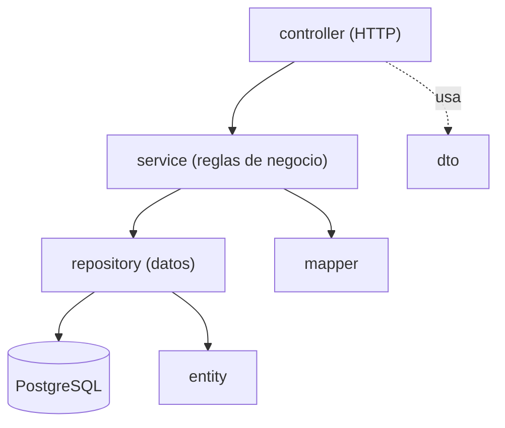

# Guía completa paso a paso: Backend del Tablero Kanban

> Java 21 · Spring Boot 3.5 · PostgreSQL 18 · **Java puro, sin Lombok**.
> Partes de `kanban-backend-base` (proyecto en blanco que ya arranca) y lo completas paso a paso hasta tener `kanban-backend`.
> **Cada paso termina en: compilar → levantar → verificar.** El proyecto debe poder arrancar al terminar cada paso.

## Mapa del proceso

| Paso | Qué haces | Paquetes | Verificas |
|---|---|---|---|
| 0 | Preparar entorno y base de datos | — | Conexión con `psql` |
| 1 | Levantar el proyecto base | — | Flyway aplica V1 y V2; Swagger vacío |
| 2 | Modelo | `enums`, `entity`, `repository` | Hibernate valida la tabla |
| 3 | DTOs, excepciones y handler | `dto`, `exception` | Arranca sin errores |
| 4 | Mapper y Service | `mapper`, `service`, `service.impl` | Spring inyecta los beans |
| 5 | Configuración | `config` | Título en Swagger |
| 6 | Controller | `controller` | Probar los 6 endpoints en Swagger (incluidos los 409) |
| 7 | Tests | `src/test` | `.\mvnw.cmd test` en verde |
| 8 | Conectar con Angular | — | Tablero funcionando |



---

## Fase de análisis: diagrama de casos de uso (antes de construir)



*(Detalle y teoría en [00-casos-de-uso.md](00-casos-de-uso.md).)*

- El **actor** (el monito) es el **Usuario**; está fuera del sistema.
- Cada **óvalo principal** (Ver, Crear, Editar, Mover, Eliminar) se convierte en **un endpoint**.
- **«include» = siempre** (*Mover* siempre valida el movimiento). **«extend» = a veces** (*Rechazar por límite de 3* solo si En curso está llena).
- Los óvalos *extend* son **reglas de negocio**: vivirán en el **Service**.

| Óvalo | Endpoint | Método del service |
|---|---|---|
| CU-01 Ver tablero | `GET /api/tareas` | `listar()` |
| CU-02 Crear tarea | `POST /api/tareas` | `crear()` |
| CU-03 Editar tarea | `PUT /api/tareas/{id}` | `actualizar()` |
| CU-04 Mover tarea | `PATCH /api/tareas/{id}/estado` | `mover()` |
| CU-05 Eliminar tarea | `DELETE /api/tareas/{id}` | `eliminar()` |

---

## Teoría previa (léela antes de empezar)

### 0. Vocabulario Java que usarás

| Término | Qué es | Ejemplo |
|---|---|---|
| **package** | Carpeta lógica que agrupa clases | `cl.ipss.kanban.entity` |
| **class** | Molde para crear objetos | `Tarea` |
| **interface** | Contrato: qué métodos existen, sin implementarlos | `TareaService` |
| **enum** | Conjunto cerrado de valores | `EstadoTarea` |
| **record** | Clase inmutable concisa para datos | `TareaResponse` |
| **annotation** | Etiqueta `@Algo` que da instrucciones a Spring/JPA/Validation | `@Entity`, `@Service` |
| **constructor** | Método que crea el objeto | `public Tarea() {}` |
| **getter / setter** | Métodos para leer / modificar un campo | `getTitulo()`, `setTitulo(...)` |
| **excepción** | Objeto que representa un error | `TareaNoEncontradaException` |
| **bean** | Objeto que **Spring crea y administra** | un `@Service` |

> **Sin Lombok:** en este proyecto los getters, setters y logs se escriben **a mano**. Así compila en cualquier IDE sin plugins.

### 1. Arquitectura MVC en capas



Una capa **solo habla con la de abajo**. Más detalle en [02-teoria-mvc.md](02-teoria-mvc.md).

### 2. DTO vs Entity

La **Entity** representa la tabla; el **DTO** representa lo que viaja por HTTP. Si mezclaras ambos, el cliente podría enviar campos que no debe (p. ej. crear una tarea ya `HECHA`). Por eso `CrearTareaRequest` no tiene `estado`.

### 3. Programar contra interfaces

El controller usa `TareaService` (interface). La lógica está en `TareaServiceImpl`. En los tests se reemplaza por un *mock*.

### 4. Patrones y SOLID

Resumen en [03-patrones-de-diseno.md](03-patrones-de-diseno.md): Service Layer, Repository, DTO, Mapper, Dependency Injection, Singleton, JavaBean, Front Controller, Advice.

### 5. Reglas de negocio de este proyecto

1. **Máximo 3 tareas en `EN_CURSO`.** La cuarta → **409**.
2. **Movimiento válido:** `POR_HACER → EN_CURSO → HECHA`, y retroceder un paso. Saltar de `POR_HACER` a `HECHA` → **409**.
3. **Una tarea `HECHA` no se edita** → **409** (sí se puede mover).
4. Errores: **404** no existe · **400** datos inválidos · **409** conflicto · **500** inesperado.

---

## Paso 0 · Preparar el entorno y la base de datos

### Requisitos

| Herramienta | Versión | Comprobar |
|---|---|---|
| JDK | **21** | `java -version` |
| PostgreSQL | 18 | `psql --version` |
| IDE | IntelliJ, VS Code o Eclipse | — |

> **Windows:** si `java -version` muestra otra versión (p. ej. 1.8), apunta `JAVA_HOME` a un JDK 21 en la misma terminal:
> ```powershell
> $env:JAVA_HOME = "C:\ruta\a\jdk-21"
> $env:Path = "$env:JAVA_HOME\bin;$env:Path"
> ```

### 1. Crear la base de datos (una sola vez)

Usa el puerto y la clave de **tu** PostgreSQL 18:

```powershell
psql -U postgres -h localhost -p 5432 -c "CREATE DATABASE kanban_db;"
```

> Si tienes PostgreSQL 14 y 18 instalados, uno usa el 5432 y el otro el 5433. Para saber a cuál te conectaste:
> `psql -U postgres -h localhost -p 5433 -c "SHOW server_version;"`

> **¿Prefieres pgAdmin?** Es lo mismo: clic derecho en *Databases → Create → Database…* → nombre `kanban_db`.

**✅ Verificar:** `psql -U postgres -h localhost -p 5432 -c "\l"` muestra la base `kanban_db`.

### 2. ¿Con qué usuario se conecta el backend?

Crear la base **no define el usuario**: el usuario es el de la conexión con la que el backend entra a PostgreSQL. El backend lee estas variables (valores por defecto entre paréntesis):

| Variable | Qué es | Por defecto |
|---|---|---|
| `DB_USER` | Usuario de PostgreSQL | `kanban` |
| `DB_PASSWORD` | Su clave | `kanban` |
| `DB_PORT` | Puerto del servidor | `5432` |
| `DB_NAME` | Nombre de la base | `kanban_db` |

**Opción A · Usar el mismo usuario con el que entras a pgAdmin.** Casi siempre es `postgres` con la clave que definiste al instalar PostgreSQL 18. Como el proyecto trae por defecto el usuario `kanban`, aquí **sí** debes indicar el usuario y la clave antes de levantar el backend (y el puerto si no es el 5432):

```powershell
$env:DB_USER = "postgres"
$env:DB_PASSWORD = "la_clave_de_postgres"
# $env:DB_PORT = "5433"     # solo si tu PostgreSQL 18 no usa el 5432
```

> ¿Cuál es mi puerto? En pgAdmin: clic derecho sobre el servidor → *Properties → Connection → Port*. O en el *Query Tool*: `SHOW port;`

**Opción B · Crear un usuario propio para esta aplicación** (es la que usa el proyecto por defecto: usuario `kanban`, clave `kanban`). Es lo habitual: un usuario por aplicación. En pgAdmin abre el **Query Tool sobre la base `kanban_db`** (clic derecho en `kanban_db` → *Query Tool*), pega este script y ejecútalo con **F5**:

```sql
-- Crea el usuario (o le actualiza la clave si ya existe)
DO $$
BEGIN
    IF NOT EXISTS (SELECT FROM pg_roles WHERE rolname = 'kanban') THEN
        CREATE USER kanban WITH PASSWORD 'kanban';
    ELSE
        ALTER USER kanban WITH PASSWORD 'kanban';
    END IF;
END
$$;

-- Lo hace dueño de la base: así Flyway puede crear la tabla y los datos
ALTER DATABASE kanban_db OWNER TO kanban;
GRANT ALL PRIVILEGES ON DATABASE kanban_db TO kanban;
GRANT ALL ON SCHEMA public TO kanban;
```

Luego levanta el backend con ese usuario (o no definas nada: `kanban` / `kanban` ya son los valores por defecto):

```powershell
$env:DB_USER = "kanban"
$env:DB_PASSWORD = "kanban"
.\mvnw.cmd spring-boot:run
```

> **Alternativa por terminal:** el proyecto trae [`crear-bd.sql`](https://github.com/cbarralesp/kanban_backend_base/blob/main/crear-bd.sql), que hace **todo de una vez**: crea (o actualiza) el usuario, crea la base si no existe y da los permisos. Se puede ejecutar varias veces sin errores. Ejecútalo como `postgres` desde la carpeta del proyecto:
>
> ```powershell
> psql -U postgres -h localhost -p 5432 -f crear-bd.sql
> ```
>
> Usa comandos propios de `psql` (`\gexec`, `\connect`), por eso se ejecuta con `psql` y **no** en el Query Tool de pgAdmin; en pgAdmin usa el script de la Opción B.

Contenido de `crear-bd.sql`:

<!-- archivo: crear-bd.sql -->
```sql
-- Ejecutar como superusuario (postgres). Se puede repetir sin errores: crea lo que falta y actualiza lo demás.
--   psql -U postgres -h localhost -p 5432 -f crear-bd.sql

-- Crea el usuario (o le actualiza la clave si ya existe)
DO $$
BEGIN
    IF NOT EXISTS (SELECT FROM pg_roles WHERE rolname = 'kanban') THEN
        CREATE USER kanban WITH PASSWORD 'kanban';
    ELSE
        ALTER USER kanban WITH PASSWORD 'kanban';
    END IF;
END
$$;

-- Crea la base solo si no existe (CREATE DATABASE no puede ir dentro de un bloque DO)
SELECT 'CREATE DATABASE kanban_db OWNER kanban'
WHERE NOT EXISTS (SELECT FROM pg_database WHERE datname = 'kanban_db')\gexec

\connect kanban_db

-- Lo hace dueño de la base: así Flyway puede crear la tabla y los datos
ALTER DATABASE kanban_db OWNER TO kanban;
GRANT ALL PRIVILEGES ON DATABASE kanban_db TO kanban;
-- Desde PostgreSQL 15 el esquema public ya no es escribible por cualquiera: sin esto Flyway falla.
GRANT ALL ON SCHEMA public TO kanban;
```

**¿Por qué hace falta `GRANT ALL ON SCHEMA public`?** Desde PostgreSQL 15 los usuarios normales ya no pueden crear tablas en el esquema `public` por defecto. Como el dueño de la base ya puede, el `GRANT` es una segunda garantía. Sin ellos Flyway fallaría con *permission denied for schema public*.

**¿Cómo saber si el usuario y la clave están bien?** Antes de levantar el backend prueba la conexión:

```powershell
psql -U kanban -h localhost -p 5432 -d kanban_db -c "SELECT current_user;"
```

Si pide clave y responde `kanban`, el backend podrá conectarse igual. Si dice *password authentication failed*, el usuario o la clave no coinciden.

### 3. Las 3 formas de configurar usuario y clave

Por defecto el backend usa `kanban` / `kanban` (valores por defecto de `application.yml`: `${DB_USER:kanban}`).

**Forma 1 · Editar `application.yml`** (la más simple, pero cambia un archivo versionado):

```yaml
spring:
  datasource:
    username: tu_usuario
    password: tu_clave
```

**Forma 2 · Variables de entorno en la terminal** (PowerShell):

```powershell
$env:DB_USER = "postgres"
$env:DB_PASSWORD = "tu_clave"
# $env:DB_PORT = "5433"     # solo si tu PostgreSQL no usa el 5432
.\mvnw.cmd spring-boot:run
```

**Forma 3 · Variables en el IDE** (no ensucia el repositorio):
- IntelliJ: *Run → Edit Configurations → Environment variables* → `DB_USER=...;DB_PASSWORD=...`
- VS Code: en `launch.json`, la clave `"env": { "DB_USER": "...", "DB_PASSWORD": "..." }`
- Eclipse: *Run Configurations → Environment*.

Variables disponibles: `DB_HOST, DB_PORT, DB_NAME, DB_USER, DB_PASSWORD, SERVER_PORT, CORS_ORIGINS, LOG_LEVEL_APP`.

### Errores de conexión comunes

| Mensaje | Causa | Solución |
|---|---|---|
| `password authentication failed for user "kanban"` (o *la autentificación password falló*) | La clave (o el usuario) no coincide | Revisa `DB_PASSWORD`/`DB_USER`. Para reponer la clave en pgAdmin: `ALTER USER kanban WITH PASSWORD 'kanban';` |
| `role "kanban" does not exist` | El usuario por defecto del proyecto aún no existe | Ejecuta el script de la **Opción B** (o usa `postgres` con la Opción A) |
| `database "kanban_db" does not exist` | No creaste la base, o está mal escrito `DB_NAME` | Crea `kanban_db` (punto 1 de este paso) |
| `Connection refused` | Puerto equivocado o PostgreSQL apagado | Verifica el puerto con `SHOW port;` y defínelo con `DB_PORT`; revisa que el servicio esté en ejecución |
| `permission denied for schema public` (Flyway) | El usuario no puede crear tablas (PostgreSQL 15+) | Conectado a `kanban_db`: `ALTER DATABASE kanban_db OWNER TO kanban;` y `GRANT ALL ON SCHEMA public TO kanban;` |
| `Port 8083 was already in use` | Otro proceso usa el puerto | Ciérralo o define `SERVER_PORT` |
| Cambié el `application.yml` y sigue igual | La aplicación no se reinició | Detén y vuelve a ejecutar; en Eclipse: *Project → Clean…* |
| En otra terminal vuelve a fallar | Las variables `$env:` valen solo para la terminal donde se definieron | Defínelas de nuevo, o usa la Forma 1 o la Forma 3 |

### ✅ Verificar

```powershell
$env:PGPASSWORD = "kanban"
psql -U kanban -h localhost -p 5432 -d kanban_db -c "select 1"
```

Debe responder `1`.

---

## Paso 1 · Levantar el proyecto base y verificar la conexión

Abre la carpeta `kanban-backend-base`. Trae:

| Archivo | Para qué |
|---|---|
| `pom.xml` | Dependencias (solo las necesarias: web, validation, data-jpa, postgresql, flyway, springdoc, test) |
| `src/main/resources/application.yml` | Puerto, base de datos, logs |
| `db/migration/V1__crear_tabla_tarea.sql` y `V2__datos_iniciales.sql` | Esquema y 3 tareas de ejemplo |
| `KanbanApplication.java` | Punto de entrada |
| `package-info.java` por paquete | Un `TODO` que indica qué crear en cada paso |

### `application.yml`

<!-- archivo: src/main/resources/application.yml -->
```yaml
server:
  port: ${SERVER_PORT:8083}

spring:
  application:
    name: kanban-backend
  datasource:
    # Cambia el puerto/usuario/clave con variables de entorno si tu Postgres es distinto
    url: jdbc:postgresql://${DB_HOST:localhost}:${DB_PORT:5432}/${DB_NAME:kanban_db}
    username: ${DB_USER:kanban}
    password: ${DB_PASSWORD:kanban}
  jpa:
    open-in-view: false
    hibernate:
      ddl-auto: validate      # el esquema lo crea Flyway, Hibernate solo lo valida
    properties:
      hibernate:
        format_sql: true
  flyway:
    enabled: true
    locations: classpath:db/migration

app:
  cors:
    allowed-origins: ${CORS_ORIGINS:http://localhost:4200}

# -------------------------------------------------
# LOGGING (SLF4J + Logback, ya incluidos en Spring Boot; sin Lombok)
# -------------------------------------------------
logging:
  file:
    name: logs/${spring.application.name}.log
  logback:
    rollingpolicy:
      max-file-size: 10MB
      file-name-pattern: ${LOG_FILE}.%d{yyyy-MM-dd}.%i
      max-history: 7
  level:
    root: INFO
    cl.ipss: ${LOG_LEVEL_APP:INFO}       # DEBUG agrega más detalle (p. ej. las respuestas 404/409)
    org.springframework.web: INFO
    org.hibernate.SQL: DEBUG               # muestra el SQL que ejecuta Hibernate
    org.hibernate.type.descriptor.sql: INFO
```

**Explicación:** `ddl-auto: validate` hace que Hibernate **solo compruebe** que la tabla coincide con la entity; el esquema lo crea Flyway. `${DB_USER:kanban}` significa "usa la variable `DB_USER`, o `kanban` si no existe". El log va a `logs/kanban-backend.log` con rotación (10 MB, 7 días).

### Migraciones Flyway

`V1__crear_tabla_tarea.sql`:

<!-- archivo: src/main/resources/db/migration/V1__crear_tabla_tarea.sql -->
```sql
-- V1: tabla principal del tablero
CREATE TABLE tarea (
    id             BIGINT GENERATED ALWAYS AS IDENTITY PRIMARY KEY,
    titulo         VARCHAR(100) NOT NULL,
    descripcion    VARCHAR(500),
    estado         VARCHAR(15)  NOT NULL DEFAULT 'POR_HACER',
    prioridad      VARCHAR(10)  NOT NULL DEFAULT 'MEDIA',
    fecha_limite   DATE,
    creada_en      TIMESTAMP    NOT NULL DEFAULT CURRENT_TIMESTAMP,
    actualizada_en TIMESTAMP    NOT NULL DEFAULT CURRENT_TIMESTAMP,

    CONSTRAINT ck_tarea_estado    CHECK (estado IN ('POR_HACER', 'EN_CURSO', 'HECHA')),
    CONSTRAINT ck_tarea_prioridad CHECK (prioridad IN ('BAJA', 'MEDIA', 'ALTA'))
);

CREATE INDEX idx_tarea_estado ON tarea (estado);
```

`V2__datos_iniciales.sql` (exactamente 3 tareas, una por columna):

<!-- archivo: src/main/resources/db/migration/V2__datos_iniciales.sql -->
```sql
-- V2: tres tareas de ejemplo, una por columna, para ver algo en el tablero al levantar el proyecto
INSERT INTO tarea (titulo, descripcion, estado, prioridad, fecha_limite) VALUES
    ('Preparar la presentación',      'Armar las diapositivas de la clase del viernes', 'POR_HACER', 'MEDIA', NULL),
    ('Estudiar para la prueba de MVC', 'Repasar capas, DTO y patrones de diseño',       'EN_CURSO',  'ALTA',  CURRENT_DATE + 7),
    ('Instalar PostgreSQL 18',         'Crear la base kanban_db y el usuario kanban',   'HECHA',     'BAJA',  NULL);
```

> ⚠️ **Una migración ya aplicada no se edita nunca.** Los cambios van en `V3`, `V4`…

### `KanbanApplication`

<!-- archivo: src/main/java/cl/ipss/kanban/KanbanApplication.java -->
```java
package cl.ipss.kanban;

import org.springframework.boot.SpringApplication;
import org.springframework.boot.autoconfigure.SpringBootApplication;

@SpringBootApplication
public class KanbanApplication {

    public static void main(String[] args) {
        SpringApplication.run(KanbanApplication.class, args);
    }
}
```

`@SpringBootApplication` activa la configuración automática y el escaneo de componentes del paquete `cl.ipss.kanban` y sus subpaquetes.

### ✅ Compilar → levantar → verificar

```powershell
.\mvnw.cmd spring-boot:run
```

En el log debes ver:

```text
Migrating schema "public" to version "1 - crear tabla tarea"
Migrating schema "public" to version "2 - datos iniciales"
Started KanbanApplication in ... seconds
```

Abre <http://localhost:8083/swagger-ui.html>: debe cargar **sin endpoints** (aún no hay controller).

---

## Paso 2 · Crear el MODELO: enums, entity y repository

### 🧩 Archivo 2.1 · `EstadoTarea` (enum)

**① Crear el paquete** (si aún no existe): `cl.ipss.kanban.enums`

- IntelliJ: clic derecho sobre `src/main/java` → *New → Package*.
- VS Code: en el explorador, clic derecho en `src/main/java` → *New Folder* y escribe la ruta con `/` (`cl/ipss/kanban/enums`).

**② Crear el archivo** `EstadoTarea.java` en `src/main/java/cl/ipss/kanban/enums`:

| IDE | Cómo |
|---|---|
| **IntelliJ** | Clic derecho en el paquete → *New → Java Class* → nombre `EstadoTarea` → elige **Enum** |
| **VS Code** | Clic derecho en la carpeta → *New File* → `EstadoTarea.java` (el servicio de Java sugiere la estructura) |

**③ Código completo** (primera línea: `package`):

<!-- archivo: main/java/cl/ipss/kanban/enums/EstadoTarea.java -->
```java
package cl.ipss.kanban.enums;

/** Columna del tablero en la que está una tarea. El orden de las constantes es el orden de las columnas. */
public enum EstadoTarea {
    POR_HACER,
    EN_CURSO,
    HECHA
}
```

**④ Teoría**

Un **enum** es un conjunto **cerrado** de valores constantes. Evita "strings mágicos" como `"en curso"` o `"EnCurso"`: el compilador solo acepta valores que existen. Además, cada constante tiene un número de orden (`ordinal()`): 0, 1, 2…

**⑤ Explicación del código**

Las tres constantes son las **columnas del tablero**, en orden de izquierda a derecha. Ese orden **importa**: el service calcula si un movimiento es de un solo paso comparando `ordinal()` (`POR_HACER`=0, `EN_CURSO`=1, `HECHA`=2). Si reordenas las constantes, rompes la regla.

### 🧩 Archivo 2.2 · `PrioridadTarea` (enum)

**① Crear el paquete** (si aún no existe): `cl.ipss.kanban.enums`

- IntelliJ: clic derecho sobre `src/main/java` → *New → Package*.
- VS Code: en el explorador, clic derecho en `src/main/java` → *New Folder* y escribe la ruta con `/` (`cl/ipss/kanban/enums`).

**② Crear el archivo** `PrioridadTarea.java` en `src/main/java/cl/ipss/kanban/enums`:

| IDE | Cómo |
|---|---|
| **IntelliJ** | Clic derecho en el paquete → *New → Java Class* → nombre `PrioridadTarea` → elige **Enum** |
| **VS Code** | Clic derecho en la carpeta → *New File* → `PrioridadTarea.java` (el servicio de Java sugiere la estructura) |

**③ Código completo** (primera línea: `package`):

<!-- archivo: main/java/cl/ipss/kanban/enums/PrioridadTarea.java -->
```java
package cl.ipss.kanban.enums;

public enum PrioridadTarea {
    BAJA,
    MEDIA,
    ALTA
}
```

**④ Teoría**

Otro **enum**: valores cerrados que la API acepta y devuelve como texto (`"ALTA"`).

**⑤ Explicación del código**

Define las prioridades. Angular las muestra como chips de color. Si el cliente envía un valor que no existe (`"URGENTE"`), Jackson falla y el handler responde **400**.

### 🧩 Archivo 2.3 · `Tarea` (class)

**① Crear el paquete** (si aún no existe): `cl.ipss.kanban.entity`

- IntelliJ: clic derecho sobre `src/main/java` → *New → Package*.
- VS Code: en el explorador, clic derecho en `src/main/java` → *New Folder* y escribe la ruta con `/` (`cl/ipss/kanban/entity`).

**② Crear el archivo** `Tarea.java` en `src/main/java/cl/ipss/kanban/entity`:

| IDE | Cómo |
|---|---|
| **IntelliJ** | Clic derecho en el paquete → *New → Java Class* → nombre `Tarea` → elige **Class** |
| **VS Code** | Clic derecho en la carpeta → *New File* → `Tarea.java` (el servicio de Java sugiere la estructura) |

**③ Código completo** (primera línea: `package`):

<!-- archivo: main/java/cl/ipss/kanban/entity/Tarea.java -->
```java
package cl.ipss.kanban.entity;

import cl.ipss.kanban.enums.EstadoTarea;
import cl.ipss.kanban.enums.PrioridadTarea;
import jakarta.persistence.Column;
import jakarta.persistence.Entity;
import jakarta.persistence.EnumType;
import jakarta.persistence.Enumerated;
import jakarta.persistence.GeneratedValue;
import jakarta.persistence.GenerationType;
import jakarta.persistence.Id;
import jakarta.persistence.PrePersist;
import jakarta.persistence.PreUpdate;
import jakarta.persistence.Table;

import java.time.LocalDate;
import java.time.LocalDateTime;

/**
 * ENTITY (el "Model" de MVC): representa la tabla tarea.
 * Java puro: constructor vacío, getters y setters escritos a mano.
 */
@Entity
@Table(name = "tarea")
public class Tarea {

    @Id
    @GeneratedValue(strategy = GenerationType.IDENTITY)
    private Long id;

    @Column(nullable = false, length = 100)
    private String titulo;

    @Column(length = 500)
    private String descripcion;

    @Enumerated(EnumType.STRING)
    @Column(nullable = false, length = 15)
    private EstadoTarea estado;

    @Enumerated(EnumType.STRING)
    @Column(nullable = false, length = 10)
    private PrioridadTarea prioridad;

    @Column(name = "fecha_limite")
    private LocalDate fechaLimite;

    @Column(name = "creada_en", nullable = false, updatable = false)
    private LocalDateTime creadaEn;

    @Column(name = "actualizada_en", nullable = false)
    private LocalDateTime actualizadaEn;

    /** Constructor vacío: JPA lo exige para crear la entidad al leer de la base. */
    public Tarea() {
    }

    // ---------- getters ----------
    public Long getId() {
        return id;
    }

    public String getTitulo() {
        return titulo;
    }

    public String getDescripcion() {
        return descripcion;
    }

    public EstadoTarea getEstado() {
        return estado;
    }

    public PrioridadTarea getPrioridad() {
        return prioridad;
    }

    public LocalDate getFechaLimite() {
        return fechaLimite;
    }

    public LocalDateTime getCreadaEn() {
        return creadaEn;
    }

    public LocalDateTime getActualizadaEn() {
        return actualizadaEn;
    }

    // ---------- setters (id y fechas de auditoría los maneja JPA, por eso no tienen) ----------
    public void setTitulo(String titulo) {
        this.titulo = titulo;
    }

    public void setDescripcion(String descripcion) {
        this.descripcion = descripcion;
    }

    public void setEstado(EstadoTarea estado) {
        this.estado = estado;
    }

    public void setPrioridad(PrioridadTarea prioridad) {
        this.prioridad = prioridad;
    }

    public void setFechaLimite(LocalDate fechaLimite) {
        this.fechaLimite = fechaLimite;
    }

    /** Se ejecuta automáticamente justo antes del INSERT. */
    @PrePersist
    void antesDeGuardar() {
        LocalDateTime ahora = LocalDateTime.now();
        this.creadaEn = ahora;
        this.actualizadaEn = ahora;
        if (this.estado == null) {
            this.estado = EstadoTarea.POR_HACER;
        }
    }

    /** Se ejecuta automáticamente justo antes del UPDATE. */
    @PreUpdate
    void antesDeActualizar() {
        this.actualizadaEn = LocalDateTime.now();
    }
}
```

**④ Teoría**

Una **entity** es una clase cuyas instancias se guardan como filas de una tabla (JPA). Debe ser un **JavaBean**: constructor vacío + getters/setters. **Sin Lombok**, los escribimos a mano. Solo ponemos setters de lo que realmente se modifica: el `id` y las fechas de auditoría los maneja JPA.

**⑤ Explicación del código**

- `@Entity` y `@Table(name = "tarea")`: la clase es la tabla `tarea`.
- `@Id @GeneratedValue(strategy = IDENTITY)`: el `id` lo genera la base (la columna es `GENERATED ALWAYS AS IDENTITY`).
- `@Column(nullable, length)`: refleja las restricciones de la tabla; Hibernate las **valida** al arrancar.
- `@Enumerated(EnumType.STRING)`: guarda `"EN_CURSO"` y no el número 1 (más seguro si cambia el orden).
- `@Column(name = "fecha_limite")`: mapea el nombre `camelCase` al `snake_case` de la columna.
- `updatable = false` en `creadaEn`: la fecha de creación nunca cambia.
- `@PrePersist` / `@PreUpdate`: métodos que JPA llama justo antes del INSERT / UPDATE para fijar las fechas (y el estado `POR_HACER` por defecto).
- Constructor vacío: JPA lo exige para crear la entidad al leer de la base.

### 🧩 Archivo 2.4 · `TareaRepository` (interface)

**① Crear el paquete** (si aún no existe): `cl.ipss.kanban.repository`

- IntelliJ: clic derecho sobre `src/main/java` → *New → Package*.
- VS Code: en el explorador, clic derecho en `src/main/java` → *New Folder* y escribe la ruta con `/` (`cl/ipss/kanban/repository`).

**② Crear el archivo** `TareaRepository.java` en `src/main/java/cl/ipss/kanban/repository`:

| IDE | Cómo |
|---|---|
| **IntelliJ** | Clic derecho en el paquete → *New → Java Class* → nombre `TareaRepository` → elige **Interface** |
| **VS Code** | Clic derecho en la carpeta → *New File* → `TareaRepository.java` (el servicio de Java sugiere la estructura) |

**③ Código completo** (primera línea: `package`):

<!-- archivo: main/java/cl/ipss/kanban/repository/TareaRepository.java -->
```java
package cl.ipss.kanban.repository;

import cl.ipss.kanban.entity.Tarea;
import cl.ipss.kanban.enums.EstadoTarea;
import org.springframework.data.jpa.repository.JpaRepository;
import org.springframework.stereotype.Repository;

/**
 * REPOSITORY: acceso a datos. Al extender JpaRepository, Spring genera
 * en tiempo de ejecución save, findById, findAll, deleteById, existsById...
 */
@Repository
public interface TareaRepository extends JpaRepository<Tarea, Long> {

    /** Método derivado: Spring crea el SELECT COUNT leyendo el nombre del método. */
    long countByEstado(EstadoTarea estado);
}
```

**④ Teoría**

Un **repository** es la capa de acceso a datos. Es una **interface**: tú declaras qué quieres y **Spring Data genera la implementación** en tiempo de ejecución. Los *métodos derivados* se construyen leyendo el nombre del método.

**⑤ Explicación del código**

- `extends JpaRepository<Tarea, Long>`: hereda `save`, `findById`, `findAll`, `deleteById`, `existsById`… (`Tarea` = entity, `Long` = tipo del id).
- `@Repository`: lo marca como componente de acceso a datos.
- `long countByEstado(EstadoTarea estado)`: Spring lo traduce a `SELECT COUNT(*) FROM tarea WHERE estado = ?`. Lo usa el service para aplicar el **límite de 3 en curso**.


### ✅ Compilar → levantar → verificar (Paso 2)

```powershell
.\mvnw.cmd spring-boot:run
```

Sin errores de Hibernate (`Schema-validation`) y `Started KanbanApplication`. Si aparece `missing column`, el nombre de un campo no coincide con la tabla.

---

## Paso 3 · Crear DTOs, excepciones y manejo de errores

### 🧩 Archivo 3.1 · `CrearTareaRequest` (record)

**① Crear el paquete** (si aún no existe): `cl.ipss.kanban.dto`

- IntelliJ: clic derecho sobre `src/main/java` → *New → Package*.
- VS Code: en el explorador, clic derecho en `src/main/java` → *New Folder* y escribe la ruta con `/` (`cl/ipss/kanban/dto`).

**② Crear el archivo** `CrearTareaRequest.java` en `src/main/java/cl/ipss/kanban/dto`:

| IDE | Cómo |
|---|---|
| **IntelliJ** | Clic derecho en el paquete → *New → Java Class* → nombre `CrearTareaRequest` → elige **Record** |
| **VS Code** | Clic derecho en la carpeta → *New File* → `CrearTareaRequest.java` (el servicio de Java sugiere la estructura) |

**③ Código completo** (primera línea: `package`):

<!-- archivo: main/java/cl/ipss/kanban/dto/CrearTareaRequest.java -->
```java
package cl.ipss.kanban.dto;

import cl.ipss.kanban.enums.PrioridadTarea;
import jakarta.validation.constraints.NotBlank;
import jakarta.validation.constraints.NotNull;
import jakarta.validation.constraints.Size;

import java.time.LocalDate;

/** DTO de entrada para POST /api/tareas. La tarea siempre nace en POR_HACER. */
public record CrearTareaRequest(
        @NotBlank(message = "El título es obligatorio")
        @Size(max = 100, message = "El título no puede superar los 100 caracteres")
        String titulo,

        @Size(max = 500, message = "La descripción no puede superar los 500 caracteres")
        String descripcion,

        @NotNull(message = "La prioridad es obligatoria")
        PrioridadTarea prioridad,

        LocalDate fechaLimite
) {
}
```

**④ Teoría**

Un **record** es una clase **inmutable** que Java completa por ti (constructor, getters con el nombre del campo, `equals`, `toString`). Ideal para DTO. Las anotaciones de **Bean Validation** (`@NotBlank`, `@Size`…) declaran las reglas que el controller aplica con `@Valid`.

**⑤ Explicación del código**

- `@NotBlank`: no nulo, no vacío y no solo espacios.
- `@Size(max = 100)`: largo máximo (igual que `VARCHAR(100)`).
- `@NotNull` en `prioridad`: obligatoria.
- `descripcion` y `fechaLimite` no llevan `@NotNull`: son opcionales.
- **No hay `estado`**: toda tarea nace `POR_HACER`; el cliente no decide eso.
- El `message` es el texto que verá el usuario en el 400.

### 🧩 Archivo 3.2 · `ActualizarTareaRequest` (record)

**① Crear el paquete** (si aún no existe): `cl.ipss.kanban.dto`

- IntelliJ: clic derecho sobre `src/main/java` → *New → Package*.
- VS Code: en el explorador, clic derecho en `src/main/java` → *New Folder* y escribe la ruta con `/` (`cl/ipss/kanban/dto`).

**② Crear el archivo** `ActualizarTareaRequest.java` en `src/main/java/cl/ipss/kanban/dto`:

| IDE | Cómo |
|---|---|
| **IntelliJ** | Clic derecho en el paquete → *New → Java Class* → nombre `ActualizarTareaRequest` → elige **Record** |
| **VS Code** | Clic derecho en la carpeta → *New File* → `ActualizarTareaRequest.java` (el servicio de Java sugiere la estructura) |

**③ Código completo** (primera línea: `package`):

<!-- archivo: main/java/cl/ipss/kanban/dto/ActualizarTareaRequest.java -->
```java
package cl.ipss.kanban.dto;

import cl.ipss.kanban.enums.PrioridadTarea;
import jakarta.validation.constraints.NotBlank;
import jakarta.validation.constraints.NotNull;
import jakarta.validation.constraints.Size;

import java.time.LocalDate;

/** DTO de entrada para PUT /api/tareas/{id}. El estado no se edita aquí: se cambia con PATCH .../estado. */
public record ActualizarTareaRequest(
        @NotBlank(message = "El título es obligatorio")
        @Size(max = 100, message = "El título no puede superar los 100 caracteres")
        String titulo,

        @Size(max = 500, message = "La descripción no puede superar los 500 caracteres")
        String descripcion,

        @NotNull(message = "La prioridad es obligatoria")
        PrioridadTarea prioridad,

        LocalDate fechaLimite
) {
}
```

**④ Teoría**

Un DTO distinto para editar: así cada operación declara **exactamente** los datos que acepta.

**⑤ Explicación del código**

Mismos campos y validaciones que al crear. **No incluye `estado`**: cambiar de columna se hace **solo** con `PATCH /api/tareas/{id}/estado`, donde se aplican las reglas del tablero.

### 🧩 Archivo 3.3 · `MoverTareaRequest` (record)

**① Crear el paquete** (si aún no existe): `cl.ipss.kanban.dto`

- IntelliJ: clic derecho sobre `src/main/java` → *New → Package*.
- VS Code: en el explorador, clic derecho en `src/main/java` → *New Folder* y escribe la ruta con `/` (`cl/ipss/kanban/dto`).

**② Crear el archivo** `MoverTareaRequest.java` en `src/main/java/cl/ipss/kanban/dto`:

| IDE | Cómo |
|---|---|
| **IntelliJ** | Clic derecho en el paquete → *New → Java Class* → nombre `MoverTareaRequest` → elige **Record** |
| **VS Code** | Clic derecho en la carpeta → *New File* → `MoverTareaRequest.java` (el servicio de Java sugiere la estructura) |

**③ Código completo** (primera línea: `package`):

<!-- archivo: main/java/cl/ipss/kanban/dto/MoverTareaRequest.java -->
```java
package cl.ipss.kanban.dto;

import cl.ipss.kanban.enums.EstadoTarea;
import jakarta.validation.constraints.NotNull;

/** DTO de entrada para PATCH /api/tareas/{id}/estado: la columna de destino. */
public record MoverTareaRequest(
        @NotNull(message = "El estado de destino es obligatorio")
        EstadoTarea estado
) {
}
```

**④ Teoría**

Un DTO de **un solo campo**: la columna de destino. Un `PATCH` es una modificación **parcial** (a diferencia de `PUT`, que reemplaza los datos editables).

**⑤ Explicación del código**

`@NotNull` evita que llegue `{}`. Si `estado` trae un texto que no es un `EstadoTarea`, Jackson no puede convertirlo y el handler responde **400**.

### 🧩 Archivo 3.4 · `TareaResponse` (record)

**① Crear el paquete** (si aún no existe): `cl.ipss.kanban.dto`

- IntelliJ: clic derecho sobre `src/main/java` → *New → Package*.
- VS Code: en el explorador, clic derecho en `src/main/java` → *New Folder* y escribe la ruta con `/` (`cl/ipss/kanban/dto`).

**② Crear el archivo** `TareaResponse.java` en `src/main/java/cl/ipss/kanban/dto`:

| IDE | Cómo |
|---|---|
| **IntelliJ** | Clic derecho en el paquete → *New → Java Class* → nombre `TareaResponse` → elige **Record** |
| **VS Code** | Clic derecho en la carpeta → *New File* → `TareaResponse.java` (el servicio de Java sugiere la estructura) |

**③ Código completo** (primera línea: `package`):

<!-- archivo: main/java/cl/ipss/kanban/dto/TareaResponse.java -->
```java
package cl.ipss.kanban.dto;

import cl.ipss.kanban.enums.EstadoTarea;
import cl.ipss.kanban.enums.PrioridadTarea;

import java.time.LocalDate;
import java.time.LocalDateTime;

/** DTO de salida: lo que viaja en el JSON hacia Angular (la "View" de MVC en una API REST). */
public record TareaResponse(
        Long id,
        String titulo,
        String descripcion,
        EstadoTarea estado,
        PrioridadTarea prioridad,
        LocalDate fechaLimite,
        LocalDateTime creadaEn,
        LocalDateTime actualizadaEn
) {
}
```

**④ Teoría**

El DTO de **salida**: lo que se serializa a JSON hacia Angular. Es la "Vista" de MVC en una API REST.

**⑤ Explicación del código**

Incluye el `id`, el `estado` y las fechas de auditoría (que el cliente nunca envía). Nunca se devuelve la entity directamente: así la API no queda atada a la tabla.

### 🧩 Archivo 3.5 · `TareaNoEncontradaException` (class)

**① Crear el paquete** (si aún no existe): `cl.ipss.kanban.exception`

- IntelliJ: clic derecho sobre `src/main/java` → *New → Package*.
- VS Code: en el explorador, clic derecho en `src/main/java` → *New Folder* y escribe la ruta con `/` (`cl/ipss/kanban/exception`).

**② Crear el archivo** `TareaNoEncontradaException.java` en `src/main/java/cl/ipss/kanban/exception`:

| IDE | Cómo |
|---|---|
| **IntelliJ** | Clic derecho en el paquete → *New → Java Class* → nombre `TareaNoEncontradaException` → elige **Class** |
| **VS Code** | Clic derecho en la carpeta → *New File* → `TareaNoEncontradaException.java` (el servicio de Java sugiere la estructura) |

**③ Código completo** (primera línea: `package`):

<!-- archivo: main/java/cl/ipss/kanban/exception/TareaNoEncontradaException.java -->
```java
package cl.ipss.kanban.exception;

/** Se lanza cuando no existe la tarea pedida (HTTP 404). */
public class TareaNoEncontradaException extends RuntimeException {

    private static final long serialVersionUID = 1L;

    public TareaNoEncontradaException(Long id) {
        super("No existe una tarea con id " + id);
    }
}
```

**④ Teoría**

Una **excepción propia** representa un error de negocio con nombre. Extiende `RuntimeException` (no obliga a `try/catch`). **Siempre** declara `serialVersionUID`: sin él, Eclipse muestra una advertencia amarilla/roja.

**⑤ Explicación del código**

Se lanza cuando no existe una tarea con ese `id`. El handler la traduce a **404**. El constructor arma el mensaje.

### 🧩 Archivo 3.6 · `LimiteEnCursoExcedidoException` (class)

**① Crear el paquete** (si aún no existe): `cl.ipss.kanban.exception`

- IntelliJ: clic derecho sobre `src/main/java` → *New → Package*.
- VS Code: en el explorador, clic derecho en `src/main/java` → *New Folder* y escribe la ruta con `/` (`cl/ipss/kanban/exception`).

**② Crear el archivo** `LimiteEnCursoExcedidoException.java` en `src/main/java/cl/ipss/kanban/exception`:

| IDE | Cómo |
|---|---|
| **IntelliJ** | Clic derecho en el paquete → *New → Java Class* → nombre `LimiteEnCursoExcedidoException` → elige **Class** |
| **VS Code** | Clic derecho en la carpeta → *New File* → `LimiteEnCursoExcedidoException.java` (el servicio de Java sugiere la estructura) |

**③ Código completo** (primera línea: `package`):

<!-- archivo: main/java/cl/ipss/kanban/exception/LimiteEnCursoExcedidoException.java -->
```java
package cl.ipss.kanban.exception;

/** Se lanza al mover una tarea a EN_CURSO cuando esa columna ya está llena (HTTP 409). */
public class LimiteEnCursoExcedidoException extends RuntimeException {

    private static final long serialVersionUID = 1L;

    public LimiteEnCursoExcedidoException(int limite) {
        super("La columna En curso ya tiene el máximo de " + limite
                + " tareas; termina una antes de iniciar otra");
    }
}
```

**④ Teoría**

Otra excepción de negocio: modela la regla del **límite de trabajo en curso (WIP)**.

**⑤ Explicación del código**

Se lanza al intentar entrar a `EN_CURSO` cuando ya hay 3. Recibe el límite para armar un mensaje claro. El handler la traduce a **409 Conflict**.

### 🧩 Archivo 3.7 · `MovimientoInvalidoException` (class)

**① Crear el paquete** (si aún no existe): `cl.ipss.kanban.exception`

- IntelliJ: clic derecho sobre `src/main/java` → *New → Package*.
- VS Code: en el explorador, clic derecho en `src/main/java` → *New Folder* y escribe la ruta con `/` (`cl/ipss/kanban/exception`).

**② Crear el archivo** `MovimientoInvalidoException.java` en `src/main/java/cl/ipss/kanban/exception`:

| IDE | Cómo |
|---|---|
| **IntelliJ** | Clic derecho en el paquete → *New → Java Class* → nombre `MovimientoInvalidoException` → elige **Class** |
| **VS Code** | Clic derecho en la carpeta → *New File* → `MovimientoInvalidoException.java` (el servicio de Java sugiere la estructura) |

**③ Código completo** (primera línea: `package`):

<!-- archivo: main/java/cl/ipss/kanban/exception/MovimientoInvalidoException.java -->
```java
package cl.ipss.kanban.exception;

import cl.ipss.kanban.enums.EstadoTarea;

/** Se lanza al mover una tarea a una columna que no es contigua a la actual (HTTP 409). */
public class MovimientoInvalidoException extends RuntimeException {

    private static final long serialVersionUID = 1L;

    public MovimientoInvalidoException(EstadoTarea origen, EstadoTarea destino) {
        super("No se puede mover una tarea de " + origen + " a " + destino
                + "; solo se avanza o retrocede una columna a la vez");
    }
}
```

**④ Teoría**

Excepción para un movimiento que viola la secuencia de columnas.

**⑤ Explicación del código**

Recibe origen y destino para que el mensaje diga exactamente qué se intentó (`POR_HACER a HECHA`). Se traduce a **409**.

### 🧩 Archivo 3.8 · `TareaHechaNoEditableException` (class)

**① Crear el paquete** (si aún no existe): `cl.ipss.kanban.exception`

- IntelliJ: clic derecho sobre `src/main/java` → *New → Package*.
- VS Code: en el explorador, clic derecho en `src/main/java` → *New Folder* y escribe la ruta con `/` (`cl/ipss/kanban/exception`).

**② Crear el archivo** `TareaHechaNoEditableException.java` en `src/main/java/cl/ipss/kanban/exception`:

| IDE | Cómo |
|---|---|
| **IntelliJ** | Clic derecho en el paquete → *New → Java Class* → nombre `TareaHechaNoEditableException` → elige **Class** |
| **VS Code** | Clic derecho en la carpeta → *New File* → `TareaHechaNoEditableException.java` (el servicio de Java sugiere la estructura) |

**③ Código completo** (primera línea: `package`):

<!-- archivo: main/java/cl/ipss/kanban/exception/TareaHechaNoEditableException.java -->
```java
package cl.ipss.kanban.exception;

/** Se lanza al editar una tarea que ya está HECHA (HTTP 409). */
public class TareaHechaNoEditableException extends RuntimeException {

    private static final long serialVersionUID = 1L;

    public TareaHechaNoEditableException(Long id) {
        super("La tarea " + id + " está hecha y no se puede editar; muévela a En curso para modificarla");
    }
}
```

**④ Teoría**

Excepción para la regla "una tarea hecha no se edita".

**⑤ Explicación del código**

Se lanza en `actualizar` si la tarea está `HECHA`. El mensaje sugiere la salida: moverla a *En curso*. Se traduce a **409**.

### 🧩 Archivo 3.9 · `ApiError` (record)

**① Crear el paquete** (si aún no existe): `cl.ipss.kanban.exception`

- IntelliJ: clic derecho sobre `src/main/java` → *New → Package*.
- VS Code: en el explorador, clic derecho en `src/main/java` → *New Folder* y escribe la ruta con `/` (`cl/ipss/kanban/exception`).

**② Crear el archivo** `ApiError.java` en `src/main/java/cl/ipss/kanban/exception`:

| IDE | Cómo |
|---|---|
| **IntelliJ** | Clic derecho en el paquete → *New → Java Class* → nombre `ApiError` → elige **Record** |
| **VS Code** | Clic derecho en la carpeta → *New File* → `ApiError.java` (el servicio de Java sugiere la estructura) |

**③ Código completo** (primera línea: `package`):

<!-- archivo: main/java/cl/ipss/kanban/exception/ApiError.java -->
```java
package cl.ipss.kanban.exception;

import java.time.LocalDateTime;
import java.util.List;

/** Formato único de error que recibe Angular. */
public record ApiError(LocalDateTime fecha, int status, String error, String mensaje, List<String> detalles) {

    public static ApiError de(int status, String error, String mensaje, List<String> detalles) {
        return new ApiError(LocalDateTime.now(), status, error, mensaje, detalles);
    }
}
```

**④ Teoría**

Un **formato único de error**: así Angular siempre sabe cómo leer una falla, sea cual sea.

**⑤ Explicación del código**

Campos: `fecha`, `status`, `error`, `mensaje` y `detalles` (lista; se usa en los 400 para listar cada campo inválido). `de(...)` es un método estático de ayuda que pone la fecha actual.

### 🧩 Archivo 3.10 · `GlobalExceptionHandler` (class)

**① Crear el paquete** (si aún no existe): `cl.ipss.kanban.exception`

- IntelliJ: clic derecho sobre `src/main/java` → *New → Package*.
- VS Code: en el explorador, clic derecho en `src/main/java` → *New Folder* y escribe la ruta con `/` (`cl/ipss/kanban/exception`).

**② Crear el archivo** `GlobalExceptionHandler.java` en `src/main/java/cl/ipss/kanban/exception`:

| IDE | Cómo |
|---|---|
| **IntelliJ** | Clic derecho en el paquete → *New → Java Class* → nombre `GlobalExceptionHandler` → elige **Class** |
| **VS Code** | Clic derecho en la carpeta → *New File* → `GlobalExceptionHandler.java` (el servicio de Java sugiere la estructura) |

**③ Código completo** (primera línea: `package`):

<!-- archivo: main/java/cl/ipss/kanban/exception/GlobalExceptionHandler.java -->
```java
package cl.ipss.kanban.exception;

import org.slf4j.Logger;
import org.slf4j.LoggerFactory;
import org.springframework.http.HttpStatus;
import org.springframework.http.ResponseEntity;
import org.springframework.http.converter.HttpMessageNotReadableException;
import org.springframework.web.bind.MethodArgumentNotValidException;
import org.springframework.web.bind.annotation.ExceptionHandler;
import org.springframework.web.bind.annotation.ResponseStatus;
import org.springframework.web.bind.annotation.RestControllerAdvice;
import org.springframework.web.method.annotation.MethodArgumentTypeMismatchException;

import java.util.List;

/**
 * Traduce las excepciones a respuestas HTTP con un formato uniforme (ApiError).
 * Además, @ResponseStatus en cada handler le indica a Swagger qué errores puede devolver la API:
 * así se documentan UNA sola vez aquí y no en cada método del controller.
 */
@RestControllerAdvice
public class GlobalExceptionHandler {

    private static final Logger log = LoggerFactory.getLogger(GlobalExceptionHandler.class);

    // El service ya registró (warn) estos casos; aquí solo se deja el detalle en debug.
    @ExceptionHandler(TareaNoEncontradaException.class)
    @ResponseStatus(HttpStatus.NOT_FOUND)
    public ResponseEntity<ApiError> noEncontrada(TareaNoEncontradaException ex) {
        log.debug("--- response 404: {} ---", ex.getMessage());
        return responder(HttpStatus.NOT_FOUND, ex.getMessage(), List.of());
    }

    @ExceptionHandler({LimiteEnCursoExcedidoException.class, MovimientoInvalidoException.class,
            TareaHechaNoEditableException.class})
    @ResponseStatus(HttpStatus.CONFLICT)
    public ResponseEntity<ApiError> conflicto(RuntimeException ex) {
        log.debug("--- response 409: {} ---", ex.getMessage());
        return responder(HttpStatus.CONFLICT, ex.getMessage(), List.of());
    }

    @ExceptionHandler(MethodArgumentNotValidException.class)
    @ResponseStatus(HttpStatus.BAD_REQUEST)
    public ResponseEntity<ApiError> validacion(MethodArgumentNotValidException ex) {
        List<String> detalles = ex.getBindingResult().getFieldErrors().stream()
                .map(e -> e.getField() + ": " + e.getDefaultMessage())
                .toList();
        log.warn("--- invalid request: {} ---", detalles);
        return responder(HttpStatus.BAD_REQUEST, "Hay datos inválidos en la solicitud", detalles);
    }

    @ExceptionHandler({HttpMessageNotReadableException.class, MethodArgumentTypeMismatchException.class})
    @ResponseStatus(HttpStatus.BAD_REQUEST)
    public ResponseEntity<ApiError> solicitudMalFormada(Exception ex) {
        log.warn("--- malformed request: {} ---", ex.getMessage());
        return responder(HttpStatus.BAD_REQUEST, "La solicitud está mal formada", List.of());
    }

    @ExceptionHandler(Exception.class)
    @ResponseStatus(HttpStatus.INTERNAL_SERVER_ERROR)
    public ResponseEntity<ApiError> inesperado(Exception ex) {
        log.error("Unexpected error processing request", ex);
        return responder(HttpStatus.INTERNAL_SERVER_ERROR, "Ocurrió un error inesperado", List.of());
    }

    private ResponseEntity<ApiError> responder(HttpStatus status, String mensaje, List<String> detalles) {
        return ResponseEntity.status(status)
                .body(ApiError.de(status.value(), status.getReasonPhrase(), mensaje, detalles));
    }
}
```

**④ Teoría**

`@RestControllerAdvice` es un **Advice**: una clase que "aconseja" a **todos** los controllers sobre qué hacer cuando se lanza una excepción. Centraliza el manejo de errores.

**⑤ Explicación del código**

- Cada `@ExceptionHandler` captura un tipo de excepción y devuelve un `ApiError`.
- `@ResponseStatus` **no cambia** la respuesta (la arma `ResponseEntity`); sirve para que **Swagger documente** cada error **una sola vez** aquí, en lugar de repetirlo en cada endpoint.
- **404** → `TareaNoEncontradaException`. **409** → las otras tres excepciones de negocio. **400** → validación (`MethodArgumentNotValidException`, con la lista en `detalles`) y JSON mal formado. **500** → cualquier otra (`Exception`), con `log.error` y la excepción completa.
- 404 y 409 se registran en `debug` porque el service ya los dejó en `warn`.


### ✅ Compilar → levantar → verificar (Paso 3)

`.\mvnw.cmd spring-boot:run` debe arrancar igual que antes. Aún no hay endpoints que probar.

---

## Paso 4 · Crear Mapper y Service (interface + implementación)

### 📝 Logs con SLF4J (sin Lombok)

SLF4J es la fachada de logs de Spring Boot. Sin Lombok, cada clase declara su logger **a mano**:

```java
private static final Logger log = LoggerFactory.getLogger(TareaServiceImpl.class);
```

Criterio del proyecto:

| Dónde | Nivel | Formato |
|---|---|---|
| Service, al recibir/terminar una operación | `info` | `--- command receive to ... ---` / `--- finish ... ---` |
| Service, cuando rechaza algo (límite, movimiento inválido, no encontrada) | `warn` | `--- in-progress limit reached: ... ---` |
| Handler: datos inválidos | `warn` | `--- invalid request: ... ---` |
| Handler: error inesperado | `error` (con la excepción) | `Unexpected error processing request` |
| Handler: 404 y 409 | `debug` | para no duplicar lo que ya dijo el service |

Reglas: mensajes en **inglés**, entre `--- ... ---`, con `{}` para los valores y **sin datos sensibles**.

### 🧩 Archivo 4.1 · `TareaMapper` (class)

**① Crear el paquete** (si aún no existe): `cl.ipss.kanban.mapper`

- IntelliJ: clic derecho sobre `src/main/java` → *New → Package*.
- VS Code: en el explorador, clic derecho en `src/main/java` → *New Folder* y escribe la ruta con `/` (`cl/ipss/kanban/mapper`).

**② Crear el archivo** `TareaMapper.java` en `src/main/java/cl/ipss/kanban/mapper`:

| IDE | Cómo |
|---|---|
| **IntelliJ** | Clic derecho en el paquete → *New → Java Class* → nombre `TareaMapper` → elige **Class** |
| **VS Code** | Clic derecho en la carpeta → *New File* → `TareaMapper.java` (el servicio de Java sugiere la estructura) |

**③ Código completo** (primera línea: `package`):

<!-- archivo: main/java/cl/ipss/kanban/mapper/TareaMapper.java -->
```java
package cl.ipss.kanban.mapper;

import cl.ipss.kanban.dto.ActualizarTareaRequest;
import cl.ipss.kanban.dto.CrearTareaRequest;
import cl.ipss.kanban.dto.TareaResponse;
import cl.ipss.kanban.entity.Tarea;
import cl.ipss.kanban.enums.EstadoTarea;
import org.springframework.stereotype.Component;

/** Patrón Mapper: convierte entre DTOs (lo que viaja por HTTP) y la Entity (lo que se guarda). */
@Component
public class TareaMapper {

    /** Toda tarea nueva nace en la columna POR_HACER. */
    public Tarea aEntidad(CrearTareaRequest r) {
        Tarea entidad = new Tarea();
        entidad.setTitulo(r.titulo().trim());
        entidad.setDescripcion(limpiar(r.descripcion()));
        entidad.setEstado(EstadoTarea.POR_HACER);
        entidad.setPrioridad(r.prioridad());
        entidad.setFechaLimite(r.fechaLimite());
        return entidad;
    }

    /** Copia los datos editables sobre una entidad existente (el estado no se toca). */
    public void actualizarEntidad(Tarea entidad, ActualizarTareaRequest r) {
        entidad.setTitulo(r.titulo().trim());
        entidad.setDescripcion(limpiar(r.descripcion()));
        entidad.setPrioridad(r.prioridad());
        entidad.setFechaLimite(r.fechaLimite());
    }

    public TareaResponse aRespuesta(Tarea t) {
        return new TareaResponse(t.getId(), t.getTitulo(), t.getDescripcion(), t.getEstado(),
                t.getPrioridad(), t.getFechaLimite(), t.getCreadaEn(), t.getActualizadaEn());
    }

    private String limpiar(String texto) {
        return (texto == null || texto.isBlank()) ? null : texto.trim();
    }
}
```

**④ Teoría**

El patrón **Mapper** convierte entre DTO y Entity en un único lugar. Hay librerías que lo generan (MapStruct); aquí está **escrito a mano**, sin generación de código. `@Component` lo registra como **bean** de Spring.

**⑤ Explicación del código**

- `aEntidad`: DTO de creación → `Tarea`. Limpia con `trim()` y **fija `POR_HACER`**.
- `actualizarEntidad`: copia los datos editables sobre una entidad existente; **no toca el estado**.
- `aRespuesta`: `Tarea` → `TareaResponse`.
- `limpiar`: convierte texto vacío en `null` (la descripción en blanco no se guarda).

### 🧩 Archivo 4.2 · `TareaService` (interface)

**① Crear el paquete** (si aún no existe): `cl.ipss.kanban.service`

- IntelliJ: clic derecho sobre `src/main/java` → *New → Package*.
- VS Code: en el explorador, clic derecho en `src/main/java` → *New Folder* y escribe la ruta con `/` (`cl/ipss/kanban/service`).

**② Crear el archivo** `TareaService.java` en `src/main/java/cl/ipss/kanban/service`:

| IDE | Cómo |
|---|---|
| **IntelliJ** | Clic derecho en el paquete → *New → Java Class* → nombre `TareaService` → elige **Interface** |
| **VS Code** | Clic derecho en la carpeta → *New File* → `TareaService.java` (el servicio de Java sugiere la estructura) |

**③ Código completo** (primera línea: `package`):

<!-- archivo: main/java/cl/ipss/kanban/service/TareaService.java -->
```java
package cl.ipss.kanban.service;

import cl.ipss.kanban.dto.ActualizarTareaRequest;
import cl.ipss.kanban.dto.CrearTareaRequest;
import cl.ipss.kanban.dto.TareaResponse;
import cl.ipss.kanban.enums.EstadoTarea;

import java.util.List;

/**
 * SERVICE (interfaz): define QUÉ operaciones de negocio existen.
 * El controller depende de esta interfaz; la lógica está en TareaServiceImpl.
 */
public interface TareaService {

    List<TareaResponse> listar();

    TareaResponse obtener(Long id);

    TareaResponse crear(CrearTareaRequest request);

    TareaResponse actualizar(Long id, ActualizarTareaRequest request);

    /** Mueve la tarea a otra columna aplicando las reglas del tablero. */
    TareaResponse mover(Long id, EstadoTarea destino);

    void eliminar(Long id);
}
```

**④ Teoría**

Una **interface** es un contrato: lista **qué** operaciones existen sin decir **cómo**. El controller dependerá de esta interface (principio de inversión de dependencias).

**⑤ Explicación del código**

Seis operaciones, una por caso de uso (más `obtener`). `mover` recibe el estado de destino, no un DTO: el service no sabe de HTTP.

### 🧩 Archivo 4.3 · `TareaServiceImpl` (class)

**① Crear el paquete** (si aún no existe): `cl.ipss.kanban.service.impl`

- IntelliJ: clic derecho sobre `src/main/java` → *New → Package*.
- VS Code: en el explorador, clic derecho en `src/main/java` → *New Folder* y escribe la ruta con `/` (`cl/ipss/kanban/service/impl`).

**② Crear el archivo** `TareaServiceImpl.java` en `src/main/java/cl/ipss/kanban/service/impl`:

| IDE | Cómo |
|---|---|
| **IntelliJ** | Clic derecho en el paquete → *New → Java Class* → nombre `TareaServiceImpl` → elige **Class** |
| **VS Code** | Clic derecho en la carpeta → *New File* → `TareaServiceImpl.java` (el servicio de Java sugiere la estructura) |

**③ Código completo** (primera línea: `package`):

<!-- archivo: main/java/cl/ipss/kanban/service/impl/TareaServiceImpl.java -->
```java
package cl.ipss.kanban.service.impl;

import cl.ipss.kanban.dto.ActualizarTareaRequest;
import cl.ipss.kanban.dto.CrearTareaRequest;
import cl.ipss.kanban.dto.TareaResponse;
import cl.ipss.kanban.entity.Tarea;
import cl.ipss.kanban.enums.EstadoTarea;
import cl.ipss.kanban.exception.LimiteEnCursoExcedidoException;
import cl.ipss.kanban.exception.MovimientoInvalidoException;
import cl.ipss.kanban.exception.TareaHechaNoEditableException;
import cl.ipss.kanban.exception.TareaNoEncontradaException;
import cl.ipss.kanban.mapper.TareaMapper;
import cl.ipss.kanban.repository.TareaRepository;
import cl.ipss.kanban.service.TareaService;
import org.slf4j.Logger;
import org.slf4j.LoggerFactory;
import org.springframework.data.domain.Sort;
import org.springframework.stereotype.Service;
import org.springframework.transaction.annotation.Transactional;

import java.util.List;

/**
 * SERVICE (implementación): aquí viven las reglas de negocio del tablero.
 * Recibe el repository y el mapper por el constructor (inyección de dependencias).
 */
@Service
@Transactional
public class TareaServiceImpl implements TareaService {

    private static final Logger log = LoggerFactory.getLogger(TareaServiceImpl.class);

    /** Máximo de tareas que pueden estar a la vez en la columna EN_CURSO. */
    static final int LIMITE_EN_CURSO = 3;

    private final TareaRepository repository;
    private final TareaMapper mapper;

    public TareaServiceImpl(TareaRepository repository, TareaMapper mapper) {
        this.repository = repository;
        this.mapper = mapper;
    }

    @Override
    @Transactional(readOnly = true)
    public List<TareaResponse> listar() {
        log.info("--- command receive to list tasks ---");
        List<TareaResponse> tareas = repository.findAll(Sort.by(Sort.Direction.ASC, "id")).stream()
                .map(mapper::aRespuesta)
                .toList();
        log.info("--- finish list tasks: {} found ---", tareas.size());
        return tareas;
    }

    @Override
    @Transactional(readOnly = true)
    public TareaResponse obtener(Long id) {
        log.info("--- command receive to get task: {} ---", id);
        TareaResponse tarea = mapper.aRespuesta(buscar(id));
        log.info("--- finish get task: {} - {} ---", id, tarea.titulo());
        return tarea;
    }

    @Override
    public TareaResponse crear(CrearTareaRequest request) {
        log.info("--- command receive to create task ---");
        Tarea guardada = repository.save(mapper.aEntidad(request));
        log.info("--- finish create task: id {} ---", guardada.getId());
        return mapper.aRespuesta(guardada);
    }

    @Override
    public TareaResponse actualizar(Long id, ActualizarTareaRequest request) {
        log.info("--- command receive to update task: {} ---", id);
        Tarea tarea = buscar(id);
        if (tarea.getEstado() == EstadoTarea.HECHA) {
            log.warn("--- done task cannot be edited: {} ---", id);
            throw new TareaHechaNoEditableException(id);
        }
        mapper.actualizarEntidad(tarea, request);
        Tarea guardada = repository.save(tarea);
        log.info("--- finish update task: {} ---", id);
        return mapper.aRespuesta(guardada);
    }

    @Override
    public TareaResponse mover(Long id, EstadoTarea destino) {
        log.info("--- command receive to move task: {} to {} ---", id, destino);
        Tarea tarea = buscar(id);
        EstadoTarea origen = tarea.getEstado();

        // Regla 2: solo se avanza o retrocede UNA columna (POR_HACER <-> EN_CURSO <-> HECHA).
        if (Math.abs(destino.ordinal() - origen.ordinal()) != 1) {
            log.warn("--- invalid move: task {} from {} to {} ---", id, origen, destino);
            throw new MovimientoInvalidoException(origen, destino);
        }
        // Regla 1: máximo 3 tareas trabajándose a la vez.
        if (destino == EstadoTarea.EN_CURSO && repository.countByEstado(EstadoTarea.EN_CURSO) >= LIMITE_EN_CURSO) {
            log.warn("--- in-progress limit reached: task {} cannot move to {} ---", id, destino);
            throw new LimiteEnCursoExcedidoException(LIMITE_EN_CURSO);
        }

        tarea.setEstado(destino);
        Tarea guardada = repository.save(tarea);
        log.info("--- finish move task: {} from {} to {} ---", id, origen, destino);
        return mapper.aRespuesta(guardada);
    }

    @Override
    public void eliminar(Long id) {
        log.info("--- command receive to delete task: {} ---", id);
        if (!repository.existsById(id)) {
            log.warn("--- task not found: {} ---", id);
            throw new TareaNoEncontradaException(id);
        }
        repository.deleteById(id);
        log.info("--- finish delete task: {} ---", id);
    }

    private Tarea buscar(Long id) {
        return repository.findById(id).orElseThrow(() -> {
            log.warn("--- task not found: {} ---", id);
            return new TareaNoEncontradaException(id);
        });
    }
}
```

**④ Teoría**

El **Service** es donde viven las **reglas de negocio**. `@Service` lo hace un bean (Singleton). Recibe el repository y el mapper por **constructor** (*inyección de dependencias*): Spring los entrega, tú no haces `new`. `@Transactional` ejecuta cada método en una transacción: si algo falla, se revierte.

**⑤ Explicación del código**

- `@Transactional(readOnly = true)` en `listar` y `obtener`: solo leen.
- **`mover` aplica las dos reglas**, en este orden:
  1. *Un paso a la vez*: `Math.abs(destino.ordinal() - origen.ordinal()) != 1` → `MovimientoInvalidoException`. Esto rechaza saltar `POR_HACER → HECHA` **y** mover a la misma columna.
  2. *Límite*: si el destino es `EN_CURSO` y `countByEstado(EN_CURSO) >= 3` → `LimiteEnCursoExcedidoException`. Aplica también al retroceder desde `HECHA`.
- `actualizar`: si la tarea está `HECHA` → `TareaHechaNoEditableException`.
- `buscar` (privado): `findById(...).orElseThrow(...)` y registra `warn` antes de lanzar el 404.
- **Logs**: `info` en `command receive to ...` / `finish ...`; `warn` cuando rechaza algo.


### ✅ Compilar → levantar → verificar (Paso 4)

Debe arrancar sin `NoSuchBeanDefinitionException`: Spring crea `TareaMapper` y `TareaServiceImpl` e inyecta el repository.

---

## Paso 5 · Crear la configuración: Swagger y CORS

### 🧩 Archivo 5.1 · `SwaggerConfig` (class)

**① Crear el paquete** (si aún no existe): `cl.ipss.kanban.config`

- IntelliJ: clic derecho sobre `src/main/java` → *New → Package*.
- VS Code: en el explorador, clic derecho en `src/main/java` → *New Folder* y escribe la ruta con `/` (`cl/ipss/kanban/config`).

**② Crear el archivo** `SwaggerConfig.java` en `src/main/java/cl/ipss/kanban/config`:

| IDE | Cómo |
|---|---|
| **IntelliJ** | Clic derecho en el paquete → *New → Java Class* → nombre `SwaggerConfig` → elige **Class** |
| **VS Code** | Clic derecho en la carpeta → *New File* → `SwaggerConfig.java` (el servicio de Java sugiere la estructura) |

**③ Código completo** (primera línea: `package`):

<!-- archivo: main/java/cl/ipss/kanban/config/SwaggerConfig.java -->
```java
package cl.ipss.kanban.config;

import io.swagger.v3.oas.models.OpenAPI;
import io.swagger.v3.oas.models.info.Info;
import org.springframework.context.annotation.Bean;
import org.springframework.context.annotation.Configuration;

/** Datos que aparecen en la cabecera de Swagger UI (http://localhost:8083/swagger-ui.html). */
@Configuration
public class SwaggerConfig {

    @Bean
    public OpenAPI apiInfo() {
        return new OpenAPI().info(new Info()
                .title("API Tablero Kanban")
                .description("CRUD de tareas con tablero Kanban - Java 21, Spring Boot, PostgreSQL")
                .version("1.0.0"));
    }
}
```

**④ Teoría**

`@Configuration` marca una clase que **define beans**. `@Bean` indica que el valor devuelto por el método se registra en Spring. springdoc lee el bean `OpenAPI` para dibujar Swagger UI.

**⑤ Explicación del código**

Solo personaliza la cabecera de Swagger: título, descripción y versión. Los endpoints los descubre solo springdoc a partir del controller.

### 🧩 Archivo 5.2 · `CorsConfig` (class)

**① Crear el paquete** (si aún no existe): `cl.ipss.kanban.config`

- IntelliJ: clic derecho sobre `src/main/java` → *New → Package*.
- VS Code: en el explorador, clic derecho en `src/main/java` → *New Folder* y escribe la ruta con `/` (`cl/ipss/kanban/config`).

**② Crear el archivo** `CorsConfig.java` en `src/main/java/cl/ipss/kanban/config`:

| IDE | Cómo |
|---|---|
| **IntelliJ** | Clic derecho en el paquete → *New → Java Class* → nombre `CorsConfig` → elige **Class** |
| **VS Code** | Clic derecho en la carpeta → *New File* → `CorsConfig.java` (el servicio de Java sugiere la estructura) |

**③ Código completo** (primera línea: `package`):

<!-- archivo: main/java/cl/ipss/kanban/config/CorsConfig.java -->
```java
package cl.ipss.kanban.config;

import org.springframework.beans.factory.annotation.Value;
import org.springframework.context.annotation.Bean;
import org.springframework.context.annotation.Configuration;
import org.springframework.web.servlet.config.annotation.CorsRegistry;
import org.springframework.web.servlet.config.annotation.WebMvcConfigurer;

/** Permite que Angular (http://localhost:4200) consuma esta API desde el navegador. */
@Configuration
public class CorsConfig {

    @Bean
    public WebMvcConfigurer corsConfigurer(@Value("${app.cors.allowed-origins}") String[] origenes) {
        return new WebMvcConfigurer() {
            @Override
            public void addCorsMappings(CorsRegistry registry) {
                registry.addMapping("/api/**")
                        .allowedOrigins(origenes)
                        .allowedMethods("GET", "POST", "PUT", "PATCH", "DELETE", "OPTIONS");
            }
        };
    }
}
```

**④ Teoría**

**CORS** es una protección del navegador: una página en `localhost:4200` no puede llamar a `localhost:8083` salvo que el servidor lo permita. (Con el proxy de Angular no hace falta, pero se deja configurado.)

**⑤ Explicación del código**

- `@Value("${app.cors.allowed-origins}")`: lee el origen permitido del `application.yml` (variable `CORS_ORIGINS`).
- Se permite `/api/**` con los verbos `GET, POST, PUT, **PATCH**, DELETE, OPTIONS`. **`PATCH` es imprescindible** aquí: es el verbo de mover tareas.


### ✅ Compilar → levantar → verificar (Paso 5)

Abre <http://localhost:8083/swagger-ui.html>: arriba debe leerse **API Tablero Kanban** (aún sin endpoints).

---

## Paso 6 · Crear el CONTROLLER, levantar y probar todo en Swagger

### 🧩 Archivo 6.1 · `TareaController` (class)

**① Crear el paquete** (si aún no existe): `cl.ipss.kanban.controller`

- IntelliJ: clic derecho sobre `src/main/java` → *New → Package*.
- VS Code: en el explorador, clic derecho en `src/main/java` → *New Folder* y escribe la ruta con `/` (`cl/ipss/kanban/controller`).

**② Crear el archivo** `TareaController.java` en `src/main/java/cl/ipss/kanban/controller`:

| IDE | Cómo |
|---|---|
| **IntelliJ** | Clic derecho en el paquete → *New → Java Class* → nombre `TareaController` → elige **Class** |
| **VS Code** | Clic derecho en la carpeta → *New File* → `TareaController.java` (el servicio de Java sugiere la estructura) |

**③ Código completo** (primera línea: `package`):

<!-- archivo: main/java/cl/ipss/kanban/controller/TareaController.java -->
```java
package cl.ipss.kanban.controller;

import cl.ipss.kanban.dto.ActualizarTareaRequest;
import cl.ipss.kanban.dto.CrearTareaRequest;
import cl.ipss.kanban.dto.MoverTareaRequest;
import cl.ipss.kanban.dto.TareaResponse;
import cl.ipss.kanban.service.TareaService;
import io.swagger.v3.oas.annotations.Operation;
import io.swagger.v3.oas.annotations.responses.ApiResponse;
import io.swagger.v3.oas.annotations.tags.Tag;
import jakarta.servlet.http.HttpServletRequest;
import jakarta.validation.Valid;
import org.slf4j.Logger;
import org.slf4j.LoggerFactory;
import org.springframework.http.ResponseEntity;
import org.springframework.web.bind.annotation.DeleteMapping;
import org.springframework.web.bind.annotation.GetMapping;
import org.springframework.web.bind.annotation.PatchMapping;
import org.springframework.web.bind.annotation.PathVariable;
import org.springframework.web.bind.annotation.PostMapping;
import org.springframework.web.bind.annotation.PutMapping;
import org.springframework.web.bind.annotation.RequestBody;
import org.springframework.web.bind.annotation.RequestMapping;
import org.springframework.web.bind.annotation.RestController;

import java.net.URI;
import java.util.List;

/**
 * CONTROLLER (la "C" de MVC): recibe la petición HTTP, llama al service y devuelve la respuesta.
 * No contiene lógica de negocio. Las anotaciones @Tag/@Operation documentan la API en Swagger.
 * Cada endpoint registra en info cuándo empieza, la respuesta y cuándo termina.
 */
@RestController
@RequestMapping("/api/tareas")
@Tag(name = "Tareas", description = "CRUD de tareas del tablero Kanban")
public class TareaController {

    private static final Logger log = LoggerFactory.getLogger(TareaController.class);

    private final TareaService service;

    public TareaController(TareaService service) {
        this.service = service;
    }

    @GetMapping
    @Operation(summary = "Listar todas las tareas")
    public List<TareaResponse> listar(HttpServletRequest requestServlet) {
        log.info("--- start process endpoint: {} {} ---", requestServlet.getMethod(), requestServlet.getRequestURI());
        List<TareaResponse> respuesta = service.listar();
        log.info("--- response list tasks: {} found ---", respuesta.size());
        log.info("--- end process endpoint: {} {} ---", requestServlet.getMethod(), requestServlet.getRequestURI());
        return respuesta;
    }

    @GetMapping("/{id}")
    @Operation(summary = "Obtener una tarea por id")
    public TareaResponse obtener(HttpServletRequest requestServlet, @PathVariable Long id) {
        log.info("--- start process endpoint: {} {} ---", requestServlet.getMethod(), requestServlet.getRequestURI());
        TareaResponse respuesta = service.obtener(id);
        log.info("--- response get task: {} ---", respuesta);
        log.info("--- end process endpoint: {} {} ---", requestServlet.getMethod(), requestServlet.getRequestURI());
        return respuesta;
    }

    @PostMapping
    @Operation(summary = "Crear una tarea (nace en la columna Por hacer)")
    @ApiResponse(responseCode = "201", description = "Tarea creada")
    public ResponseEntity<TareaResponse> crear(HttpServletRequest requestServlet,
                                               @Valid @RequestBody CrearTareaRequest request) {
        log.info("--- start process endpoint: {} {} ---", requestServlet.getMethod(), requestServlet.getRequestURI());
        TareaResponse creada = service.crear(request);
        log.info("--- response create task: {} ---", creada);
        log.info("--- end process endpoint: {} {} ---", requestServlet.getMethod(), requestServlet.getRequestURI());
        return ResponseEntity.created(URI.create("/api/tareas/" + creada.id())).body(creada);
    }

    @PutMapping("/{id}")
    @Operation(summary = "Editar título, descripción, prioridad y fecha límite (una tarea hecha no se edita)")
    public TareaResponse actualizar(HttpServletRequest requestServlet, @PathVariable Long id,
                                    @Valid @RequestBody ActualizarTareaRequest request) {
        log.info("--- start process endpoint: {} {} ---", requestServlet.getMethod(), requestServlet.getRequestURI());
        TareaResponse respuesta = service.actualizar(id, request);
        log.info("--- response update task: {} ---", respuesta);
        log.info("--- end process endpoint: {} {} ---", requestServlet.getMethod(), requestServlet.getRequestURI());
        return respuesta;
    }

    @PatchMapping("/{id}/estado")
    @Operation(summary = "Mover la tarea a otra columna (máx. 3 en curso; solo una columna a la vez)")
    public TareaResponse mover(HttpServletRequest requestServlet, @PathVariable Long id,
                               @Valid @RequestBody MoverTareaRequest request) {
        log.info("--- start process endpoint: {} {} ---", requestServlet.getMethod(), requestServlet.getRequestURI());
        TareaResponse respuesta = service.mover(id, request.estado());
        log.info("--- response move task: {} ---", respuesta);
        log.info("--- end process endpoint: {} {} ---", requestServlet.getMethod(), requestServlet.getRequestURI());
        return respuesta;
    }

    @DeleteMapping("/{id}")
    @Operation(summary = "Eliminar una tarea")
    @ApiResponse(responseCode = "204", description = "Tarea eliminada")
    public ResponseEntity<Void> eliminar(HttpServletRequest requestServlet, @PathVariable Long id) {
        log.info("--- start process endpoint: {} {} ---", requestServlet.getMethod(), requestServlet.getRequestURI());
        service.eliminar(id);
        log.info("--- end process endpoint: {} {} ---", requestServlet.getMethod(), requestServlet.getRequestURI());
        return ResponseEntity.noContent().build();
    }
}
```

**④ Teoría**

El **Controller** (la "C" de MVC) recibe la petición HTTP, **delega en el service** y devuelve el código correcto. **No contiene reglas de negocio.** `@RestController` = `@Controller` + `@ResponseBody` (devuelve JSON).

**⑤ Explicación del código**

- `@RequestMapping("/api/tareas")`: prefijo común. `@GetMapping`, `@PostMapping`, `@PutMapping`, `@PatchMapping`, `@DeleteMapping`: un verbo HTTP cada uno.
- `@PathVariable Long id`: toma el `{id}` de la URL. `@RequestBody`: convierte el JSON en el DTO. `@Valid`: ejecuta las validaciones del DTO (si fallan → 400).
- `HttpServletRequest requestServlet` va **primero** en cada método y sirve para los logs: `start process endpoint: MÉTODO RUTA`, `response ...`, `end process endpoint: ...` (si hay error no llega a "end").
- `crear` devuelve **201** con la cabecera `Location`; `eliminar` devuelve **204** sin cuerpo (`ResponseEntity.noContent()`).
- `mover` es el `PATCH /{id}/estado`: pasa `request.estado()` al service.
- `@Operation` documenta cada endpoint; `@ApiResponse` solo para 201 y 204. Los errores se documentan **una vez** en el handler.


### ✅ Compilar → levantar → verificar en Swagger

```powershell
.\mvnw.cmd spring-boot:run
```

Abre <http://localhost:8083/swagger-ui.html>. Deben aparecer los 6 endpoints de **Tareas**. Prueba en este orden (parte con los 3 datos de ejemplo: ids 1 `POR_HACER`, 2 `EN_CURSO`, 3 `HECHA`):

| # | Prueba | Petición | Resultado esperado |
|---|---|---|---|
| 1 | Listar | `GET /api/tareas` | **200** con 3 tareas, una por estado |
| 2 | Obtener una | `GET /api/tareas/1` | **200** |
| 3 | Obtener inexistente | `GET /api/tareas/999` | **404** `No existe una tarea con id 999` |
| 4 | Crear | `POST /api/tareas` `{"titulo":"Nueva","prioridad":"ALTA"}` | **201**, cabecera `Location: /api/tareas/4`, `estado: POR_HACER` |
| 5 | Crear inválido | `POST` con `{"titulo":"","prioridad":"ALTA"}` | **400** con `detalles: ["titulo: El título es obligatorio"]` |
| 6 | Editar | `PUT /api/tareas/1` `{"titulo":"Editada","prioridad":"BAJA"}` | **200** |
| 7 | Editar una hecha | `PUT /api/tareas/3` con cualquier cuerpo válido | **409** `La tarea 3 está hecha…` |
| 8 | Mover (feliz) | `PATCH /api/tareas/1/estado` `{"estado":"EN_CURSO"}` | **200** (ahora hay 2 en curso) |
| 9 | **Movimiento inválido** | `PATCH /api/tareas/4/estado` `{"estado":"HECHA"}` (la 4 está en `POR_HACER`) | **409** `No se puede mover una tarea de POR_HACER a HECHA…` |
| 10 | Llenar En curso | `PATCH /api/tareas/4/estado` `{"estado":"EN_CURSO"}` | **200** (ya son 3) |
| 11 | **Límite de 3** | Crea otra tarea (id 5) y `PATCH /api/tareas/5/estado` `{"estado":"EN_CURSO"}` | **409** `La columna En curso ya tiene el máximo de 3 tareas…` |
| 12 | Retroceder | `PATCH /api/tareas/3/estado` `{"estado":"EN_CURSO"}` (la 3 está `HECHA`, y En curso está llena) | **409** por límite (el límite aplica a cualquier ingreso) |
| 13 | Estado desconocido | `PATCH` con `{"estado":"ARCHIVADA"}` | **400** `La solicitud está mal formada` |
| 14 | Eliminar | `DELETE /api/tareas/5` | **204** |
| 15 | Eliminar inexistente | `DELETE /api/tareas/999` | **404** |

Todos los errores salen con el mismo formato:

```json
{ "fecha": "2026-10-25T22:00:00", "status": 409, "error": "Conflict", "mensaje": "…", "detalles": [] }
```

En el log (`logs/kanban-backend.log`) verás, por ejemplo, para la prueba 11:

```text
--- start process endpoint: PATCH /api/tareas/5/estado ---
--- command receive to move task: 5 to EN_CURSO ---
--- in-progress limit reached: task 5 cannot move to EN_CURSO ---
```

(sin `end process endpoint`, porque hubo error).

---

## Paso 7 · Tests automáticos

Los tests **no necesitan base de datos**: el service se prueba con Mockito y el controller con `@WebMvcTest`.

### 🧩 Archivo 7.1 · `TareaServiceImplTest` (class)

**① Crear el paquete** (si aún no existe): `cl.ipss.kanban.service`

- IntelliJ: clic derecho sobre `src/test/java` → *New → Package*.
- VS Code: en el explorador, clic derecho en `src/test/java` → *New Folder* y escribe la ruta con `/` (`cl/ipss/kanban/service`).

**② Crear el archivo** `TareaServiceImplTest.java` en `src/test/java/cl/ipss/kanban/service`:

| IDE | Cómo |
|---|---|
| **IntelliJ** | Clic derecho en el paquete → *New → Java Class* → nombre `TareaServiceImplTest` → elige **Class** |
| **VS Code** | Clic derecho en la carpeta → *New File* → `TareaServiceImplTest.java` (el servicio de Java sugiere la estructura) |

**③ Código completo** (primera línea: `package`):

<!-- archivo: test/java/cl/ipss/kanban/service/TareaServiceImplTest.java -->
```java
package cl.ipss.kanban.service;

import cl.ipss.kanban.dto.ActualizarTareaRequest;
import cl.ipss.kanban.dto.CrearTareaRequest;
import cl.ipss.kanban.dto.TareaResponse;
import cl.ipss.kanban.entity.Tarea;
import cl.ipss.kanban.enums.EstadoTarea;
import cl.ipss.kanban.enums.PrioridadTarea;
import cl.ipss.kanban.exception.LimiteEnCursoExcedidoException;
import cl.ipss.kanban.exception.MovimientoInvalidoException;
import cl.ipss.kanban.exception.TareaHechaNoEditableException;
import cl.ipss.kanban.exception.TareaNoEncontradaException;
import cl.ipss.kanban.mapper.TareaMapper;
import cl.ipss.kanban.repository.TareaRepository;
import cl.ipss.kanban.service.impl.TareaServiceImpl;
import org.junit.jupiter.api.BeforeEach;
import org.junit.jupiter.api.Test;
import org.junit.jupiter.api.extension.ExtendWith;
import org.mockito.Mock;
import org.mockito.junit.jupiter.MockitoExtension;
import org.springframework.test.util.ReflectionTestUtils;

import java.util.Optional;

import static org.junit.jupiter.api.Assertions.assertEquals;
import static org.junit.jupiter.api.Assertions.assertNull;
import static org.junit.jupiter.api.Assertions.assertThrows;
import static org.mockito.ArgumentMatchers.any;
import static org.mockito.Mockito.never;
import static org.mockito.Mockito.verify;
import static org.mockito.Mockito.when;

/**
 * Test unitario del service: el repository se "simula" con Mockito,
 * así no hace falta levantar Spring ni PostgreSQL.
 */
@ExtendWith(MockitoExtension.class)
class TareaServiceImplTest {

    @Mock
    private TareaRepository repository;

    private TareaServiceImpl service;

    @BeforeEach
    void preparar() {
        service = new TareaServiceImpl(repository, new TareaMapper());
    }

    private Tarea tarea(EstadoTarea estado) {
        Tarea t = new Tarea();
        t.setTitulo("Tarea de prueba");
        t.setPrioridad(PrioridadTarea.MEDIA);
        t.setEstado(estado);
        return t;
    }

    @Test
    void creaTareaLimpiandoDatosYNaceEnPorHacer() {
        when(repository.save(any(Tarea.class))).thenAnswer(inv -> {
            Tarea t = inv.getArgument(0);
            ReflectionTestUtils.setField(t, "id", 1L); // la BD real asigna el id
            return t;
        });

        TareaResponse r = service.crear(new CrearTareaRequest(" Estudiar ", "  ", PrioridadTarea.ALTA, null));

        assertEquals(1L, r.id());
        assertEquals("Estudiar", r.titulo());
        assertNull(r.descripcion());
        assertEquals(EstadoTarea.POR_HACER, r.estado());
    }

    @Test
    void obtenerLanzaErrorSiNoExiste() {
        when(repository.findById(99L)).thenReturn(Optional.empty());

        assertThrows(TareaNoEncontradaException.class, () -> service.obtener(99L));
    }

    @Test
    void actualizaDatosSinCambiarElEstado() {
        Tarea existente = tarea(EstadoTarea.EN_CURSO);
        when(repository.findById(5L)).thenReturn(Optional.of(existente));
        when(repository.save(existente)).thenReturn(existente);

        TareaResponse r = service.actualizar(5L,
                new ActualizarTareaRequest("Nuevo título", "Detalle", PrioridadTarea.BAJA, null));

        assertEquals("Nuevo título", r.titulo());
        assertEquals(PrioridadTarea.BAJA, r.prioridad());
        assertEquals(EstadoTarea.EN_CURSO, r.estado());
    }

    @Test
    void noEditaUnaTareaHecha() {
        when(repository.findById(5L)).thenReturn(Optional.of(tarea(EstadoTarea.HECHA)));

        assertThrows(TareaHechaNoEditableException.class, () -> service.actualizar(5L,
                new ActualizarTareaRequest("Otro", null, PrioridadTarea.BAJA, null)));
        verify(repository, never()).save(any());
    }

    @Test
    void mueveDePorHacerAEnCurso() {
        Tarea t = tarea(EstadoTarea.POR_HACER);
        when(repository.findById(1L)).thenReturn(Optional.of(t));
        when(repository.countByEstado(EstadoTarea.EN_CURSO)).thenReturn(2L);
        when(repository.save(t)).thenReturn(t);

        TareaResponse r = service.mover(1L, EstadoTarea.EN_CURSO);

        assertEquals(EstadoTarea.EN_CURSO, r.estado());
    }

    @Test
    void rechazaLaCuartaTareaEnCurso() {
        when(repository.findById(1L)).thenReturn(Optional.of(tarea(EstadoTarea.POR_HACER)));
        when(repository.countByEstado(EstadoTarea.EN_CURSO)).thenReturn(3L);

        assertThrows(LimiteEnCursoExcedidoException.class, () -> service.mover(1L, EstadoTarea.EN_CURSO));
        verify(repository, never()).save(any());
    }

    @Test
    void rechazaSaltarDePorHacerAHecha() {
        when(repository.findById(1L)).thenReturn(Optional.of(tarea(EstadoTarea.POR_HACER)));

        assertThrows(MovimientoInvalidoException.class, () -> service.mover(1L, EstadoTarea.HECHA));
        verify(repository, never()).save(any());
    }

    @Test
    void rechazaMoverALaMismaColumna() {
        when(repository.findById(1L)).thenReturn(Optional.of(tarea(EstadoTarea.EN_CURSO)));

        assertThrows(MovimientoInvalidoException.class, () -> service.mover(1L, EstadoTarea.EN_CURSO));
    }

    @Test
    void permiteRetrocederDeHechaAEnCursoSiHayCupo() {
        Tarea t = tarea(EstadoTarea.HECHA);
        when(repository.findById(1L)).thenReturn(Optional.of(t));
        when(repository.countByEstado(EstadoTarea.EN_CURSO)).thenReturn(1L);
        when(repository.save(t)).thenReturn(t);

        assertEquals(EstadoTarea.EN_CURSO, service.mover(1L, EstadoTarea.EN_CURSO).estado());
    }

    @Test
    void retrocederAPorHacerNoRevisaElLimite() {
        Tarea t = tarea(EstadoTarea.EN_CURSO);
        when(repository.findById(1L)).thenReturn(Optional.of(t));
        when(repository.save(t)).thenReturn(t);

        assertEquals(EstadoTarea.POR_HACER, service.mover(1L, EstadoTarea.POR_HACER).estado());
        verify(repository, never()).countByEstado(any());
    }

    @Test
    void moverLanzaErrorSiNoExiste() {
        when(repository.findById(99L)).thenReturn(Optional.empty());

        assertThrows(TareaNoEncontradaException.class, () -> service.mover(99L, EstadoTarea.EN_CURSO));
    }

    @Test
    void eliminaSoloSiExiste() {
        when(repository.existsById(7L)).thenReturn(true);
        when(repository.existsById(8L)).thenReturn(false);

        service.eliminar(7L);

        verify(repository).deleteById(7L);
        assertThrows(TareaNoEncontradaException.class, () -> service.eliminar(8L));
    }
}
```

**④ Teoría**

Un **test unitario** prueba una sola clase aislada. **Mockito** crea un repository *falso* (`@Mock`) para no necesitar base de datos. `@ExtendWith(MockitoExtension.class)` activa Mockito en JUnit 5. `ReflectionTestUtils.setField(t, "id", 1L)` simula el `id` que asignaría la base (la entity no tiene `setId`).

**⑤ Explicación del código**

Cada `@Test` cubre una regla: creación en `POR_HACER`, 404, edición, **hecha no editable**, movimiento feliz, **cuarta tarea en curso (límite)**, **salto inválido**, misma columna, retroceso con cupo, retroceso sin revisar límite, mover inexistente y eliminar. `when(...).thenReturn(...)` programa al mock; `verify(repository, never()).save(any())` comprueba que **no** se guardó nada al rechazar.

### 🧩 Archivo 7.2 · `TareaControllerTest` (class)

**① Crear el paquete** (si aún no existe): `cl.ipss.kanban.controller`

- IntelliJ: clic derecho sobre `src/test/java` → *New → Package*.
- VS Code: en el explorador, clic derecho en `src/test/java` → *New Folder* y escribe la ruta con `/` (`cl/ipss/kanban/controller`).

**② Crear el archivo** `TareaControllerTest.java` en `src/test/java/cl/ipss/kanban/controller`:

| IDE | Cómo |
|---|---|
| **IntelliJ** | Clic derecho en el paquete → *New → Java Class* → nombre `TareaControllerTest` → elige **Class** |
| **VS Code** | Clic derecho en la carpeta → *New File* → `TareaControllerTest.java` (el servicio de Java sugiere la estructura) |

**③ Código completo** (primera línea: `package`):

<!-- archivo: test/java/cl/ipss/kanban/controller/TareaControllerTest.java -->
```java
package cl.ipss.kanban.controller;

import cl.ipss.kanban.dto.TareaResponse;
import cl.ipss.kanban.enums.EstadoTarea;
import cl.ipss.kanban.enums.PrioridadTarea;
import cl.ipss.kanban.exception.LimiteEnCursoExcedidoException;
import cl.ipss.kanban.exception.MovimientoInvalidoException;
import cl.ipss.kanban.exception.TareaNoEncontradaException;
import cl.ipss.kanban.service.TareaService;
import org.junit.jupiter.api.Test;
import org.springframework.beans.factory.annotation.Autowired;
import org.springframework.boot.test.autoconfigure.web.servlet.WebMvcTest;
import org.springframework.http.MediaType;
import org.springframework.test.context.bean.override.mockito.MockitoBean;
import org.springframework.test.web.servlet.MockMvc;

import java.time.LocalDateTime;
import java.util.List;

import static org.mockito.ArgumentMatchers.any;
import static org.mockito.ArgumentMatchers.eq;
import static org.mockito.Mockito.when;
import static org.springframework.test.web.servlet.request.MockMvcRequestBuilders.get;
import static org.springframework.test.web.servlet.request.MockMvcRequestBuilders.patch;
import static org.springframework.test.web.servlet.request.MockMvcRequestBuilders.post;
import static org.springframework.test.web.servlet.result.MockMvcResultMatchers.header;
import static org.springframework.test.web.servlet.result.MockMvcResultMatchers.jsonPath;
import static org.springframework.test.web.servlet.result.MockMvcResultMatchers.status;

/** Prueba solo la capa web (rutas, validaciones y códigos HTTP) con el service simulado. */
@WebMvcTest(TareaController.class)
class TareaControllerTest {

    @Autowired
    private MockMvc mvc;

    @MockitoBean
    private TareaService service;

    private static final String JSON_VALIDO = "{\"titulo\":\"Estudiar\",\"prioridad\":\"ALTA\"}";

    private TareaResponse ejemplo(EstadoTarea estado) {
        LocalDateTime ahora = LocalDateTime.now();
        return new TareaResponse(1L, "Estudiar", null, estado, PrioridadTarea.ALTA, null, ahora, ahora);
    }

    @Test
    void listaTareas() throws Exception {
        when(service.listar()).thenReturn(List.of(ejemplo(EstadoTarea.POR_HACER)));

        mvc.perform(get("/api/tareas"))
                .andExpect(status().isOk())
                .andExpect(jsonPath("$[0].titulo").value("Estudiar"));
    }

    @Test
    void creaTareaDevuelve201ConLocation() throws Exception {
        when(service.crear(any())).thenReturn(ejemplo(EstadoTarea.POR_HACER));

        mvc.perform(post("/api/tareas").contentType(MediaType.APPLICATION_JSON).content(JSON_VALIDO))
                .andExpect(status().isCreated())
                .andExpect(header().string("Location", "/api/tareas/1"))
                .andExpect(jsonPath("$.estado").value("POR_HACER"));
    }

    @Test
    void tituloVacioDevuelve400ConDetalle() throws Exception {
        String json = "{\"titulo\":\"\",\"prioridad\":\"ALTA\"}";

        mvc.perform(post("/api/tareas").contentType(MediaType.APPLICATION_JSON).content(json))
                .andExpect(status().isBadRequest())
                .andExpect(jsonPath("$.detalles[0]").value("titulo: El título es obligatorio"));
    }

    @Test
    void tareaInexistenteDevuelve404() throws Exception {
        when(service.obtener(99L)).thenThrow(new TareaNoEncontradaException(99L));

        mvc.perform(get("/api/tareas/99"))
                .andExpect(status().isNotFound())
                .andExpect(jsonPath("$.mensaje").value("No existe una tarea con id 99"));
    }

    @Test
    void mueveTareaDevuelve200() throws Exception {
        when(service.mover(eq(1L), eq(EstadoTarea.EN_CURSO))).thenReturn(ejemplo(EstadoTarea.EN_CURSO));

        mvc.perform(patch("/api/tareas/1/estado").contentType(MediaType.APPLICATION_JSON)
                        .content("{\"estado\":\"EN_CURSO\"}"))
                .andExpect(status().isOk())
                .andExpect(jsonPath("$.estado").value("EN_CURSO"));
    }

    @Test
    void limiteEnCursoDevuelve409() throws Exception {
        when(service.mover(eq(1L), eq(EstadoTarea.EN_CURSO))).thenThrow(new LimiteEnCursoExcedidoException(3));

        mvc.perform(patch("/api/tareas/1/estado").contentType(MediaType.APPLICATION_JSON)
                        .content("{\"estado\":\"EN_CURSO\"}"))
                .andExpect(status().isConflict())
                .andExpect(jsonPath("$.status").value(409));
    }

    @Test
    void movimientoInvalidoDevuelve409() throws Exception {
        when(service.mover(eq(1L), eq(EstadoTarea.HECHA)))
                .thenThrow(new MovimientoInvalidoException(EstadoTarea.POR_HACER, EstadoTarea.HECHA));

        mvc.perform(patch("/api/tareas/1/estado").contentType(MediaType.APPLICATION_JSON)
                        .content("{\"estado\":\"HECHA\"}"))
                .andExpect(status().isConflict());
    }

    @Test
    void estadoDesconocidoDevuelve400() throws Exception {
        mvc.perform(patch("/api/tareas/1/estado").contentType(MediaType.APPLICATION_JSON)
                        .content("{\"estado\":\"ARCHIVADA\"}"))
                .andExpect(status().isBadRequest());
    }
}
```

**④ Teoría**

`@WebMvcTest` levanta **solo la capa web** (rutas, validaciones, JSON y códigos HTTP). El service se reemplaza con `@MockitoBean`. `MockMvc` simula peticiones sin abrir un puerto.

**⑤ Explicación del código**

Verifica los códigos: **200** al listar y mover, **201** con `Location` al crear, **400** con título vacío (y con estado desconocido), **404** inexistente y **409** tanto por límite como por movimiento inválido, además del formato `ApiError` (`$.mensaje`, `$.status`, `$.detalles[0]`).


### ✅ Ejecutar

```powershell
.\mvnw.cmd test
```

Debe terminar con `BUILD SUCCESS` y `Tests run: 20, Failures: 0, Errors: 0`.

---

## Paso 8 · Conectar con Angular (el front ya está listo)

El frontend terminado está en `kanban-frontend/`. Guía completa: [08-guia-angular-paso-a-paso.md](08-guia-angular-paso-a-paso.md).

1. Backend levantado en el puerto **8083**.
2. En otra terminal:

```powershell
cd kanban-frontend
npm install
npm start
```

3. Abre <http://localhost:4200>: verás el tablero con las 3 tareas de ejemplo, una por columna.
4. Prueba: crear, editar, mover con ← → y arrastrando, y llenar *En curso* hasta ver el aviso de límite.

`proxy.conf.json` reenvía `/api` al backend, por lo que Angular no depende de CORS (igual se deja `CorsConfig`).

---

## Anexo A · Problemas frecuentes

| Síntoma | Causa | Solución |
|---|---|---|
| `Unsupported class file major version` / `release version 21 not supported` | Maven usa otro JDK | Apuntar `JAVA_HOME` a un JDK 21 |
| `Schema-validation: missing column [...]` | Campo de la entity distinto de la columna | Revisar `@Column(name = ...)` |
| `FlywayException: Validate failed: Migration checksum mismatch` | Editaste una migración ya aplicada | Revertir el cambio y crear `V3` |
| Marcadores rojos en Eclipse sobre las excepciones | Falta `serialVersionUID` | Agregarlo (ya está en las 4 excepciones) |
| `404` en `/swagger-ui.html` | El backend no arrancó | Revisar el log |
| `400` al mover con un estado válido | JSON mal escrito (`"estado"` sin comillas) | Revisar el cuerpo |
| El front muestra *No hay conexión con el servidor* | Backend apagado o puerto distinto | Levantar el backend en 8083 |
| `CORS` en el navegador | Front sin proxy | Usar `npm start` (con proxy) o `CORS_ORIGINS` |

## Anexo B · Checklist de calidad

- [ ] Sin Lombok ni librerías de generación de código
- [ ] Entities con constructor vacío, getters y setters a mano (sin setter de `id` ni de fechas)
- [ ] DTO como `record`
- [ ] Las reglas viven en el service, no en el controller
- [ ] Errores documentados una sola vez en el `@RestControllerAdvice`
- [ ] `serialVersionUID` en cada excepción
- [ ] Logs con el formato `--- texto: {} ---`, en inglés, sin datos sensibles
- [ ] `.\mvnw.cmd test` en verde
- [ ] Probados en Swagger el 409 por límite y el 409 por movimiento inválido

## Anexo C · Resumen: qué se crea en cada paso

| Paso | Archivos |
|---|---|
| 2 | `EstadoTarea`, `PrioridadTarea`, `Tarea`, `TareaRepository` |
| 3 | `CrearTareaRequest`, `ActualizarTareaRequest`, `MoverTareaRequest`, `TareaResponse`, `TareaNoEncontradaException`, `LimiteEnCursoExcedidoException`, `MovimientoInvalidoException`, `TareaHechaNoEditableException`, `ApiError`, `GlobalExceptionHandler` |
| 4 | `TareaMapper`, `TareaService`, `TareaServiceImpl` |
| 5 | `SwaggerConfig`, `CorsConfig` |
| 6 | `TareaController` |
| 7 | `TareaServiceImplTest`, `TareaControllerTest` |

## Anexo D · Cómo validar tu trabajo contra el proyecto terminado

1. Compara tu carpeta `src/main/java` con [`kanban-backend`](../kanban-backend): mismos paquetes y mismos nombres.
2. Ejecuta `.\mvnw.cmd test`: debe dar `BUILD SUCCESS`.
3. Repite la tabla de pruebas del Paso 6 en Swagger.
4. Levanta el front (Paso 8) y prueba el tablero.

> Los bloques de código de esta guía se generan **directamente desde los archivos reales** de `kanban-backend`, por lo que son idénticos a ellos.
