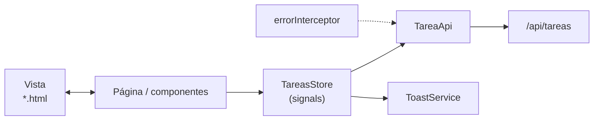

# 08 · Guía del frontend: Angular 21 paso a paso

> Angular 21 · standalone · zoneless · **signals** · Vitest · **sin librerías extra** (el arrastrar y soltar usa la API nativa de HTML5, no Angular CDK).
> El proyecto terminado está en `kanban-frontend/`. Los bloques de código de esta guía se generan **directamente desde esos archivos**.

## Mapa

```text
src/app
├── core
│   ├── models        api-error.ts · tarea.model.ts
│   ├── api           tarea.api.ts
│   └── interceptors  error.interceptor.ts
├── shared/ui         toast.service.ts · toast.ts · confirm-dialog.ts
├── features/tareas
│   ├── tareas.store.ts (+ spec)
│   ├── tarea-labels.ts
│   ├── pages         tablero.page (ts · html · css)
│   └── components    tarea-card · tarea-form
├── app.config.ts · app.routes.ts · app.ts/html/css
proxy.conf.json
```



## Teoría previa

| Concepto | Qué es | Dónde se usa |
|---|---|---|
| **Componente standalone** | Componente que declara sus propios `imports`; no hay `NgModule` | Todos |
| **Signal** | Valor reactivo: `signal(0)`, se lee `x()`, se cambia `x.set()` | `tareas`, `cargando`… |
| **computed** | Signal derivada que se recalcula sola | `tareasPorEstado`, `resumen` |
| **Zoneless** | Angular no usa `zone.js`; la vista se actualiza cuando cambian signals | Toda la app |
| **Store / Facade** | Un servicio que concentra el estado y las operaciones | `TareasStore` |
| **Interceptor** | Función que ve toda petición/respuesta HTTP | `errorInterceptor` |
| **`input()` / `output()`** | Datos que entran / eventos que salen de un componente | `TareaCard`, `TareaForm` |
| **Formularios reactivos** | El formulario se define en TypeScript con `Validators` | `TareaForm` |

## Paso 1 · Proyecto, proxy y puertos

```powershell
cd kanban-frontend
npm install
npm start          # http://localhost:4200
```

El proxy reenvía `/api` al backend (puerto **8083**), así el front no depende de CORS. Está registrado en `angular.json` (`serve.options.proxyConfig`).

{{NG:proxy.conf.json}}

> Si el puerto 4200 está ocupado (p. ej. por el proyecto de la clase 02): `npx ng serve --port 4300` y agrega `http://localhost:4300` a `CORS_ORIGINS` solo si no usas el proxy.

## Paso 2 · Modelos (`core/models`)

Reflejan los DTO del backend. **Los códigos coinciden con los enums de Java.**

{{NG:src/app/core/models/tarea.model.ts}}

- `ESTADOS` define el **orden de las columnas**.
- `LIMITE_EN_CURSO = 3` repite la regla del backend para **avisar visualmente**; el que manda es el servidor.
- `REGLAS_TAREA` repite los máximos del DTO para el formulario.

{{NG:src/app/core/models/api-error.ts}}

## Paso 3 · API e interceptor (`core/api`, `core/interceptors`)

`TareaApi` es **el único lugar que conoce las rutas HTTP**:

{{NG:src/app/core/api/tarea.api.ts}}

Un `PATCH` a `/api/tareas/{id}/estado` con `{ estado }` mueve la tarjeta.

El interceptor convierte cualquier error en un `ApiError` con **mensaje legible** (el `mensaje` y `detalles` que manda `ApiError.java`; o "No hay conexión…" si el backend está apagado):

{{NG:src/app/core/interceptors/error.interceptor.ts}}

## Paso 4 · Avisos y diálogo (`shared/ui`)

`ToastService` mantiene una lista de avisos en un signal; `Toast` los dibuja. Desaparecen solos a los 4 segundos.

{{NG:src/app/shared/ui/toast.service.ts}}

{{NG:src/app/shared/ui/toast.ts}}

`ConfirmDialog` es el diálogo reutilizable "¿Seguro…?" (se usa antes de eliminar):

{{NG:src/app/shared/ui/confirm-dialog.ts}}

## Paso 5 · El Store (`features/tareas/tareas.store.ts`)

Patrón **Store/Facade con signals**. Las páginas **leen** signals y **llaman** métodos; nunca hablan con la API.

{{NG:src/app/features/tareas/tareas.store.ts}}

| Pieza | Tipo | Para qué |
|---|---|---|
| `tareas` | `signal` | Lista completa desde el servidor |
| `tareasPorEstado` | `computed` | `{ POR_HACER: [...], EN_CURSO: [...], HECHA: [...] }` |
| `resumen` | `computed` | Contadores por columna y `enCursoLleno` (≥ 3) |
| `crear / actualizar / mover / eliminar` | `Observable<void>` | Llaman a la API, **refrescan la lista** y emiten **solo si salió bien** |
| `fallar` | función | Muestra el error en un toast y **corta** el flujo con `EMPTY` |

> **Por qué `Observable<void>` que emite solo en éxito:** la página cierra el formulario o el diálogo dentro del `subscribe(next)`. Si el servidor rechaza (p. ej. **409** por límite), no emite: el usuario ve el toast y el tablero queda como estaba.

### Prueba del store (Vitest + `HttpTestingController`)

{{NG:src/app/features/tareas/tareas.store.spec.ts}}

```powershell
npx ng test --watch=false     # 8 pruebas en verde
```

## Paso 6 · Textos y fechas (`tarea-labels.ts`)

{{NG:src/app/features/tareas/tarea-labels.ts}}

`formatearFecha` **no usa `Date`** para mostrar `fechaLimite`: así se evitan corrimientos de un día por zona horaria.

## Paso 7 · La tarjeta (`tarea-card`)

Componente **presentacional**: recibe la tarea por `input()` y avisa con `output()`. No conoce el store.

{{NG:src/app/features/tareas/components/tarea-card/tarea-card.ts}}

{{NG:src/app/features/tareas/components/tarea-card/tarea-card.html}}

- Muestra **título, chip de prioridad, fecha límite** y los botones **editar, eliminar y mover (← →)**.
- `draggable="true"` + `(dragstart)` es la **API nativa de HTML5**: se guarda el `id` en `dataTransfer`.
- Los botones ← → son la **alternativa accesible** al arrastre (funcionan con teclado y en móvil).
- Una tarea `HECHA` no se puede editar (el botón se deshabilita, igual que la regla del backend).

{{NG:src/app/features/tareas/components/tarea-card/tarea-card.css}}

## Paso 8 · El formulario (`tarea-form`)

Formulario reactivo en un diálogo. Las validaciones **reflejan las del DTO**: título obligatorio y máx. 100, descripción máx. 500.

{{NG:src/app/features/tareas/components/tarea-form/tarea-form.ts}}

{{NG:src/app/features/tareas/components/tarea-form/tarea-form.html}}

- `Validators.required` + `Validators.pattern(/\S/)` rechazan un título de solo espacios (como `@NotBlank`).
- `form.markAllAsTouched()` hace aparecer los mensajes si se intenta guardar un formulario inválido.
- Si recibe una `tarea`, edita; si no, crea.

## Paso 9 · La página del tablero (`pages/tablero.page`)

{{NG:src/app/features/tareas/pages/tablero.page.ts}}

### Arrastrar y soltar con HTML5 (sin librerías)

1. La **tarjeta** es `draggable` y en `dragstart` guarda su `id`.
2. La **columna** escucha `dragover` y llama `preventDefault()` (sin esto el navegador **no permite soltar**).
3. En `drop` se lee el `id`, se busca la tarea y se llama `store.mover(...)`.
4. Si el backend rechaza el movimiento (**409** por límite o por saltarse una columna), el toast muestra el mensaje y la tarjeta no se mueve.

{{NG:src/app/features/tareas/pages/tablero.page.html}}

- El contador de cada columna usa `store.tareasPorEstado()[columna].length`.
- **En curso** muestra `n / 3` y, al llegar al límite, cambia de color y muestra el aviso *"Límite alcanzado"* (`resumen().enCursoLleno`).
- `@for … @empty` dibuja *"Sin tareas"* en las columnas vacías.
- La confirmación de eliminar usa `ConfirmDialog`.

{{NG:src/app/features/tareas/pages/tablero.page.css}}

> **Sin scroll lateral:** el truco es `grid-template-columns: repeat(3, minmax(0, 1fr))` (el `minmax(0, …)` permite que las columnas se encojan) y, bajo 800 px, una sola columna.

## Paso 10 · Configuración y rutas

{{NG:src/app/app.config.ts}}

{{NG:src/app/app.routes.ts}}

`loadComponent` hace *lazy loading*: la pantalla del tablero se descarga solo cuando se visita.

## Paso 11 · Estilos globales

Diseño propio con **tema oscuro** (distinto del rojo de Bip!). Los colores viven en variables de `:root`, incluido el acento de cada columna:

{{NG:src/styles.css}}

## Paso 12 · Verificar

| Prueba | Resultado esperado |
|---|---|
| Abrir <http://localhost:4200> | 3 columnas con una tarjeta de ejemplo en cada una, **sin scroll lateral** |
| Redimensionar a 1366, 1024, 800 y 375 px | A 800 px o menos las columnas se apilan; sin scroll horizontal en ninguno |
| **+ Nueva tarea** con título vacío | Mensaje de validación; no se envía |
| Crear una tarea | Aparece en *Por hacer* y un toast "Tarea creada" |
| Pulsar → en esa tarea | Pasa a *En curso* (contador `2 / 3`) |
| Arrastrar una tarjeta de *Por hacer* a *Hecha* | Toast de error 409 (no se salta una columna) |
| Llenar *En curso* con 3 y mover una cuarta | Toast 409 por límite; la columna se ve en naranja con el aviso |
| Editar una tarea `HECHA` | El botón *Editar* está deshabilitado |
| Eliminar | Diálogo de confirmación; luego toast "Tarea eliminada" |
| Apagar el backend y recargar | Aviso *"No hay conexión con el servidor"* con botón *Reintentar* |

```powershell
npx ng build          # compila para producción
npx ng test --watch=false
```
