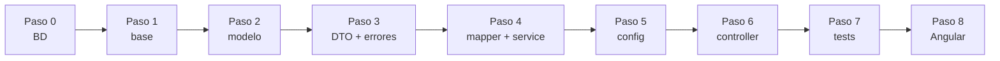
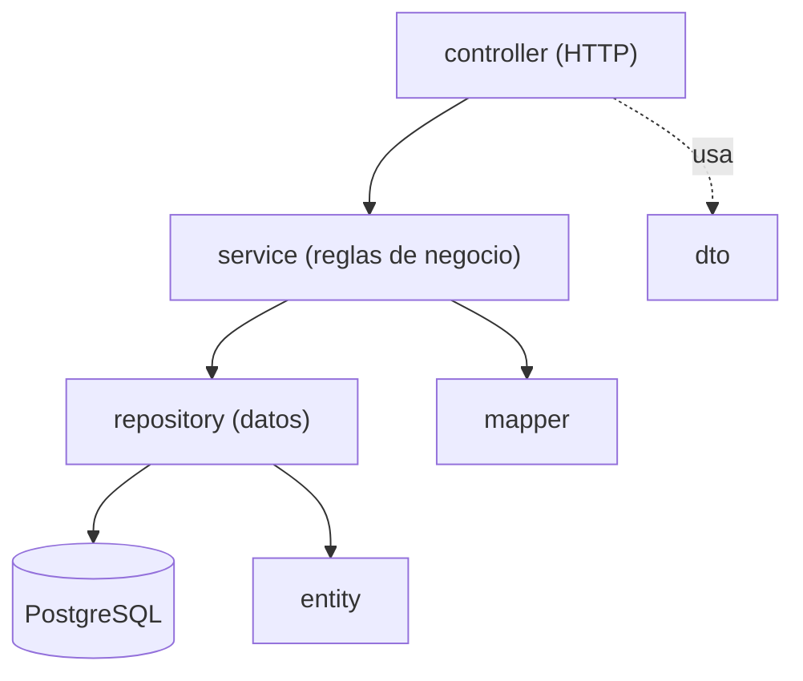

# Guía completa paso a paso: Backend del Tablero Kanban

> Java 21 · Spring Boot 3.5 · PostgreSQL 18 · **Java puro, sin Lombok**.
> Partes de `kanban-backend-base` (proyecto en blanco que ya arranca) y lo completas paso a paso hasta tener `kanban-backend`.
> **Cada paso termina en: compilar → levantar → verificar.** El proyecto debe poder arrancar al terminar cada paso.

## Mapa del proceso

| Paso | Qué haces | Paquetes | Verificas |
|---|---|---|---|
| 0 | Preparar entorno y base de datos | — | Conexión con `psql` |
| 1 | Levantar el proyecto base | — | Flyway aplica V1 y V2; Swagger vacío |
| 2 | Modelo | `enums`, `entity`, `repository` | Hibernate valida la tabla |
| 3 | DTOs, excepciones y handler | `dto`, `exception` | Arranca sin errores |
| 4 | Mapper y Service | `mapper`, `service`, `service.impl` | Spring inyecta los beans |
| 5 | Configuración | `config` | Título en Swagger |
| 6 | Controller | `controller` | Probar los 6 endpoints en Swagger (incluidos los 409) |
| 7 | Tests | `src/test` | `.\mvnw.cmd test` en verde |
| 8 | Conectar con Angular | — | Tablero funcionando |



---

## Fase de análisis: diagrama de casos de uso (antes de construir)


*(Detalle y teoría en [00-casos-de-uso.md](00-casos-de-uso.md).)*

- El **actor** (el monito) es el **Usuario**; está fuera del sistema.
- Cada **óvalo principal** (Ver, Crear, Editar, Mover, Eliminar) se convierte en **un endpoint**.
- **«include» = siempre** (*Mover* siempre valida el movimiento). **«extend» = a veces** (*Rechazar por límite de 3* solo si En curso está llena).
- Los óvalos *extend* son **reglas de negocio**: vivirán en el **Service**.

| Óvalo | Endpoint | Método del service |
|---|---|---|
| CU-01 Ver tablero | `GET /api/tareas` | `listar()` |
| CU-02 Crear tarea | `POST /api/tareas` | `crear()` |
| CU-03 Editar tarea | `PUT /api/tareas/{id}` | `actualizar()` |
| CU-04 Mover tarea | `PATCH /api/tareas/{id}/estado` | `mover()` |
| CU-05 Eliminar tarea | `DELETE /api/tareas/{id}` | `eliminar()` |

---

## Teoría previa (léela antes de empezar)

### 0. Vocabulario Java que usarás

| Término | Qué es | Ejemplo |
|---|---|---|
| **package** | Carpeta lógica que agrupa clases | `cl.ipss.kanban.entity` |
| **class** | Molde para crear objetos | `Tarea` |
| **interface** | Contrato: qué métodos existen, sin implementarlos | `TareaService` |
| **enum** | Conjunto cerrado de valores | `EstadoTarea` |
| **record** | Clase inmutable concisa para datos | `TareaResponse` |
| **annotation** | Etiqueta `@Algo` que da instrucciones a Spring/JPA/Validation | `@Entity`, `@Service` |
| **constructor** | Método que crea el objeto | `public Tarea() {}` |
| **getter / setter** | Métodos para leer / modificar un campo | `getTitulo()`, `setTitulo(...)` |
| **excepción** | Objeto que representa un error | `TareaNoEncontradaException` |
| **bean** | Objeto que **Spring crea y administra** | un `@Service` |

> **Sin Lombok:** en este proyecto los getters, setters y logs se escriben **a mano**. Así compila en cualquier IDE sin plugins.

### 1. Arquitectura MVC en capas



Una capa **solo habla con la de abajo**. Más detalle en [02-teoria-mvc.md](02-teoria-mvc.md).

### 2. DTO vs Entity

La **Entity** representa la tabla; el **DTO** representa lo que viaja por HTTP. Si mezclaras ambos, el cliente podría enviar campos que no debe (p. ej. crear una tarea ya `HECHA`). Por eso `CrearTareaRequest` no tiene `estado`.

### 3. Programar contra interfaces

El controller usa `TareaService` (interface). La lógica está en `TareaServiceImpl`. En los tests se reemplaza por un *mock*.

### 4. Patrones y SOLID

Resumen en [03-patrones-de-diseno.md](03-patrones-de-diseno.md): Service Layer, Repository, DTO, Mapper, Dependency Injection, Singleton, JavaBean, Front Controller, Advice.

### 5. Reglas de negocio de este proyecto

1. **Máximo 3 tareas en `EN_CURSO`.** La cuarta → **409**.
2. **Movimiento válido:** `POR_HACER → EN_CURSO → HECHA`, y retroceder un paso. Saltar de `POR_HACER` a `HECHA` → **409**.
3. **Una tarea `HECHA` no se edita** → **409** (sí se puede mover).
4. Errores: **404** no existe · **400** datos inválidos · **409** conflicto · **500** inesperado.

---

## Paso 0 · Preparar el entorno y la base de datos

### Requisitos

| Herramienta | Versión | Comprobar |
|---|---|---|
| JDK | **21** | `java -version` |
| PostgreSQL | 18 | `psql --version` |
| IDE | IntelliJ, VS Code o Eclipse | — |

> **Windows:** si `java -version` muestra otra versión (p. ej. 1.8), apunta `JAVA_HOME` a un JDK 21 en la misma terminal:
> ```powershell
> $env:JAVA_HOME = "C:\ruta\a\jdk-21"
> $env:Path = "$env:JAVA_HOME\bin;$env:Path"
> ```

### 1. Crear la base de datos (una sola vez)

Usa el puerto y la clave de **tu** PostgreSQL 18:

```powershell
psql -U postgres -h localhost -p 5432 -c "CREATE DATABASE kanban_db;"
```

> Si tienes PostgreSQL 14 y 18 instalados, uno usa el 5432 y el otro el 5433. Para saber a cuál te conectaste:
> `psql -U postgres -h localhost -p 5433 -c "SHOW server_version;"`

> **¿Prefieres pgAdmin?** Es lo mismo: clic derecho en *Databases → Create → Database…* → nombre `kanban_db`.

**✅ Verificar:** `psql -U postgres -h localhost -p 5432 -c "\l"` muestra la base `kanban_db`.

### 2. ¿Con qué usuario se conecta el backend?

Crear la base **no define el usuario**: el usuario es el de la conexión con la que el backend entra a PostgreSQL. El backend lee estas variables (valores por defecto entre paréntesis):

| Variable | Qué es | Por defecto |
|---|---|---|
| `DB_USER` | Usuario de PostgreSQL | `kanban` |
| `DB_PASSWORD` | Su clave | `kanban` |
| `DB_PORT` | Puerto del servidor | `5432` |
| `DB_NAME` | Nombre de la base | `kanban_db` |

**Opción A · Usar el mismo usuario con el que entras a pgAdmin.** Casi siempre es `postgres` con la clave que definiste al instalar PostgreSQL 18. Como el proyecto trae por defecto el usuario `kanban`, aquí **sí** debes indicar el usuario y la clave antes de levantar el backend (y el puerto si no es el 5432):

```powershell
$env:DB_USER = "postgres"
$env:DB_PASSWORD = "la_clave_de_postgres"
# $env:DB_PORT = "5433"     # solo si tu PostgreSQL 18 no usa el 5432
```

> ¿Cuál es mi puerto? En pgAdmin: clic derecho sobre el servidor → *Properties → Connection → Port*. O en el *Query Tool*: `SHOW port;`

**Opción B · Crear un usuario propio para esta aplicación** (es la que usa el proyecto por defecto: usuario `kanban`, clave `kanban`). Es lo habitual: un usuario por aplicación. En pgAdmin abre el **Query Tool sobre la base `kanban_db`** (clic derecho en `kanban_db` → *Query Tool*), pega este script y ejecútalo con **F5**:

```sql
-- Crea el usuario (o le actualiza la clave si ya existe)
DO $$
BEGIN
    IF NOT EXISTS (SELECT FROM pg_roles WHERE rolname = 'kanban') THEN
        CREATE USER kanban WITH PASSWORD 'kanban';
    ELSE
        ALTER USER kanban WITH PASSWORD 'kanban';
    END IF;
END
$$;

-- Lo hace dueño de la base: así Flyway puede crear la tabla y los datos
ALTER DATABASE kanban_db OWNER TO kanban;
GRANT ALL PRIVILEGES ON DATABASE kanban_db TO kanban;
GRANT ALL ON SCHEMA public TO kanban;
```

Luego levanta el backend con ese usuario (o no definas nada: `kanban` / `kanban` ya son los valores por defecto):

```powershell
$env:DB_USER = "kanban"
$env:DB_PASSWORD = "kanban"
.\mvnw.cmd spring-boot:run
```

> **Alternativa por terminal:** el proyecto trae [`crear-bd.sql`](https://github.com/cbarralesp/kanban_backend_base/blob/main/crear-bd.sql), que hace **todo de una vez**: crea (o actualiza) el usuario, crea la base si no existe y da los permisos. Se puede ejecutar varias veces sin errores. Ejecútalo como `postgres` desde la carpeta del proyecto:
>
> ```powershell
> psql -U postgres -h localhost -p 5432 -f crear-bd.sql
> ```
>
> Usa comandos propios de `psql` (`\gexec`, `\connect`), por eso se ejecuta con `psql` y **no** en el Query Tool de pgAdmin; en pgAdmin usa el script de la Opción B.

Contenido de `crear-bd.sql`:

{{CODE:../crear-bd.sql}}

**¿Por qué hace falta `GRANT ALL ON SCHEMA public`?** Desde PostgreSQL 15 los usuarios normales ya no pueden crear tablas en el esquema `public` por defecto. Como el dueño de la base ya puede, el `GRANT` es una segunda garantía. Sin ellos Flyway fallaría con *permission denied for schema public*.

**¿Cómo saber si el usuario y la clave están bien?** Antes de levantar el backend prueba la conexión:

```powershell
psql -U kanban -h localhost -p 5432 -d kanban_db -c "SELECT current_user;"
```

Si pide clave y responde `kanban`, el backend podrá conectarse igual. Si dice *password authentication failed*, el usuario o la clave no coinciden.

### 3. Las 3 formas de configurar usuario y clave

Por defecto el backend usa `kanban` / `kanban` (valores por defecto de `application.yml`: `${DB_USER:kanban}`).

**Forma 1 · Editar `application.yml`** (la más simple, pero cambia un archivo versionado):

```yaml
spring:
  datasource:
    username: tu_usuario
    password: tu_clave
```

**Forma 2 · Variables de entorno en la terminal** (PowerShell):

```powershell
$env:DB_USER = "postgres"
$env:DB_PASSWORD = "tu_clave"
# $env:DB_PORT = "5433"     # solo si tu PostgreSQL no usa el 5432
.\mvnw.cmd spring-boot:run
```

**Forma 3 · Variables en el IDE** (no ensucia el repositorio):
- IntelliJ: *Run → Edit Configurations → Environment variables* → `DB_USER=...;DB_PASSWORD=...`
- VS Code: en `launch.json`, la clave `"env": { "DB_USER": "...", "DB_PASSWORD": "..." }`
- Eclipse: *Run Configurations → Environment*.

Variables disponibles: `DB_HOST, DB_PORT, DB_NAME, DB_USER, DB_PASSWORD, SERVER_PORT, CORS_ORIGINS, LOG_LEVEL_APP`.

### Errores de conexión comunes

| Mensaje | Causa | Solución |
|---|---|---|
| `password authentication failed for user "kanban"` (o *la autentificación password falló*) | La clave (o el usuario) no coincide | Revisa `DB_PASSWORD`/`DB_USER`. Para reponer la clave en pgAdmin: `ALTER USER kanban WITH PASSWORD 'kanban';` |
| `role "kanban" does not exist` | El usuario por defecto del proyecto aún no existe | Ejecuta el script de la **Opción B** (o usa `postgres` con la Opción A) |
| `database "kanban_db" does not exist` | No creaste la base, o está mal escrito `DB_NAME` | Crea `kanban_db` (punto 1 de este paso) |
| `Connection refused` | Puerto equivocado o PostgreSQL apagado | Verifica el puerto con `SHOW port;` y defínelo con `DB_PORT`; revisa que el servicio esté en ejecución |
| `permission denied for schema public` (Flyway) | El usuario no puede crear tablas (PostgreSQL 15+) | Conectado a `kanban_db`: `ALTER DATABASE kanban_db OWNER TO kanban;` y `GRANT ALL ON SCHEMA public TO kanban;` |
| `Port 8083 was already in use` | Otro proceso usa el puerto | Ciérralo o define `SERVER_PORT` |
| Cambié el `application.yml` y sigue igual | La aplicación no se reinició | Detén y vuelve a ejecutar; en Eclipse: *Project → Clean…* |
| En otra terminal vuelve a fallar | Las variables `$env:` valen solo para la terminal donde se definieron | Defínelas de nuevo, o usa la Forma 1 o la Forma 3 |

### ✅ Verificar

```powershell
$env:PGPASSWORD = "kanban"
psql -U kanban -h localhost -p 5432 -d kanban_db -c "select 1"
```

Debe responder `1`.

---

## Paso 1 · Levantar el proyecto base y verificar la conexión

Abre la carpeta `kanban-backend-base`. Trae:

| Archivo | Para qué |
|---|---|
| `pom.xml` | Dependencias (solo las necesarias: web, validation, data-jpa, postgresql, flyway, springdoc, test) |
| `src/main/resources/application.yml` | Puerto, base de datos, logs |
| `db/migration/V1__crear_tabla_tarea.sql` y `V2__datos_iniciales.sql` | Esquema y 3 tareas de ejemplo |
| `KanbanApplication.java` | Punto de entrada |
| `package-info.java` por paquete | Un `TODO` que indica qué crear en cada paso |

### `application.yml`

{{CODE:main/resources/application.yml}}

**Explicación:** `ddl-auto: validate` hace que Hibernate **solo compruebe** que la tabla coincide con la entity; el esquema lo crea Flyway. `${DB_USER:kanban}` significa "usa la variable `DB_USER`, o `kanban` si no existe". El log va a `logs/kanban-backend.log` con rotación (10 MB, 7 días).

### Migraciones Flyway

`V1__crear_tabla_tarea.sql`:

{{CODE:main/resources/db/migration/V1__crear_tabla_tarea.sql}}

`V2__datos_iniciales.sql` (exactamente 3 tareas, una por columna):

{{CODE:main/resources/db/migration/V2__datos_iniciales.sql}}

> ⚠️ **Una migración ya aplicada no se edita nunca.** Los cambios van en `V3`, `V4`…

### `KanbanApplication`

{{CODE:main/java/cl/ipss/kanban/KanbanApplication.java}}

`@SpringBootApplication` activa la configuración automática y el escaneo de componentes del paquete `cl.ipss.kanban` y sus subpaquetes.

### ✅ Compilar → levantar → verificar

```powershell
.\mvnw.cmd spring-boot:run
```

En el log debes ver:

```text
Migrating schema "public" to version "1 - crear tabla tarea"
Migrating schema "public" to version "2 - datos iniciales"
Started KanbanApplication in ... seconds
```

Abre <http://localhost:8083/swagger-ui.html>: debe cargar **sin endpoints** (aún no hay controller).

---

## Paso 2 · Crear el MODELO: enums, entity y repository

{{FILES:2}}

### ✅ Compilar → levantar → verificar (Paso 2)

```powershell
.\mvnw.cmd spring-boot:run
```

Sin errores de Hibernate (`Schema-validation`) y `Started KanbanApplication`. Si aparece `missing column`, el nombre de un campo no coincide con la tabla.

---

## Paso 3 · Crear DTOs, excepciones y manejo de errores

{{FILES:3}}

### ✅ Compilar → levantar → verificar (Paso 3)

`.\mvnw.cmd spring-boot:run` debe arrancar igual que antes. Aún no hay endpoints que probar.

---

## Paso 4 · Crear Mapper y Service (interface + implementación)

### 📝 Logs con SLF4J (sin Lombok)

SLF4J es la fachada de logs de Spring Boot. Sin Lombok, cada clase declara su logger **a mano**:

```java
private static final Logger log = LoggerFactory.getLogger(TareaServiceImpl.class);
```

Criterio del proyecto:

| Dónde | Nivel | Formato |
|---|---|---|
| Service, al recibir/terminar una operación | `info` | `--- command receive to ... ---` / `--- finish ... ---` |
| Service, cuando rechaza algo (límite, movimiento inválido, no encontrada) | `warn` | `--- in-progress limit reached: ... ---` |
| Handler: datos inválidos | `warn` | `--- invalid request: ... ---` |
| Handler: error inesperado | `error` (con la excepción) | `Unexpected error processing request` |
| Handler: 404 y 409 | `debug` | para no duplicar lo que ya dijo el service |

Reglas: mensajes en **inglés**, entre `--- ... ---`, con `{}` para los valores y **sin datos sensibles**.

{{FILES:4}}

### ✅ Compilar → levantar → verificar (Paso 4)

Debe arrancar sin `NoSuchBeanDefinitionException`: Spring crea `TareaMapper` y `TareaServiceImpl` e inyecta el repository.

---

## Paso 5 · Crear la configuración: Swagger y CORS

{{FILES:5}}

### ✅ Compilar → levantar → verificar (Paso 5)

Abre <http://localhost:8083/swagger-ui.html>: arriba debe leerse **API Tablero Kanban** (aún sin endpoints).

---

## Paso 6 · Crear el CONTROLLER, levantar y probar todo en Swagger

{{FILES:6}}

### ✅ Compilar → levantar → verificar en Swagger

```powershell
.\mvnw.cmd spring-boot:run
```

Abre <http://localhost:8083/swagger-ui.html>. Deben aparecer los 6 endpoints de **Tareas**. Prueba en este orden (parte con los 3 datos de ejemplo: ids 1 `POR_HACER`, 2 `EN_CURSO`, 3 `HECHA`):

| # | Prueba | Petición | Resultado esperado |
|---|---|---|---|
| 1 | Listar | `GET /api/tareas` | **200** con 3 tareas, una por estado |
| 2 | Obtener una | `GET /api/tareas/1` | **200** |
| 3 | Obtener inexistente | `GET /api/tareas/999` | **404** `No existe una tarea con id 999` |
| 4 | Crear | `POST /api/tareas` `{"titulo":"Nueva","prioridad":"ALTA"}` | **201**, cabecera `Location: /api/tareas/4`, `estado: POR_HACER` |
| 5 | Crear inválido | `POST` con `{"titulo":"","prioridad":"ALTA"}` | **400** con `detalles: ["titulo: El título es obligatorio"]` |
| 6 | Editar | `PUT /api/tareas/1` `{"titulo":"Editada","prioridad":"BAJA"}` | **200** |
| 7 | Editar una hecha | `PUT /api/tareas/3` con cualquier cuerpo válido | **409** `La tarea 3 está hecha…` |
| 8 | Mover (feliz) | `PATCH /api/tareas/1/estado` `{"estado":"EN_CURSO"}` | **200** (ahora hay 2 en curso) |
| 9 | **Movimiento inválido** | `PATCH /api/tareas/4/estado` `{"estado":"HECHA"}` (la 4 está en `POR_HACER`) | **409** `No se puede mover una tarea de POR_HACER a HECHA…` |
| 10 | Llenar En curso | `PATCH /api/tareas/4/estado` `{"estado":"EN_CURSO"}` | **200** (ya son 3) |
| 11 | **Límite de 3** | Crea otra tarea (id 5) y `PATCH /api/tareas/5/estado` `{"estado":"EN_CURSO"}` | **409** `La columna En curso ya tiene el máximo de 3 tareas…` |
| 12 | Retroceder | `PATCH /api/tareas/3/estado` `{"estado":"EN_CURSO"}` (la 3 está `HECHA`, y En curso está llena) | **409** por límite (el límite aplica a cualquier ingreso) |
| 13 | Estado desconocido | `PATCH` con `{"estado":"ARCHIVADA"}` | **400** `La solicitud está mal formada` |
| 14 | Eliminar | `DELETE /api/tareas/5` | **204** |
| 15 | Eliminar inexistente | `DELETE /api/tareas/999` | **404** |

Todos los errores salen con el mismo formato:

```json
{ "fecha": "2026-10-25T22:00:00", "status": 409, "error": "Conflict", "mensaje": "…", "detalles": [] }
```

En el log (`logs/kanban-backend.log`) verás, por ejemplo, para la prueba 11:

```text
--- start process endpoint: PATCH /api/tareas/5/estado ---
--- command receive to move task: 5 to EN_CURSO ---
--- in-progress limit reached: task 5 cannot move to EN_CURSO ---
```

(sin `end process endpoint`, porque hubo error).

---

## Paso 7 · Tests automáticos

Los tests **no necesitan base de datos**: el service se prueba con Mockito y el controller con `@WebMvcTest`.

{{FILES:7}}

### ✅ Ejecutar

```powershell
.\mvnw.cmd test
```

Debe terminar con `BUILD SUCCESS` y `Tests run: 20, Failures: 0, Errors: 0`.

---

## Paso 8 · Conectar con Angular (el front ya está listo)

El frontend terminado está en `kanban-frontend/`. Guía completa: [08-guia-angular-paso-a-paso.md](08-guia-angular-paso-a-paso.md).

1. Backend levantado en el puerto **8083**.
2. En otra terminal:

```powershell
cd kanban-frontend
npm install
npm start
```

3. Abre <http://localhost:4200>: verás el tablero con las 3 tareas de ejemplo, una por columna.
4. Prueba: crear, editar, mover con ← → y arrastrando, y llenar *En curso* hasta ver el aviso de límite.

`proxy.conf.json` reenvía `/api` al backend, por lo que Angular no depende de CORS (igual se deja `CorsConfig`).

---

## Anexo A · Problemas frecuentes

| Síntoma | Causa | Solución |
|---|---|---|
| `Unsupported class file major version` / `release version 21 not supported` | Maven usa otro JDK | Apuntar `JAVA_HOME` a un JDK 21 |
| `Schema-validation: missing column [...]` | Campo de la entity distinto de la columna | Revisar `@Column(name = ...)` |
| `FlywayException: Validate failed: Migration checksum mismatch` | Editaste una migración ya aplicada | Revertir el cambio y crear `V3` |
| Marcadores rojos en Eclipse sobre las excepciones | Falta `serialVersionUID` | Agregarlo (ya está en las 4 excepciones) |
| `404` en `/swagger-ui.html` | El backend no arrancó | Revisar el log |
| `400` al mover con un estado válido | JSON mal escrito (`"estado"` sin comillas) | Revisar el cuerpo |
| El front muestra *No hay conexión con el servidor* | Backend apagado o puerto distinto | Levantar el backend en 8083 |
| `CORS` en el navegador | Front sin proxy | Usar `npm start` (con proxy) o `CORS_ORIGINS` |

## Anexo B · Checklist de calidad

- [ ] Sin Lombok ni librerías de generación de código
- [ ] Entities con constructor vacío, getters y setters a mano (sin setter de `id` ni de fechas)
- [ ] DTO como `record`
- [ ] Las reglas viven en el service, no en el controller
- [ ] Errores documentados una sola vez en el `@RestControllerAdvice`
- [ ] `serialVersionUID` en cada excepción
- [ ] Logs con el formato `--- texto: {} ---`, en inglés, sin datos sensibles
- [ ] `.\mvnw.cmd test` en verde
- [ ] Probados en Swagger el 409 por límite y el 409 por movimiento inválido

## Anexo C · Resumen: qué se crea en cada paso

| Paso | Archivos |
|---|---|
| 2 | `EstadoTarea`, `PrioridadTarea`, `Tarea`, `TareaRepository` |
| 3 | `CrearTareaRequest`, `ActualizarTareaRequest`, `MoverTareaRequest`, `TareaResponse`, `TareaNoEncontradaException`, `LimiteEnCursoExcedidoException`, `MovimientoInvalidoException`, `TareaHechaNoEditableException`, `ApiError`, `GlobalExceptionHandler` |
| 4 | `TareaMapper`, `TareaService`, `TareaServiceImpl` |
| 5 | `SwaggerConfig`, `CorsConfig` |
| 6 | `TareaController` |
| 7 | `TareaServiceImplTest`, `TareaControllerTest` |

## Anexo D · Cómo validar tu trabajo contra el proyecto terminado

1. Compara tu carpeta `src/main/java` con [`kanban_backend`](https://github.com/cbarralesp/kanban_backend): mismos paquetes y mismos nombres.
2. Ejecuta `.\mvnw.cmd test`: debe dar `BUILD SUCCESS`.
3. Repite la tabla de pruebas del Paso 6 en Swagger.
4. Levanta el front (Paso 8) y prueba el tablero.

> Los bloques de código de esta guía se generan **directamente desde los archivos reales** de `kanban-backend`, por lo que son idénticos a ellos.
